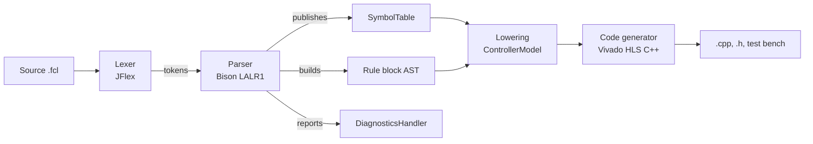

# FLC IEC 61131-7 Compiler

Compiler for the IEC 61131-7 (Fuzzy Control Language, FCL) standard. It performs lexical analysis (JFlex), LALR(1) syntactic analysis (GNU Bison, lalr1.java skeleton), semantic type resolution into a symbol table, and generation of a fuzzy controller as Vivado HLS C++. It covers the declarative and initializer subset of the standard: function blocks, user-defined types (structures, enumerations, subranges, arrays), and fuzzification/defuzzification/rule blocks. A lowering phase turns the symbol table and rule-block AST into the controller model consumed by the generator, and simulators validate the generated controllers without Vivado.

## Requirements

* Java 8 (build locked to source/target 1.8 in pom.xml)
* Maven 3.6+
* JFlex 1.9.1 via jflex-maven-plugin (configured in pom.xml, no separate installation needed)
* GNU Bison 3.8.2: used offline to regenerate Parser.java from Parser.y (skeleton lalr1.java); generated code is versioned, so Bison is not required for Maven builds

## Dependencies

| Dependency                         | Version | Scope    |
|------------------------------------|---------|----------|
| JUnit Jupiter (API + Engine)       | 5.11.4  | test     |
| Mockito Inline + JUnit Jupiter     | 4.11.0  | test     |
| JSpecify (nullability annotations) | 1.0.0   | compile  |
| SpotBugs Annotations               | 4.8.3   | provided |

## Build and Test Commands

Full build with quality gates (lexer generation, compilation, tests, coverage, Checkstyle, SpotBugs):

```bash
mvn clean verify
```

Tests only:

```bash
mvn test
```

Integration tests (require explicit selection, as they follow \*IT naming convention):

```bash
mvn test -Dtest='*IT'
```

Run specific test suites:

```bash
mvn test -Dtest=ParserTest
mvn test -Dtest=RepeatedInitializationTest
mvn test -Dtest=SymbolTableTest
mvn test -Dtest=LexerTokenizationTest
mvn test -Dtest=CommandLineIT
mvn test -Dtest=ControllerSimulationIT
```

Generate Javadoc (excludes generated Parser.java and Lexer.java):

```bash
mvn javadoc:javadoc
```

Regenerate parser (requires Bison 3.8.2 installed locally):

```bash
cd src/main/java/parser
bison -o Parser.java Parser.y
```

Regenerate lexer (via Maven):

```bash
mvn jflex:generate
```

## Usage

Build the executable jar and compile an FCL program:

```bash
mvn package
java -jar target/flc-iec61131-7-compiler-1.0-SNAPSHOT.jar <program.fcl> [output directory]
```

The generated files are `<base>_out.cpp`, `<base>_out.h`, and `<base>_outTB.cpp`, where `<base>` is the program name without extension and with spaces replaced by underscores. By default, they are written next to the program. The exit status is 0 when code was generated, 1 for compilation errors or unsupported features, 2 for usage or I/O errors, and 3 for an internal compiler error.

## Architecture



The parser orchestrates the front end: it invokes the lexer, executes grammar semantic actions, and publishes results to a shared SymbolTable (Repository pattern). The lexer normalizes input text via transformer chains (lexer/transformers/, Chain of Responsibility) and validates literals with per-category semantic analyzers (lexer/semantics/). Each resolved lexeme becomes a LexemeInfo (type, subtype, use, source, limits, parameters, initialization), built incrementally via LexemeInfoBuilder and predefined Director recipes (utils/builders/), and published atomically. Semantic classification relies on the Type, Subtype, Use, and Source enums (utils/enums/). Errors and warnings are collected in a central DiagnosticsHandler, preserving insertion order.

The back end lowers the symbol table and the rule-block AST into an immutable ControllerModel and emits the C++ implementation, header, and test bench. The lowering phase also reports features the generator cannot produce as unsupported. Two simulators read the same ControllerModel: QuantizedSimulator reproduces the integer arithmetic of the generated code, while ReferenceSimulator computes the ideal IEC 61131-7 controller in real numbers.

### Key Classes

| Module         | Class                              | Responsibility                                                                                                         |
|----------------|------------------------------------|------------------------------------------------------------------------------------------------------------------------|
| compiler       | `compiler.FlcCompiler`             | Chains lexer, parser, lowering, and code generation; returns generated files                                           |
| compiler       | `compiler.CommandLine`             | Command-line entry point; writes generated files and maps failures to exit statuses                                    |
| lowering       | `lowering.ControllerLowering`      | Builds the ControllerModel from the symbol table and rule-block AST; reports unsupported features                      |
| codegen        | `codegen.ControllerModel`          | Immutable input model consumed by the code generator                                                                   |
| codegen        | `codegen.CodeGenerator`            | Emits the Vivado HLS C++ implementation, header, and test bench                                                        |
| ast            | `ast.AbstractSyntaxTree`           | Immutable rule-block tree produced by the parser and consumed by lowering                                              |
| simulation     | `simulation.QuantizedSimulator`    | Computes the integer arithmetic of the generated C++                                                                   |
| simulation     | `simulation.ReferenceSimulator`    | Computes the ideal IEC 61131-7 controller in real numbers                                                              |
| utils          | `utils.SymbolTable`                | Stores and retrieves `LexemeInfo` by lexeme name                                                                       |
| utils          | `utils.LexemeInfo`                 | DTO with complete semantic attributes (type, subtype, use, source, limits, parameters, initial value)                  |
| utils          | `utils.DiagnosticsHandler`         | Collects and manages diagnostics (errors/warnings) in insertion order                                                  |
| utils.builders | `utils.builders.LexemeInfoMutator` | Fluent contract with a setter per `LexemeInfo` attribute                                                               |
| utils.builders | `utils.builders.LexemeInfoView`    | Read-only view of `LexemeInfo` attributes                                                                              |
| utils.builders | `utils.builders.LexemeInfoBuilder` | Concrete implementation of the builder with `build()`                                                                  |
| utils.builders | `utils.builders.Director`          | Static recipes for literal and default `LexemeInfo` configurations                                                     |
| utils.enums    | `utils.enums.Type`                 | General classification: ARRAY, ENUMERATE, FUNCTION, NONE, SIMPLE, STRUCT, SUBRANGE, UNKNOWN                            |
| utils.enums    | `utils.enums.Subtype`              | IEC 61131-7 primitive types (INT, REAL, BOOL, TIME, etc.) + CUSTOM/NONE                                                |
| utils.enums    | `utils.enums.Use`                  | Usage context: COMPONENT, CONSTANT, FIELD, FUNCTION_BLOCK, LITERAL, MACRO, PRAGMA, RULE, TERM, TYPE, UNKNOWN, VARIABLE |
| utils.enums    | `utils.enums.Source`               | Declaration block: IN, OUT, INTERNAL, FUZZIFY, DEFUZZIFY, NONE, UNKNOWN                                                |

Full technical documentation: [doc/modules/lexer.md](doc/modules/lexer.md), [doc/modules/parser.md](doc/modules/parser.md), [doc/modules/ast.md](doc/modules/ast.md), [doc/modules/codegen.md](doc/modules/codegen.md), [doc/modules/utils.md](doc/modules/utils.md).

## Repository Structure

| Folder                         | Contents                                                                                                                                                                                                                                                                                                                                 |
|--------------------------------|------------------------------------------------------------------------------------------------------------------------------------------------------------------------------------------------------------------------------------------------------------------------------------------------------------------------------------------|
| src/main/java/lexer/           | Lexer.flex/Lexer.java (generated), internals/ (lexical analyzers and preprocessors), transformers/ (Chain of Responsibility for lexical normalization), semantics/ (semantic analyzers per literal family: numbers, dates, strings, identifiers, intervals)                                                                              |
| src/main/java/parser/          | Parser.y/Parser.java (generated; Luca.y is a legacy grammar not part of the build), facades/ (rule-block AST builder, dimension and scope helpers), initializations/ (polymorphic initialization hierarchy: leafs/ and nodes/), metadata/ (type metadata views), publishers/ (symbol table publishers), tree/ (parse tree nodes), utils/ |
| src/main/java/ast/             | Immutable rule-block AST: AbstractSyntaxTree, AbstractAstNode, ruleblock/ nodes, ruleblock/operators/ logical and comparison operators                                                                                                                                                                                                   |
| src/main/java/lowering/        | ControllerLowering (entry point), RuleLowering, FuzzySetLowering, SymbolKeys (symbol resolution), LoweringReport                                                                                                                                                                                                                         |
| src/main/java/codegen/         | ControllerModel, CodeGenerator, CppWriter, Fuzzifier, Variable; fuzzysets/ (membership functions), evaluation/ (min-max method), defuzzification/ (centroid defuzzifier)                                                                                                                                                                 |
| src/main/java/compiler/        | FlcCompiler (pipeline facade), CommandLine (CLI), GeneratedFile                                                                                                                                                                                                                                                                          |
| src/main/java/simulation/      | QuantizedSimulator, ReferenceSimulator, SimulationComparison, OutputComparison, MinMaxEvaluation                                                                                                                                                                                                                                         |
| src/main/java/utils/           | SymbolTable (Repository pattern), LexemeInfo (immutable DTO), DiagnosticsHandler, builders/ (LexemeInfoBuilder, LexemeInfoMutator, LexemeInfoView, Director, LexemeInfoSchema), enums/ (Type, Subtype, Use, Source), diagnostics/ (Error/Warning/SyntaxError/UnsupportedFeature hierarchy), LucaInfo (@deprecated)                       |
| src/main/java/Main.java        | Compiler entry point                                                                                                                                                                                                                                                                                                                     |
| src/test/java/                 | Unit tests by component (unit/ast/, unit/codegen/, unit/lexer/, unit/parser/, unit/utils/), integration tests (integration/compiler/, integration/lexer/parser/, integration/lowering/, integration/simulation/), test doubles (doubles/), support classes (utils/)                                                                      |
| src/test/resources/examples/   | Example FCL programs used by parser and integration tests                                                                                                                                                                                                                                                                                |
| src/test/resources/golden/     | Reference outputs used to characterize the code generator against Luca Sarramone's generator                                                                                                                                                                                                                                             |
| doc/                           | Modular technical docs (doc/modules/), thesis chapters (doc/thesis/), versioned Mermaid diagrams (doc/diagrams/), code-generated charts (doc/assets/)                                                                                                                                                                                    |
| scripts/                       | Documentation utilities: generate_charts.py, generate_diagrams.py, render_mermaid.py, synthesize_thesis_context.py, validate_docs.py, format_markdown.py, extract_stats.py, build_thesis.sh                                                                                                                                              |
| config/                        | Quality config: config/checkstyle/checkstyle.xml and config/spotbugs/excludeFilter.xml (used by mvn verify gates)                                                                                                                                                                                                                        |
| requirements.txt               | Python deps for doc scripts (matplotlib); install via pip install -r requirements.txt                                                                                                                                                                                                                                                    |
| Dockerfile, docker-compose.yml | Reproducible build/doc environment (Maven 3.9 + JDK 8, pandoc, python3)                                                                                                                                                                                                                                                                  |
| .opencode/                     | OpenCode agents for docs, charts, and thesis (see doc/HARNESS.md)                                                                                                                                                                                                                                                                        |

## Agent-Assisted Documentation

This repo includes an OpenCode agent harness to keep docs, charts, and thesis in sync with actual code (never invented data). See [doc/HARNESS.md](doc/HARNESS.md).

## Authors

* Matías Ortiz
* Victoriano Etcheverría

***

Generated and maintained by OpenCode agents. See [doc/HARNESS.md](doc/HARNESS.md) for details.
