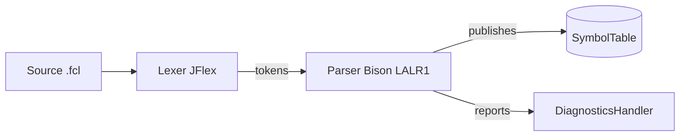

# FLC IEC 61131-7 Compiler

Compiler for the IEC 61131-7 (Fuzzy Control Language, FCL) standard. Implements lexical analysis (JFlex), LALR(1) syntactic analysis (GNU Bison, lalr1.java skeleton), and semantic type resolution into a symbol table, covering the declarative and initializer subset of the standard: function blocks, user-defined types (structures, enumerations, subranges, arrays), and fuzzification/defuzzification/rule blocks.

## Requirements

* Java 8 (build locked to source/target 1.8 in pom.xml)
* Maven 3.6+
* JFlex 1.9.1 via jflex-maven-plugin (configured in pom.xml, no separate installation needed)
* GNU Bison 3.8.2: used offline to regenerate Parser.java from Parser.y (skeleton lalr1.java); generated code is versioned, so Bison is not required for Maven builds

## Dependencies

| Dependency                         | Version | Scope    |
|------------------------------------|---------|----------|
| JUnit Jupiter (API + Engine)       | 5.11.4  | test     |
| Mockito Inline + JUnit Jupiter     | 4.11.0  | test     |
| JSpecify (nullability annotations) | 1.0.0   | compile  |
| SpotBugs Annotations               | 4.8.3   | provided |

## Build and Test Commands

Full build with quality gates (lexer generation, compilation, tests, coverage, Checkstyle, SpotBugs):

```bash
mvn clean verify
```

Tests only:

```bash
mvn test
```

Integration tests (require explicit selection, as they follow \*IT naming convention):

```bash
mvn test -Dtest='*IT'
```

Run specific test suites:

```bash
mvn test -Dtest=ParserTest
mvn test -Dtest=RepeatedInitializationTest
mvn test -Dtest=StringTypeIT
mvn test -Dtest=SymbolTableTest
mvn test -Dtest=LexerTokenizationTest
```

Generate Javadoc (excludes generated Parser.java and Lexer.java):

```bash
mvn javadoc:javadoc
```

Regenerate parser (requires Bison 3.8.2 installed locally):

```bash
cd src/main/java/parser
bison -o Parser.java Parser.y
```

Regenerate lexer (via Maven):

```bash
mvn jflex:generate
```

## Architecture



The parser orchestrates compilation: invokes the lexer, executes grammar semantic actions, and publishes results to a shared SymbolTable (Repository pattern). The lexer normalizes input text via transformer chains (lexer/transformers/, Chain of Responsibility) and validates literals with per-category semantic analyzers (lexer/semantics/). Each resolved lexeme becomes a LexemeInfo (type, subtype, use, source, limits, parameters, initialization), built incrementally via LexemeInfoBuilder and predefined Director recipes (utils/builders/), and published atomically. Semantic classification relies on the Type, Subtype, Use, and Source enums (utils/enums/). Errors and warnings are collected in a central DiagnosticsHandler, preserving insertion order.

### Key Classes

| Module         | Class                              | Responsibility                                                                                                                     |
|----------------|------------------------------------|------------------------------------------------------------------------------------------------------------------------------------|
| utils          | `utils.SymbolTable`                | Almacena y recupera `LexemeInfo` por nombre de lexema                                                                              |
| utils          | `utils.LexemeInfo`                 | DTO con atributos semánticos completos (tipo, subtipo, uso, fuente, límites, parámetros, valor inicial)                            |
| utils          | `utils.DiagnosticsHandler`         | Recolecta y gestiona diagnósticos (errores/warnings) en orden de inserción                                                         |
| utils.builders | `utils.builders.LexemeInfoSchema`  | Contrato fluido con un setter por atributo de `LexemeInfo` (no declara `build()`)                                                  |
| utils.builders | `utils.builders.LexemeInfoBuilder` | Implementación concreta del builder con `build()`                                                                                  |
| utils.builders | `utils.builders.Director`          | Recetas estáticas: `makeLiteral`, `makeType`, `makeMacro`, `makeDefaultInteger` y valores por defecto REAL, BOOL, STRING y WSTRING |
| utils.enums    | `utils.enums.Type`                 | Clasificación general: UNKNOWN, SIMPLE, ENUMERATE, SUBRANGE, ARRAY, STRUCT                                                         |
| utils.enums    | `utils.enums.Subtype`              | Tipos primitivos IEC 61131-7 (INT, REAL, BOOL, TIME, etc.) + CUSTOM/NONE                                                           |
| utils.enums    | `utils.enums.Use`                  | Contexto de uso: VARIABLE, FIELD, LITERAL, FUNCTION, RULE, TYPE, MACRO, OPTION, UNKNOWN                                            |
| utils.enums    | `utils.enums.Source`               | Bloque de declaración: IN, OUT, INTERNAL, FUZZIFY, DEFUZZIFY, NONE, UNKNOWN                                                        |

Full technical documentation: [doc/modules/lexer.md](doc/modules/lexer.md), [doc/modules/parser.md](doc/modules/parser.md), [doc/modules/utils.md](doc/modules/utils.md).

## Repository Structure

| Folder                         | Contents                                                                                                                                                                                                                                                                                                                                                                                                                                        |
|--------------------------------|-------------------------------------------------------------------------------------------------------------------------------------------------------------------------------------------------------------------------------------------------------------------------------------------------------------------------------------------------------------------------------------------------------------------------------------------------|
| src/main/java/lexer/           | Lexer.flex/Lexer.java (generated), internals/ (LexicalAnalyzers, LexicalPreprocessors), transformers/ (Chain of Responsibility for lexical normalization), semantics/ (semantic analyzers per literal family: numbers, dates, strings, identifiers, intervals)                                                                                                                                                                                  |
| src/main/java/parser/          | Parser.y/Parser.java (generated; Luca.y is a legacy grammar not part of the build), internals/ (parse context: ContextHandler, ParsingContext, NameMangler), initializations/ (polymorphic initialization hierarchy: VariableInitialization, EnumeratedInitialization, parser_initializations_nodes_StructInitialization, RepeatedInitialization, etc.), utils/ (NameMangler), facades/ (DimensionCalculator, UnderlyingScopeSearcher), Factory |
| src/main/java/utils/           | SymbolTable (Repository pattern), LexemeInfo (immutable DTO), DiagnosticsHandler, builders/ (LexemeInfoBuilder, Director, LexemeInfoSchema), enums/ (Type, Subtype, Use, Source), diagnostics/ (Error/Warning/SyntaxError hierarchy), LucaInfo (@deprecated)                                                                                                                                                                                    |
| src/main/java/Main.java        | Compiler entry point                                                                                                                                                                                                                                                                                                                                                                                                                            |
| src/test/java/                 | Unit tests by component (unit/lexer/, unit/parser/, unit/utils/), lexer-parser integration tests (integration/lexer/parser/symboltable/), test doubles (doubles/), support classes (utils/)                                                                                                                                                                                                                                                     |
| src/test/resources/examples/   | Example FCL programs used by ParserTest and integration tests                                                                                                                                                                                                                                                                                                                                                                                   |
| doc/                           | Modular technical docs (doc/modules/), thesis chapters (doc/thesis/), versioned Mermaid diagrams (doc/diagrams/), code-generated charts (doc/assets/)                                                                                                                                                                                                                                                                                           |
| scripts/                       | Documentation utilities: generate_charts.py, generate_diagrams.py, render_mermaid.py, synthesize_thesis_context.py, validate_docs.py, format_markdown.py, extract_stats.py, build_thesis.sh                                                                                                                                                                                                                                                     |
| config/                        | Quality config: config/checkstyle/checkstyle.xml and config/spotbugs/excludeFilter.xml (used by mvn verify gates)                                                                                                                                                                                                                                                                                                                               |
| requirements.txt               | Python deps for doc scripts (matplotlib); install via pip install -r requirements.txt                                                                                                                                                                                                                                                                                                                                                           |
| Dockerfile, docker-compose.yml | Reproducible build/doc environment (Maven 3.9 + JDK 8, pandoc, python3)                                                                                                                                                                                                                                                                                                                                                                         |
| .opencode/                     | OpenCode agents for docs, charts, and thesis (see doc/HARNESS.md)                                                                                                                                                                                                                                                                                                                                                                               |

## Agent-Assisted Documentation

This repo includes an OpenCode agent harness to keep docs, charts, and thesis in sync with actual code (never invented data). See [doc/HARNESS.md](doc/HARNESS.md).

## Authors

* Matías Ortiz
* Victoriano Etcheverría

***

Generated and maintained by OpenCode agents. See [doc/HARNESS.md](doc/HARNESS.md) for details.
