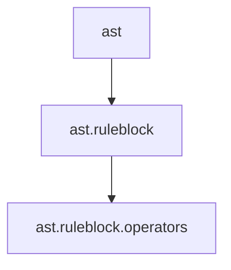
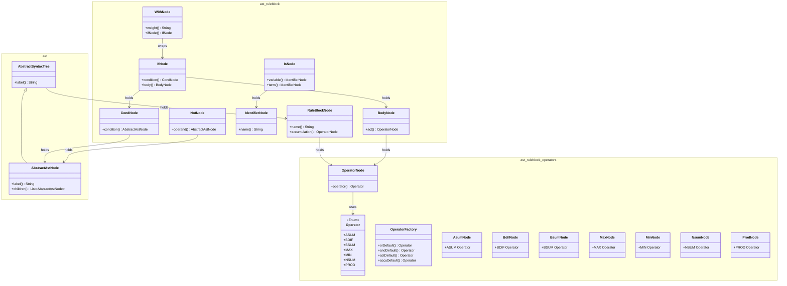
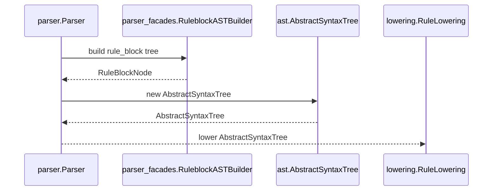

# Abstract Syntax Tree Module Documentation

One-line description: The abstract syntax tree (AST) models the semantic content of a function block rule block as an immutable node hierarchy consumed by the lowering phase.

Last update: 2026-10-29

## Purpose

The `ast` package (`ast` and subpackages) models the fuzzy rule block of a function block as an immutable tree of typed nodes. The parser builds the tree while reducing the `RULEBLOCK` grammar rules, through `parser.facades.RuleblockASTBuilder`, which maps the `parser.tree.TreeNode` built during the reductions into `ast` nodes. The resulting `ast.AbstractSyntaxTree` is the input of the lowering phase, which turns it into the rule matrix of the code generator.

Every node extends `ast.AbstractAstNode` and answers with a semantic label, such as `ROOT`, `IF`, `WITH`, `IS`, `NOT`, `AND`, `OR`, `BODY`, `ACTIVATION`, `ACCUMULATION`, or `COMPONENT`, or with the name of the rule block it represents. Nodes hold their attributes in final fields and their children in an unmodifiable list.

## Package Diagram



The flow moves from the root node types into the rule-block hierarchy, whose leaves are the logical operators of the fuzzy rules.

## Class Diagram



## Class Table

| Class                                     | Responsibility                                                                  | Pattern       |
|-------------------------------------------|---------------------------------------------------------------------------------|---------------|
| `ast_AbstractAstNode`                     | Base node holding an immutable list of children and the abstract semantic label | Abstract base |
| `ast_AbstractSyntaxTree`                  | Root node holding the list of rule blocks                                       | Composite     |
| `ast_ruleblock_BodyNode`                  | Holds the activation operator of a rule body                                    | Composite     |
| `ast_ruleblock_CondNode`                  | Holds the condition of a rule                                                   | Composite     |
| `ast_ruleblock_IdentifierNode`            | Holds the name of a variable or term                                            | Value object  |
| `ast_ruleblock_IfNode`                    | Holds the condition and the body of one rule                                    | Composite     |
| `ast_ruleblock_IsNode`                    | Holds the variable and the term of a variable IS term proposition               | Composite     |
| `ast_ruleblock_NotNode`                   | Holds the operand of a negated condition                                        | Composite     |
| `ast_ruleblock_RuleBlockNode`             | Holds the name of the rule block and its accumulation operator                  | Composite     |
| `ast_ruleblock_WithNode`                  | Holds the weighting factor and the rule of a weighted rule                      | Composite     |
| `ast_ruleblock_operators_Operator`        | Enumerates the logical operators of the fuzzy rules                             | Enum          |
| `ast_ruleblock_operators_OperatorFactory` | Creates the default logical operators for OR, AND, activation, and accumulation | Factory       |
| `ast_ruleblock_operators_OperatorNode`    | Holds a logical operator and its operands                                       | Composite     |
| `ast_ruleblock_operators_AsumNode`        | Logical operator node for the ASUM operator                                     | Composite     |
| `ast_ruleblock_operators_BdifNode`        | Logical operator node for the BDIF operator                                     | Composite     |
| `ast_ruleblock_operators_BsumNode`        | Logical operator node for the BSUM operator                                     | Composite     |
| `ast_ruleblock_operators_MaxNode`         | Logical operator node for the MAX operator                                      | Composite     |
| `ast_ruleblock_operators_MinNode`         | Logical operator node for the MIN operator                                      | Composite     |
| `ast_ruleblock_operators_NsumNode`        | Logical operator node for the NSUM operator                                     | Composite     |
| `ast_ruleblock_operators_ProdNode`        | Logical operator node for the PROD operator                                     | Composite     |

## Logical Operators

### Operator

`ast.ruleblock.operators.Operator` is the enum of logical operators: `ASUM`, `BDIF`, `BSUM`, `MAX`, `MIN`, `NSUM`, and `PROD`.

### OperatorNode

`ast.ruleblock.operators.OperatorNode` extends `ast.AbstractAstNode` and holds a logical operator together with its operands; its label is the operator name.

### OperatorFactory

`ast.ruleblock.operators.OperatorFactory` is a final utility class with static default operators: `orDefault` returns `MAX`, `andDefault` returns `MIN`, `actDefault` returns `MIN`, and `accuDefault` returns `MAX`.

## Construction from the Parser

The `parser.Parser` assigns the AST after reducing the `rule_block` rule: the generated parser accumulates `RuleBlockNode` instances into a list and wraps them into an `ast.AbstractSyntaxTree`.

`parser.facades.RuleblockASTBuilder` maps the parser tree labels into AST nodes:

| Tree label   | AST node                             |
|--------------|--------------------------------------|
| IDENTIFIER   | ast_ruleblock_IdentifierNode         |
| IS           | ast_ruleblock_IsNode                 |
| ACTIVATION   | ast_ruleblock_operators_OperatorNode |
| BODY         | ast_ruleblock_BodyNode               |
| NOT          | ast_ruleblock_NotNode                |
| OR           | ast_ruleblock_operators_OperatorNode |
| AND          | ast_ruleblock_operators_OperatorNode |
| CONDITION    | ast_ruleblock_CondNode               |
| IF           | ast_ruleblock_IfNode                 |
| WITH         | ast_ruleblock_WithNode               |
| ACCUMULATION | ast_ruleblock_operators_OperatorNode |
| COMPONENT    | ast_ruleblock_RuleBlockNode          |

## Construction Flow



## Lowering

`lowering.RuleLowering.lower(ast.AbstractSyntaxTree)` returns the rows of the supported rules: one row per rule, one column per input and then per output, each cell holding the index of the term of that variable.

`lowering.ControllerLowering.lower(ast.AbstractSyntaxTree)` builds the `codegen.ControllerModel` from the AST and the symbol table. The model is built only if the program follows the Basic Level subset: exactly one rule block, accumulation `ACCU: MAX`, each rule an `AND: MIN` of `input IS term` propositions that uses every input once and concludes `output IS term` for every output, and no weighting factor other than one.

Every problem is reported through `utils.DiagnosticsHandler` as an `utils.diagnostics.UnsupportedFeature` or an `utils.diagnostics.UndeclaredReference`.

## Charts

Chart: `assets/test_coverage.png` — test coverage per package from the JaCoCo report; the AST packages appear with 92 and 100 percent.

## How to Test

| Test class          | Directory                                                           | Coverage                                               |
|---------------------|---------------------------------------------------------------------|--------------------------------------------------------|
| AbstractAstNodeTest | src/test/java/unit/ast/AbstractAstNodeTest.java                     | Base node label, defensive copy, unmodifiable children |
| BodyNodeTest        | src/test/java/unit/ast/ruleblock/BodyNodeTest.java                  | Activation operator of a rule body                     |
| CondNodeTest        | src/test/java/unit/ast/ruleblock/CondNodeTest.java                  | Condition of a rule                                    |
| IdentifierNodeTest  | src/test/java/unit/ast/ruleblock/IdentifierNodeTest.java            | Variable and term names                                |
| IfNodeTest          | src/test/java/unit/ast/ruleblock/IfNodeTest.java                    | Condition and body of a rule                           |
| IsNodeTest          | src/test/java/unit/ast/ruleblock/IsNodeTest.java                    | Variable IS term propositions                          |
| NotNodeTest         | src/test/java/unit/ast/ruleblock/NotNodeTest.java                   | Negated operands                                       |
| RuleBlockNodeTest   | src/test/java/unit/ast/ruleblock/RuleBlockNodeTest.java             | Rule block name and accumulation                       |
| RuleBlockTreeTest   | src/test/java/unit/ast/ruleblock/RuleBlockTreeTest.java             | Tree to rule block mapping                             |
| WithNodeTest        | src/test/java/unit/ast/ruleblock/WithNodeTest.java                  | Weighting factor of a rule                             |
| OperatorFactoryTest | src/test/java/unit/ast/ruleblock/operators/OperatorFactoryTest.java | Default logical operators                              |
| OperatorNodeTest    | src/test/java/unit/ast/ruleblock/operators/OperatorNodeTest.java    | Operator and operands                                  |
| RuleBlockIT         | src/test/java/integration/lexer/parser/ast/RuleBlockIT.java         | Rule-block AST of a program                            |

Run the module tests with Maven:

```
mvn test -Dtest=AbstractAstNodeTest,BodyNodeTest,CondNodeTest,IdentifierNodeTest,IfNodeTest,IsNodeTest,NotNodeTest,RuleBlockNodeTest,RuleBlockTreeTest,WithNodeTest,OperatorNodeTest,OperatorFactoryTest
mvn verify -Dit.test=RuleBlockIT
```

## File Tree

```
src/main/java/ast/
├── AbstractAstNode.java
├── AbstractSyntaxTree.java
└── ruleblock/
    ├── BodyNode.java
    ├── CondNode.java
    ├── IdentifierNode.java
    ├── IfNode.java
    ├── IsNode.java
    ├── NotNode.java
    ├── RuleBlockNode.java
    ├── WithNode.java
    └── operators/
        ├── AsumNode.java
        ├── BdifNode.java
        ├── BsumNode.java
        ├── MaxNode.java
        ├── MinNode.java
        ├── NsumNode.java
        ├── Operator.java
        ├── OperatorFactory.java
        ├── OperatorNode.java
        └── ProdNode.java
```

## Usage in Thesis

The content of this module feeds the thesis chapters `doc/thesis/04.1-arbol-sintaxis-ruleblock.md`, `doc/thesis/04.2-lowering.md`, and `doc/thesis/07-mantenibilidad.md`, following the module-to-chapter mapping of the thesis writer.
