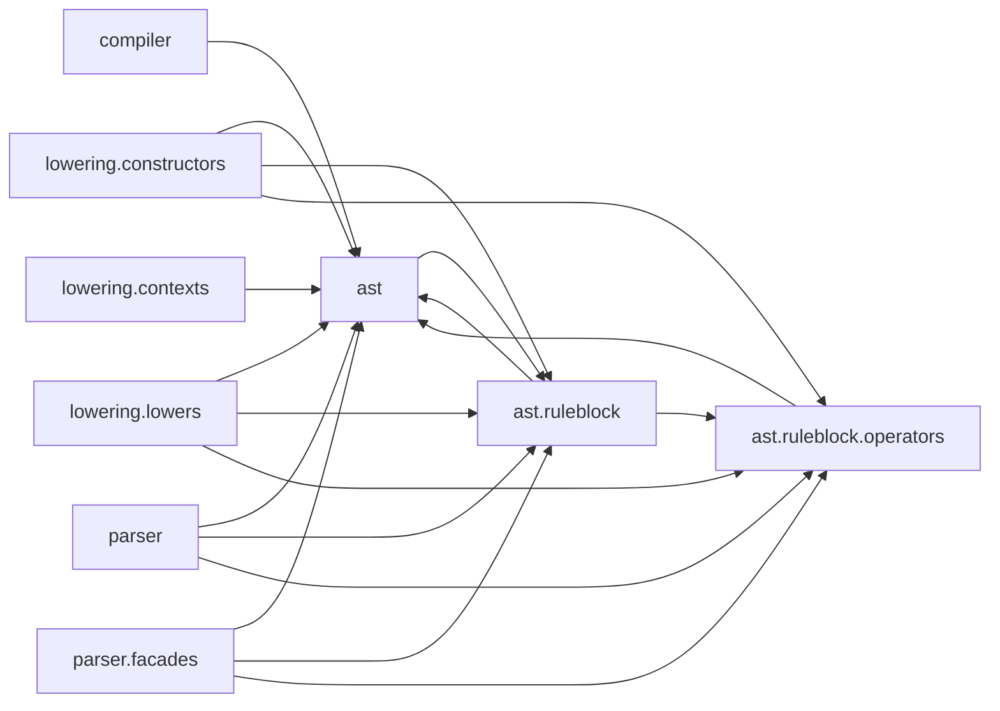
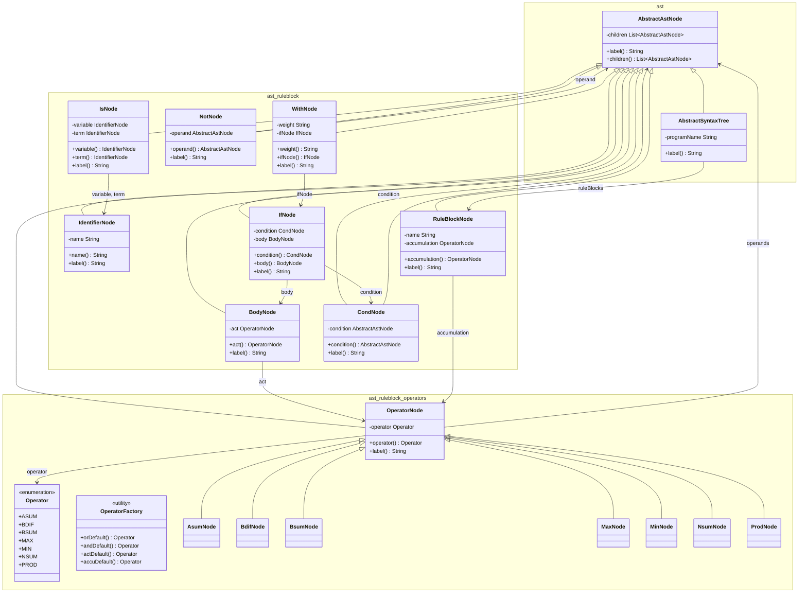
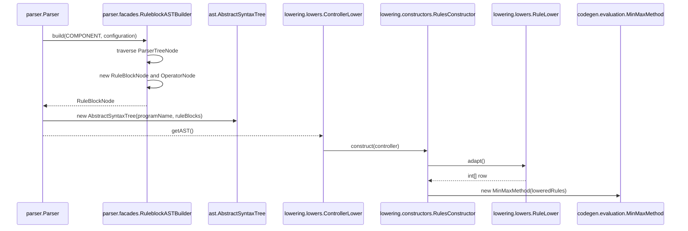

# Abstract Syntax Tree Module Documentation

One-line description: The abstract syntax tree models the RULEBLOCK body of a function block as an immutable node hierarchy consumed by the lowering phase.

Last update: 2026-11-04

## Purpose

The `ast` package and its subpackages model the fuzzy rule block of a function block as an immutable tree of typed nodes. The parser builds the tree while reducing the `RULEBLOCK` grammar rules, through `parser.facades.RuleblockASTBuilder`, which maps the `parser.tree.ParserTreeNode` built during the reductions into `ast` nodes. The resulting `ast.AbstractSyntaxTree` is the input of the lowering phase, which turns it into the rule matrix of the code generator.

Every node extends `ast.AbstractAstNode` and answers with a semantic label. Labels are plain strings computed by each node; there is no separate label enumeration. Examples are `BODY`, `COND`, `IF`, `IS`, `NOT`, the name of the operator, the name of an identifier, the scoped rule-block name, and the program name. Nodes hold their attributes in private final fields and their children in an unmodifiable list.

The three packages have distinct roles:

| Package                   | Role                                          |
|---------------------------|-----------------------------------------------|
| `ast`                     | Base node and program root                    |
| `ast.ruleblock`           | Rule-block structure and identifiers          |
| `ast.ruleblock.operators` | Fuzzy operator enumeration and operator nodes |

## Package Diagram

Generated by `scripts/generate_diagrams.py ast` in `doc/diagrams/`:



The edges follow the `import` statements from the importing package to the imported one. The AST packages have no outgoing dependency on another project package: they use only the Java standard library. Their consumers are `parser`, `parser.facades`, `lowering.constructors`, `lowering.contexts`, `lowering.lowers`, and `compiler`.

## Class Diagram

Generated by `scripts/generate_diagrams.py ast` in `doc/diagrams/`:



`AbstractAstNode` copies and null-checks its child list in the constructor, then exposes it as an unmodifiable list. `AbstractSyntaxTree` is the root of a whole FCL program: it holds the rule blocks and returns the program name as its label. It does not expose a separate `programName()` accessor.

`RuleBlockNode` holds the scoped rule-block name, for example `MAIN#INFERENCE`, and the accumulation operator. The name is available through `label()`, not through a `name()` accessor. `WithNode` holds the weighting factor as a string, so it accepts both numeric literals and identifiers, and returns `WITH ` followed by that value as its label.

The concrete operator nodes `AsumNode`, `BdifNode`, `BsumNode`, `MaxNode`, `MinNode`, `NsumNode`, and `ProdNode` each fix one `Operator` constant. The parser builds generic `OperatorNode` instances configured with the operator selected in the source; the concrete subclasses are available as typed alternatives and are exercised by the AST unit tests.

## Class Table

| Class                                     | Responsibility                                                                 | Pattern          |
|-------------------------------------------|--------------------------------------------------------------------------------|------------------|
| `ast_AbstractAstNode`                     | Base node holding an immutable list of children and an abstract semantic label | Abstract base    |
| `ast_AbstractSyntaxTree`                  | Root node holding the program name and the list of rule blocks                 | Composite        |
| `ast_ruleblock_BodyNode`                  | Holds the activation operator of a rule body                                   | Composite        |
| `ast_ruleblock_CondNode`                  | Holds the condition of a rule                                                  | Composite        |
| `ast_ruleblock_IdentifierNode`            | Holds the name of a variable or term                                           | Value object     |
| `ast_ruleblock_IfNode`                    | Holds the condition and the body of one rule                                   | Composite        |
| `ast_ruleblock_IsNode`                    | Holds the variable and the term of a variable IS term proposition              | Composite        |
| `ast_ruleblock_NotNode`                   | Holds the operand of a negated condition                                       | Composite        |
| `ast_ruleblock_RuleBlockNode`             | Holds the scoped rule-block name and its accumulation operator                 | Composite        |
| `ast_ruleblock_WithNode`                  | Holds the weighting factor and the rule of a weighted rule                     | Composite        |
| `ast_ruleblock_operators_Operator`        | Enumerates the fuzzy operators supported by the generator                      | Enumeration      |
| `ast_ruleblock_operators_OperatorFactory` | Creates the default operator for OR, AND, activation, and accumulation         | Factory          |
| `ast_ruleblock_operators_OperatorNode`    | Holds a fuzzy operator and its operands                                        | Composite        |
| `ast_ruleblock_operators_AsumNode`        | Operator node fixed to the ASUM operator                                       | Specialized node |
| `ast_ruleblock_operators_BdifNode`        | Operator node fixed to the BDIF operator                                       | Specialized node |
| `ast_ruleblock_operators_BsumNode`        | Operator node fixed to the BSUM operator                                       | Specialized node |
| `ast_ruleblock_operators_MaxNode`         | Operator node fixed to the MAX operator                                        | Specialized node |
| `ast_ruleblock_operators_MinNode`         | Operator node fixed to the MIN operator                                        | Specialized node |
| `ast_ruleblock_operators_NsumNode`        | Operator node fixed to the NSUM operator                                       | Specialized node |
| `ast_ruleblock_operators_ProdNode`        | Operator node fixed to the PROD operator                                       | Specialized node |

## Node Labels

| Node                                   | `label()` result                                   |
|----------------------------------------|----------------------------------------------------|
| `ast_AbstractSyntaxTree`               | Program name, such as `MAIN`                       |
| `ast_ruleblock_RuleBlockNode`          | Scoped rule-block name, such as `MAIN#INFERENCE`   |
| `ast_ruleblock_IfNode`                 | `IF`                                               |
| `ast_ruleblock_CondNode`               | `COND`                                             |
| `ast_ruleblock_BodyNode`               | `BODY`                                             |
| `ast_ruleblock_IsNode`                 | `IS`                                               |
| `ast_ruleblock_NotNode`                | `NOT`                                              |
| `ast_ruleblock_WithNode`               | `WITH ` followed by the weight, such as `WITH 0.5` |
| `ast_ruleblock_IdentifierNode`         | The identifier name                                |
| `ast_ruleblock_operators_OperatorNode` | The operator name, such as `MIN`                   |

The label is diagnostic and structural: it identifies the node in rendered trees and diagnostics. It is not an enum, and two different nodes may return the same label, as happens with two `IS` propositions.

## Logical Operators

`ast.ruleblock.operators.Operator` is the enumeration of fuzzy operators: `ASUM`, `BDIF`, `BSUM`, `MAX`, `MIN`, `NSUM`, and `PROD`. `OperatorNode` extends `AbstractAstNode` and holds one operator together with its operands; its label is the operator name.

`ast.ruleblock.operators.OperatorFactory` is a final utility class with a private constructor. Its static defaults match the grammar defaults:

| Operation    | Default | Source configuration                       |
|--------------|---------|--------------------------------------------|
| OR           | `MAX`   | `OR: MAX`, `OR: ASUM`, or `OR: BSUM`       |
| AND          | `MIN`   | `AND: MIN`, `AND: PROD`, or `AND: BDIF`    |
| Activation   | `MIN`   | `ACT: MIN` or `ACT: PROD`                  |
| Accumulation | `MAX`   | `ACCU: MAX`, `ACCU: BSUM`, or `ACCU: NSUM` |

The grammar builds the configuration list in the order OR, AND, activation, accumulation. `RuleblockASTBuilder` reads that list by index: 0 for OR, 1 for AND, 2 for activation, and 3 for accumulation.

## Construction from the Parser

The grammar rule `rule_block` reduces `RULEBLOCK rule_block_name operator_definition opt_activation_method accumulation_method rules_decl END_RULEBLOCK`. The semantic action appends the activation and accumulation operators to the OR and AND operators produced by `operator_definition`, wraps `rules_decl` in a `COMPONENT` parser node, and calls `RuleblockASTBuilder.build(componentNode, configuration)`.

`rule_block_name` returns `programName + '#' + IDENTIFIER`, so a rule block is scoped to its function block, for example `MAIN#INFERENCE`. The parser accumulates the resulting `RuleBlockNode` instances in `opt_rule_block_list`. When `function_block_declaration` reduces, it creates `new AbstractSyntaxTree(programName, ruleBlocks)`; the root is not created per rule block.

`parser.facades.RuleblockASTBuilder` traverses the parser tree and maps each `ParserLabel` to an AST node:

| Parser label   | AST node                               | Value taken from the parser tree                                   |
|----------------|----------------------------------------|--------------------------------------------------------------------|
| `IDENTIFIER`   | `ast_ruleblock_IdentifierNode`         | `symbolReference()`                                                |
| `IS`           | `ast_ruleblock_IsNode`                 | Two identifier children                                            |
| `ACTIVATION`   | `ast_ruleblock_operators_OperatorNode` | Activation operator from configuration index 2 and the conclusions |
| `BODY`         | `ast_ruleblock_BodyNode`               | The activation operator node                                       |
| `NOT`          | `ast_ruleblock_NotNode`                | The negated operand                                                |
| `OR`           | `ast_ruleblock_operators_OperatorNode` | OR operator from configuration index 0 and two operands            |
| `AND`          | `ast_ruleblock_operators_OperatorNode` | AND operator from configuration index 1 and two operands           |
| `CONDITION`    | `ast_ruleblock_CondNode`               | The condition child                                                |
| `IF`           | `ast_ruleblock_IfNode`                 | A condition node and a body node                                   |
| `WITH`         | `ast_ruleblock_WithNode`               | `symbolReference()` as weight and the wrapped if node              |
| `ACCUMULATION` | `ast_ruleblock_operators_OperatorNode` | Accumulation operator from configuration index 3 and the rules     |
| `COMPONENT`    | `ast_ruleblock_RuleBlockNode`          | `symbolReference()` as scoped name and the accumulation operator   |

`RuleblockASTBuilder.build` rejects a configuration list whose size is not four with `IllegalArgumentException`, and rejects a root that does not produce a `RuleBlockNode`. During traversal it also validates the expected arity and child types of each label and throws a `RuntimeException` for a malformed parser tree. A label outside the table yields `null`.

## Construction Flow

Generated by `scripts/generate_diagrams.py ast` in `doc/diagrams/`:



The parser owns construction; the lowering phase only reads the immutable tree. `ControllerLower.newInstance` stores the root and creates `SymbolKeys` from `root.label()`, which is the program name.

## Lowering

`lowering.lowers.ControllerLower.adapt()` builds the `codegen.ControllerModel` from the symbol table and the AST. It runs three constructors in order: `BitWidthConstructor`, `FuzzyVariablesConstructor`, and `RulesConstructor`. The method returns `Optional.empty()` as soon as one constructor reports an unsupported program.

`lowering.constructors.RulesConstructor` is the part that consumes the rule-block AST. It accepts exactly one rule block, requires accumulation `ACCU: MAX`, and requires at least one rule. Each rule is lowered by `lowering.lowers.RuleLower.adapt()`, which returns one `int[]` row. The rows are collected into a `codegen.evaluation.MinMaxMethod`.

`RuleLower` builds a row with one column per input followed by one column per output. Each cell holds the index of the term in the variable's fuzzifier or defuzzifier parameter list; `-1` marks an unused cell. The accepted subset is narrower than the full grammar:

| Input construct                              | Accepted by `RuleLower`                                      |
|----------------------------------------------|--------------------------------------------------------------|
| Rule without `WITH`                          | Yes                                                          |
| Rule with `WITH`                             | Only when the weight compares equal to one as a `BigDecimal` |
| Condition `variable IS term`                 | Yes                                                          |
| Condition tree of `AND: MIN`                 | Yes, flattened recursively                                   |
| `OR` condition with `MAX`, `ASUM`, or `BSUM` | No                                                           |
| `AND` with `PROD` or `BDIF`                  | No                                                           |
| `NOT`                                        | No                                                           |
| Bare identifier as a condition               | No                                                           |
| Conclusion that is not `variable IS term`    | No                                                           |
| Repeated input or output variable            | No                                                           |
| Input or output not used by the rule         | No                                                           |

Problems are reported through `utils.DiagnosticsHandler`. Unsupported constructs produce `utils.diagnostics.UnsupportedFeature`. Undeclared variables, terms that do not belong to the variable, and repeated variables produce `utils.diagnostics.UndeclaredReference`. The model is built only when every rule lowers without a diagnostic.

## Charts

Chart: `assets/ast_node_distribution.png` — AST type distribution counted from `src/main/java/ast/**/*.java`; the chart records 8 rule-block node classes, 8 operator node classes, and the 2 classes whose names begin with `Abstract`.

Chart: `assets/loc_per_module.png` — non-blank, non-line-comment lines of code per module from `src/main/java`; the AST module has 639 lines across 20 source files.

Chart: `assets/package_coupling.png` — afferent and efferent coupling per package from the import analysis across `src/main/java`; the AST package has afferent coupling 3 and efferent coupling 0.

Chart: `assets/test_coverage.png` — line coverage per package from the JaCoCo report; the AST package records 100 percent.

## How to Test

| Test class            | Source                                                                | Verification                                                                                             |
|-----------------------|-----------------------------------------------------------------------|----------------------------------------------------------------------------------------------------------|
| `AbstractAstNodeTest` | `src/test/java/unit/ast/AbstractAstNodeTest.java`                     | Label, defensive copy, unmodifiable children, null children and null child rejection                     |
| `BodyNodeTest`        | `src/test/java/unit/ast/ruleblock/BodyNodeTest.java`                  | `BODY` label, singleton activation child, unmodifiable children                                          |
| `CondNodeTest`        | `src/test/java/unit/ast/ruleblock/CondNodeTest.java`                  | `COND` label, singleton condition child, unmodifiable children                                           |
| `IdentifierNodeTest`  | `src/test/java/unit/ast/ruleblock/IdentifierNodeTest.java`            | Name label, empty unmodifiable children, null name rejection                                             |
| `IfNodeTest`          | `src/test/java/unit/ast/ruleblock/IfNodeTest.java`                    | `IF` label, condition then body order, unmodifiable children                                             |
| `IsNodeTest`          | `src/test/java/unit/ast/ruleblock/IsNodeTest.java`                    | `IS` label, variable then term order, unmodifiable children                                              |
| `NotNodeTest`         | `src/test/java/unit/ast/ruleblock/NotNodeTest.java`                   | `NOT` label, singleton operand, `IS NOT` represented as `NOT` over `IS`                                  |
| `RuleBlockNodeTest`   | `src/test/java/unit/ast/ruleblock/RuleBlockNodeTest.java`             | Scoped name label, singleton accumulation child, unmodifiable children                                   |
| `RuleBlockTreeTest`   | `src/test/java/unit/ast/ruleblock/RuleBlockTreeTest.java`             | Full rule-block rendering, `IS NOT`, parenthesized condition without an extra node                       |
| `WithNodeTest`        | `src/test/java/unit/ast/ruleblock/WithNodeTest.java`                  | `WITH` weight label, singleton if child, unmodifiable children                                           |
| `OperatorFactoryTest` | `src/test/java/unit/ast/ruleblock/operators/OperatorFactoryTest.java` | Defaults `MAX`, `MIN`, `MIN`, `MAX`                                                                      |
| `OperatorNodeTest`    | `src/test/java/unit/ast/ruleblock/operators/OperatorNodeTest.java`    | Operator and label for every enum constant, child order, empty and unmodifiable children, null rejection |
| `RuleBlockIT`         | `src/test/java/integration/lexer/parser/ast/RuleBlockIT.java`         | End-to-end RULEBLOCK AST: scoped names, source order, operators, `WITH`, multiple rule blocks            |

The unit tests share `src/test/java/utils/AstTestSupport.java`, which renders a tree as an indented list of labels and checks that `children()` is unmodifiable.

Run the module tests with Maven:

```bash
mvn -q -Dtest=AbstractAstNodeTest,BodyNodeTest,CondNodeTest,IdentifierNodeTest,IfNodeTest,IsNodeTest,NotNodeTest,RuleBlockNodeTest,RuleBlockTreeTest,WithNodeTest,OperatorNodeTest,OperatorFactoryTest test
mvn -q -Dit.test=RuleBlockIT verify
```

## File Tree

```text
src/main/java/ast/
├── AbstractAstNode.java
├── AbstractSyntaxTree.java
├── package-info.java
└── ruleblock/
    ├── BodyNode.java
    ├── CondNode.java
    ├── IdentifierNode.java
    ├── IfNode.java
    ├── IsNode.java
    ├── NotNode.java
    ├── RuleBlockNode.java
    ├── WithNode.java
    ├── package-info.java
    └── operators/
        ├── AsumNode.java
        ├── BdifNode.java
        ├── BsumNode.java
        ├── MaxNode.java
        ├── MinNode.java
        ├── NsumNode.java
        ├── Operator.java
        ├── OperatorFactory.java
        ├── OperatorNode.java
        ├── ProdNode.java
        └── package-info.java
```

## Usage in Thesis

The content of this module feeds `doc/thesis/04.1-arbol-sintaxis-ruleblock.md` and `doc/thesis/04.2-lowering.md`. The pipeline description in `doc/thesis/04.5-pipeline-compilador.md` also places the AST between parsing and lowering, and `doc/thesis/07-mantenibilidad.md` uses the immutable node hierarchy as an example of the composite structure of the compiler.
