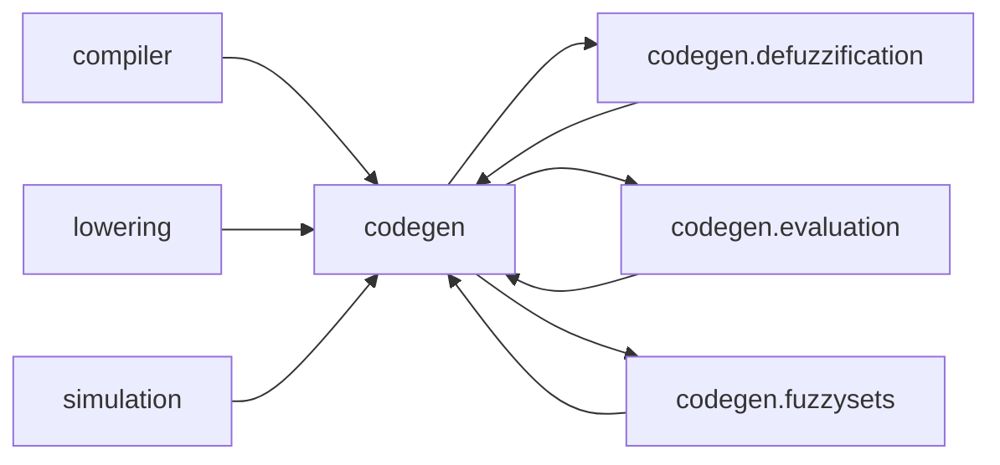
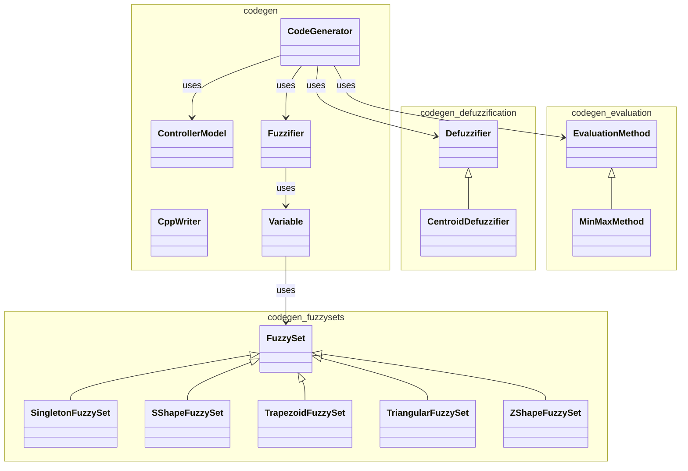
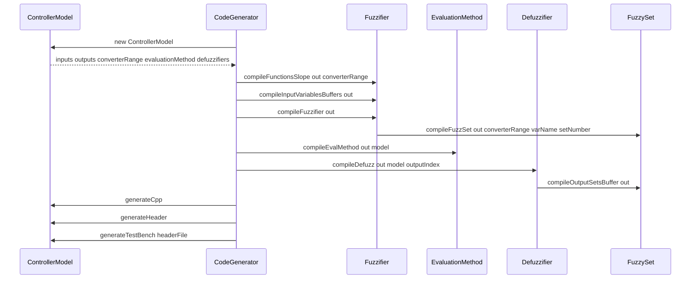

# Code Generator

Emits the Vivado HLS C++ implementation, header, and test bench of a fuzzy controller.

Last update: 2026-11-04

## Purpose

The codegen package (`codegen` and its subpackages) consumes the immutable `codegen.ControllerModel` built by the lowering phase and emits the C++ source of a fuzzy controller for Vivado HLS:

* `<base>_out.cpp` — implementation of the fuzzy controller
* `<base>_out.h` — header with types and function declarations
* `<base>_outTB.cpp` — test bench

`compiler.FlcCompiler` connects the generator to the pipeline: it parses the FCL program, asks `lowering.lowers.ControllerLower` for a `ControllerModel`, calls `CodeGenerator`, and wraps the returned text in `compiler.GeneratedFile` instances.

The generator is a port of the code generator of Luca Sarramone (Generador-FLC, commit `c304c1d`), used with permission. The generated code is the same; the differences are internal: the model is passed explicitly instead of living in static fields, and the code is returned as text instead of being written to files.

## Package Diagram

Generated by `scripts/generate_diagrams.py codegen` in `doc/diagrams/`:



The diagram lists the packages of the module and the directed edges from the importing package to the imported one, taken from the `import` statements of `src/main/java/codegen/**/*.java` and from the imports of the consumer packages. `lowering` builds the model, `compiler` runs the whole pipeline, and `simulation` compares the reference and quantized controllers.

## Class Structure

Generated by `scripts/generate_diagrams.py codegen` in `doc/diagrams/`:



`Defuzzifier`, `EvaluationMethod`, and `FuzzySet` are abstract classes, not Java interfaces. Each concrete subclass emits the C++ of one stage or one membership shape.

## Class Table

| Class                                         | Responsibility                                                                                           | Pattern                |
|-----------------------------------------------|----------------------------------------------------------------------------------------------------------|------------------------|
| `codegen_CodeGenerator`                       | Emits the C++ implementation, header, and test bench of a fuzzy controller from the controller model.    | Facade                 |
| `codegen_ControllerModel`                     | Immutable controller model: bit width, inputs, outputs, rule matrix evaluation method, and defuzzifiers. | Immutable value object |
| `codegen_CppWriter`                           | In-memory text sink for generated C++ fragments; no global state and no I/O.                             | Text sink              |
| `codegen_Fuzzifier`                           | Emits the slope constants, the fuzz buffers, and the fuzzifier function of every input.                  | Stage facade           |
| `codegen_Variable`                            | Input or output variable with its fuzzy sets; emits slopes, buffers, and membership degrees.             | Composite              |
| `codegen_defuzzification_Defuzzifier`         | Abstract base of the defuzzification stage: output membership buffers and defuzzifier functions.         | Abstract strategy      |
| `codegen_defuzzification_CentroidDefuzzifier` | Computes the centroid of the singleton output values (CoGS).                                             | Strategy               |
| `codegen_evaluation_EvaluationMethod`         | Abstract base of the rule evaluation stage: owns the rule matrix and emits the evaluation.               | Abstract strategy      |
| `codegen_evaluation_MinMaxMethod`             | MIN-MAX evaluation: AND as minimum, ACCUMULATION as maximum.                                             | Strategy               |
| `codegen_fuzzysets_FuzzySet`                  | Abstract fuzzy set: emits its C++ membership function and computes the quantized degree.                 | Abstract strategy      |
| `codegen_fuzzysets_SingletonFuzzySet`         | Singleton fuzzy set: maximum degree at one value, zero elsewhere; output variables use singletons.       | Specialization         |
| `codegen_fuzzysets_SShapeFuzzySet`            | Increasing ramp: membership (a, 0) (b, 1).                                                               | Specialization         |
| `codegen_fuzzysets_TriangularFuzzySet`        | Triangle: membership (a, 0) (b, 1) (c, 0).                                                               | Specialization         |
| `codegen_fuzzysets_TrapezoidFuzzySet`         | Trapezoid: membership (a, 0) (b, 1) (c, 1) (d, 0).                                                       | Specialization         |
| `codegen_fuzzysets_ZShapeFuzzySet`            | Decreasing ramp: membership (c, 1) (d, 0).                                                               | Specialization         |

**Table sources:** `src/main/java/codegen/CodeGenerator.java`, `src/main/java/codegen/ControllerModel.java`, `src/main/java/codegen/CppWriter.java`, `src/main/java/codegen/Fuzzifier.java`, `src/main/java/codegen/Variable.java`, `src/main/java/codegen/defuzzification/`, `src/main/java/codegen/evaluation/`, and `src/main/java/codegen/fuzzysets/`.

## Controller Model

`codegen.ControllerModel` is the immutable input of the generator. It carries the bit width `N` of every value (`MIN_BIT_WIDTH = 1` to `MAX_BIT_WIDTH = 30`), the ordered input and output variables, the evaluation method that owns the rule matrix, and the defuzzifier of every output.

The constructor receives a `lowering.utils.ControllerModelState` and validates it:

* the bit width is between `MIN_BIT_WIDTH` and `MAX_BIT_WIDTH`;
* there is at least one input and one output;
* every output has a defuzzifier;
* the evaluation method is not `null`.

It copies the input and output lists and the defuzzifier map into unmodifiable collections, so later changes to the builder state do not affect the model.

The maximum degree of the converter is `converterRange = 2^N - 1`, and every value of the controller is an unsigned integer of `N` bits (`ap_uint<N>`). The rule matrix column layout is fixed: `inputColumn(i)` is `i`, and `outputColumn(i)` is the number of inputs plus `i`.

## Generated C++ Types

The generated controller uses the fixed point types:

| Type                 | Width                             | Use                               |
|----------------------|-----------------------------------|-----------------------------------|
| `fixed_int`          | `N`                               | Input value or membership degree  |
| `fixed_aux_<output>` | `2N + number of sets of <output>` | Centroid accumulator of an output |
| `fixed_out`          | `N * number of outputs`           | Packed controller result          |

The test bench keeps the fixed types of the original generator: `fixed_int = ap_uint<8>` and `fixed_aux = ap_uint<18>`.

## Generation Stages

### Fuzzification Stage

`codegen.Fuzzifier` emits, for every input variable, the slope constants `function<var><i>`, the zero-initialized buffer `<var>Fuzz[n]`, and the `fuzzifier` function. The function applies `#pragma HLS PIPELINE` and `#pragma HLS ARRAY_PARTITION`, then evaluates every fuzzy set through `codegen.Variable.compile` into `<var>Fuzz[setNumber]`.

### Rule Evaluation Stage

`codegen.evaluation.EvaluationMethod` owns the rule matrix as an immutable list of rows, one row per rule and one cell per variable column. The column layout is the order of the inputs of the controller signature followed by the order of the packed outputs. The constructor clones every row, so the matrix cannot be modified through the caller.

`codegen.evaluation.MinMaxMethod` implements the AND as the minimum of the input membership degrees and the ACCUMULATION as the maximum over the rules that conclude the output set. It emits `rulesEvaluation` with one nested `min(...)` expression per rule, visits outputs from the last to the first, assigns the first rule of a set directly, and keeps the maximum for the remaining rules with an `aux` variable.

### Defuzzification Stage

`codegen.defuzzification.Defuzzifier` emits the `<output>MembershipValues[n]` buffers filled by the rule evaluation, and one defuzzifier function per output. `codegen.defuzzification.CentroidDefuzzifier` implements the centroid of the singleton output values (FCL `METHOD: CoGS`): it emits the `outputValues<output>` array, accumulates numerator and denominator, and returns `numerator/denominator`. As in the original generator there is no `DEFAULT`: when no rule fires, the denominator is zero.

### Controller Function

`codegen.CodeGenerator.generateCpp` emits the implementation with the types, the slopes, the fuzzifier, the rule evaluation, the defuzzifiers, and the `fuzzyController` function annotated with `#pragma HLS DATAFLOW`. The controller calls `fuzzifier`, `rulesEvaluation`, and one defuzzifier per output, shifts every output by `N * outputIndex`, and returns the packed result of all outputs.

`generateHeader` repeats the types and declares `fuzzifier`, `rulesEvaluation`, every defuzzifier, and `fuzzyController`. `generateTestBench` includes the generated header, keeps the original `ap_uint<8>` and `ap_uint<18>` test types, sets every input to `converterRange()/2`, and prints the controller result.

## Membership Functions

| Set                  | FCL coordinates             | Generated membership                                                            |
|----------------------|-----------------------------|---------------------------------------------------------------------------------|
| `SShapeFuzzySet`     | (a, 0) (b, 1)               | 0 below `a`, maximum degree above `b`, rising slope in between                  |
| `ZShapeFuzzySet`     | (c, 1) (d, 0)               | Maximum degree below `c`, 0 above `d`, falling slope in between                 |
| `TriangularFuzzySet` | (a, 0) (b, 1) (c, 0)        | 0 outside `[a, c]`, rising slope up to `b`, falling slope after `b`             |
| `TrapezoidFuzzySet`  | (a, 0) (b, 1) (c, 1) (d, 0) | 0 outside `[a, d]`, rising up to `b`, maximum on the plateau, falling after `c` |
| `SingletonFuzzySet`  | One value                   | Maximum degree at the value, 0 elsewhere                                        |

The slope constants use integer division: `converterRange / width`. The generated membership is therefore quantized, and `FuzzySet.quantizedDegree` reproduces the same branches and truncates the result to `N` bits with `& converterRange`, as an assignment to `ap_uint<N>` does. `FuzzySet.degree` returns the ideal IEC 61131-7 degree in `[0, 1]` and is used by the tests.

The triangle and the trapezoid are corrected with respect to the original generator; their Javadoc in `TriangularFuzzySet.java` and `TrapezoidFuzzySet.java` documents the difference. Output variables must contain only singletons: `Variable.compileOutputSetsBuffer` throws `IllegalStateException` for any other shape.

## Generation Sequence

Generated by `scripts/generate_diagrams.py codegen` in `doc/diagrams/`:



## Generated Files

| File               | Content                                                                                                              |
|--------------------|----------------------------------------------------------------------------------------------------------------------|
| `<base>_out.cpp`   | Types, slope constants, fuzz and membership buffers, `fuzzifier`, `rulesEvaluation`, defuzzifiers, `fuzzyController` |
| `<base>_out.h`     | Types and declarations of `fuzzifier`, `rulesEvaluation`, every defuzzifier, and `fuzzyController`                   |
| `<base>_outTB.cpp` | Test bench with the generated header, every input at half of the converter range, and the printed controller result  |

## Charts

Chart: `assets/loc_per_module.png` — lines of code per module in `src/main/java`; the codegen module has 1205 lines in 15 files.

Chart: `assets/package_coupling.png` — afferent and efferent coupling per package from the import analysis; codegen has afferent coupling 3, efferent coupling 1, and instability 0.25.

Chart: `assets/cyclomatic_complexity.png` — average cyclomatic complexity per package estimated from decision points in `src/main/java`; codegen averages 2.7 over 37 estimated methods.

Chart: `assets/test_coverage.png` — test coverage per package from `target/site/jacoco/jacoco.xml`; codegen reaches 97%.

The numeric values above come from `doc/stats.json`, produced by `scripts/extract_stats.py`.

## How to Test

| Test class                                       | Verification                                                                                                                                                                                                       |
|--------------------------------------------------|--------------------------------------------------------------------------------------------------------------------------------------------------------------------------------------------------------------------|
| `unit.codegen.LucaGeneratorCharacterizationTest` | Port of the original generator: with the examples of `src/test/resources/golden/luca/` (pendulo_invertido, Autoenfoque, EstacionamientoCamion) the emitted C++ matches the original text, except for line endings. |
| `unit.codegen.fuzzysets.FuzzySetDegreeTest`      | Quantized degrees of every fuzzy set shape with 8 bits, using the integer slope of the generated code, and the ideal degrees of IEC 61131-7.                                                                       |
| `unit.codegen.fuzzysets.TrapezoidFuzzySetTest`   | Trapezoid membership code: zero outside the feet, rising slope up to the plateau, maximum degree on the plateau, and falling slope after it.                                                                       |
| `integration.compiler.LucaGoldenIT`              | Whole pipeline from FCL source to generated files; the output is equivalent to the reference files of Luca's generator, compared as C++ tokens.                                                                    |
| `integration.compiler.CommandLineIT`             | File naming, output directory creation, warning propagation, rejection of unsupported `OR`, syntax errors, and usage errors.                                                                                       |

```bash
mvn -q test
```

Focused unit tests:

```bash
mvn -q -Dtest=LucaGeneratorCharacterizationTest,FuzzySetDegreeTest,TrapezoidFuzzySetTest test
```

## File Tree

Source: `src/main/java/codegen/`.

```text
src/main/java/codegen/
    CodeGenerator.java
    ControllerModel.java
    CppWriter.java
    Fuzzifier.java
    Variable.java
    package-info.java
    defuzzification/
        CentroidDefuzzifier.java
        Defuzzifier.java
        package-info.java
    evaluation/
        EvaluationMethod.java
        MinMaxMethod.java
        package-info.java
    fuzzysets/
        FuzzySet.java
        SingletonFuzzySet.java
        SShapeFuzzySet.java
        TrapezoidFuzzySet.java
        TriangularFuzzySet.java
        ZShapeFuzzySet.java
        package-info.java

```

## Usage in Thesis

According to the module-to-chapter mapping in `scripts/synthesize_thesis_context.py`, this module is consumed by the thesis chapters `doc/thesis/04.2-lowering.md`, `doc/thesis/04.3-generacion-codigo.md`, and `doc/thesis/04.5-pipeline-compilador.md`. The code generation phase receives the `codegen.ControllerModel` built by the lowering phase and emits the C++ files of the generated fuzzy controller.
