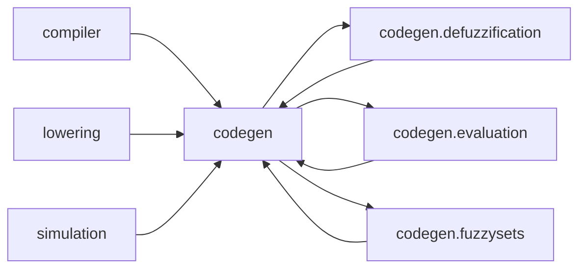
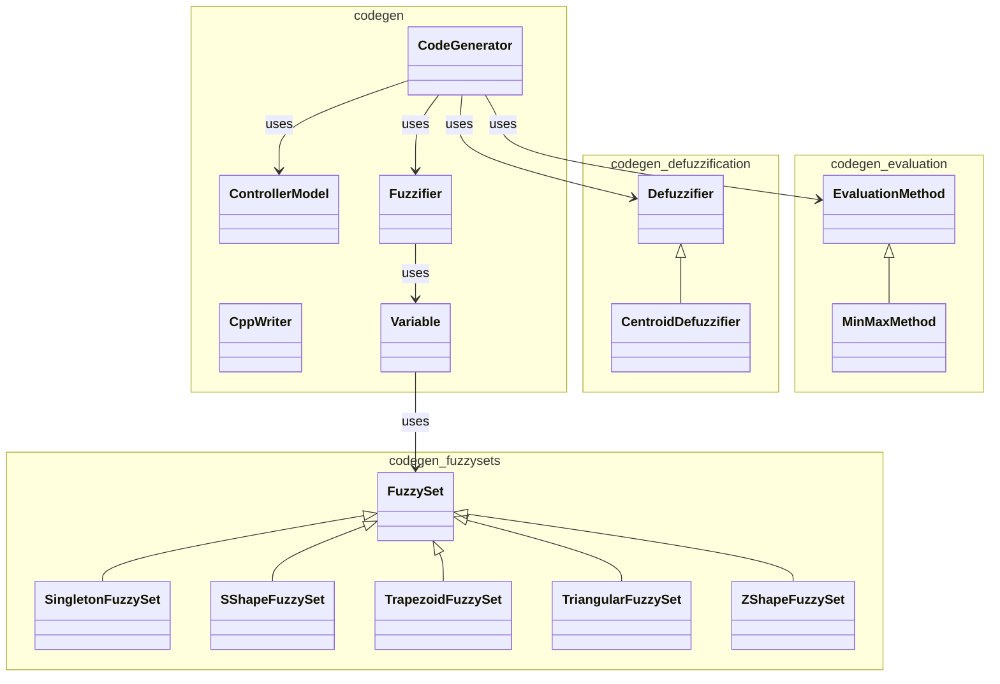
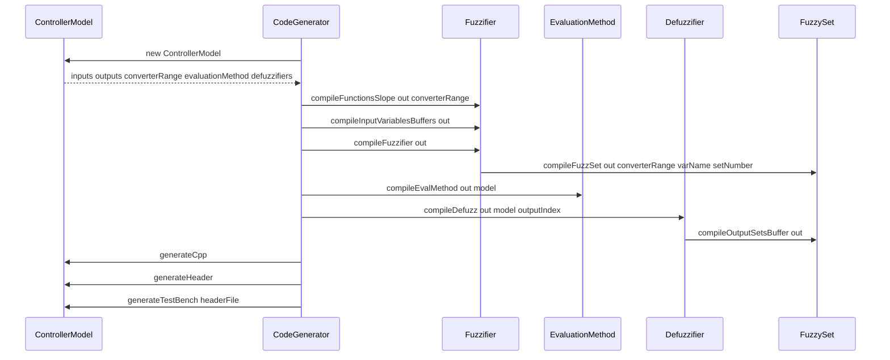

# Code Generator

Emits the Vivado HLS C++ implementation, header, and test bench of a fuzzy controller.

Last update: 2026-10-29

## Purpose

The codegen package (`codegen` and subpackages) consumes the immutable `codegen.ControllerModel` built by the lowering phase and emits the C++ source of a fuzzy controller for Vivado HLS:

* `<base>_out.cpp` — implementation of the fuzzy controller
* `<base>_out.h` — header with types and signatures
* `<base>_outTB.cpp` — test bench

The generator is a port of the code generator of Luca Sarramone (Generador-FLC, commit `c304c1d`), used with permission. The generated code is the same; the differences are internal: the model is passed explicitly instead of living in static fields, and the code is returned as text instead of being written to files.

## Package Diagram

Generated by `scripts/generate_diagrams.py codegen` in `doc/diagrams/`:



The diagram lists the packages of the module and the directed edges from the importing package to the imported one, taken from the `import` statements of `src/main/java/codegen/**/*.java` and from the imports of the consumer packages.

## Class Structure

Generated by `scripts/generate_diagrams.py codegen` in `doc/diagrams/`:



## Class Table

| Class                                         | Responsibility                                                                                           | Pattern            |
|-----------------------------------------------|----------------------------------------------------------------------------------------------------------|--------------------|
| `codegen_CodeGenerator`                       | Emits the C++ implementation, header, and test bench of a fuzzy controller from the controller model.    | Orchestrator       |
| `codegen_ControllerModel`                     | Immutable controller model: bit width, inputs, outputs, rule matrix evaluation method, and defuzzifiers. | Immutable model    |
| `codegen_CppWriter`                           | In-memory text sink for generated C++ fragments; no global state and no I/O.                             | Writer             |
| `codegen_Fuzzifier`                           | Emits the slope constants, the fuzz buffers, and the fuzzifier function of every input.                  | Stage              |
| `codegen_Variable`                            | Input or output variable with its fuzzy sets; emits slopes, buffers, and membership degrees.             | Composite          |
| `codegen_defuzzification_Defuzzifier`         | Interface of the defuzzification stage: output membership buffers and defuzzifier functions.             | Strategy interface |
| `codegen_defuzzification_CentroidDefuzzifier` | Computes the centroid of the singleton output values (CoGS).                                             | Strategy           |
| `codegen_evaluation_EvaluationMethod`         | Interface of the rule evaluation stage: owns the rule matrix and emits the evaluation.                   | Strategy interface |
| `codegen_evaluation_MinMaxMethod`             | MIN-MAX evaluation: AND as minimum, ACCUMULATION as maximum.                                             | Strategy           |
| `codegen_fuzzysets_FuzzySet`                  | Abstract fuzzy set: emits its C++ membership function and computes the quantized degree.                 | Template method    |
| `codegen_fuzzysets_SingletonFuzzySet`         | Singleton fuzzy set: maximum degree at one value, zero elsewhere; output variables use singletons.       | Specialization     |
| `codegen_fuzzysets_SShapeFuzzySet`            | Increasing ramp: membership (a, 0) (b, 1).                                                               | Specialization     |
| `codegen_fuzzysets_TriangularFuzzySet`        | Triangle: membership (a, 0) (b, 1) (c, 0).                                                               | Specialization     |
| `codegen_fuzzysets_TrapezoidFuzzySet`         | Trapezoid: membership (a, 0) (b, 1) (c, 1) (d, 0).                                                       | Specialization     |
| `codegen_fuzzysets_ZShapeFuzzySet`            | Decreasing ramp: membership (c, 1) (d, 0).                                                               | Specialization     |

**Table sources:** `src/main/java/codegen/CodeGenerator.java`, `src/main/java/codegen/ControllerModel.java`, `src/main/java/codegen/CppWriter.java`, `src/main/java/codegen/Fuzzifier.java`, `src/main/java/codegen/Variable.java`, `src/main/java/codegen/defuzzification/`, `src/main/java/codegen/evaluation/`, and `src/main/java/codegen/fuzzysets/`.

## Controller Model

`codegen.ControllerModel` is the immutable input of the generator. It carries the bit width `N` of every value (`MIN_BIT_WIDTH = 1` to `MAX_BIT_WIDTH = 30`), the ordered input and output variables, the evaluation method that owns the rule matrix, and the defuzzifier of every output. The constructor validates the bit width, requires at least one input and one output, and requires every output to have a defuzzifier.

The maximum degree of the converter is `converterRange = 2^N - 1`, and every value of the controller is an unsigned integer of `N` bits (`ap_uint<N>`).

## Generated C++ Types

The generated controller uses the fixed point types:

* `fixed_int`: input value or membership degree, `ap_uint<N>`.
* `fixed_aux_<output>`: centroid accumulator of an output, `ap_uint<2N + number of sets>`.
* `fixed_out`: packed controller result, `ap_uint<N * number of outputs>`.

The test bench keeps the fixed types of the original generator: `fixed_int = ap_uint<8>` and `fixed_aux = ap_uint<18>`.

## Generation Stages

### Fuzzification Stage

`codegen.Fuzzifier` emits, for every input variable, the slope constants `function<var><i>`, the zero-initialized buffer `<var>Fuzz[n]`, and the `fuzzifier` function. The function applies `#pragma HLS PIPELINE` and `#pragma HLS ARRAY_PARTITION`, then evaluates every fuzzy set through `codegen.Variable.compile` into `<var>Fuzz[setNumber]`.

### Rule Evaluation Stage

`codegen.evaluation.EvaluationMethod` owns the rule matrix as an immutable list of rows, one row per rule and one cell per variable column. The column layout is the order of the inputs of the controller signature followed by the order of the packed outputs. `codegen.evaluation.MinMaxMethod` implements the AND as the minimum of the input membership degrees and the ACCUMULATION as the maximum over the rules that conclude the output set.

### Defuzzification Stage

`codegen.defuzzification.Defuzzifier` emits the `<output>MembershipValues[n]` buffers filled by the rule evaluation, and one defuzzifier function per output. `codegen.defuzzification.CentroidDefuzzifier` implements the centroid of the singleton output values (FCL `METHOD: CoGS`); when no rule fires, the denominator is zero.

## Generated Controller

`codegen.CodeGenerator.generateCpp` emits the implementation with the types, the slopes, the fuzzifier, the rule evaluation, the defuzzifiers, and the `fuzzyController` function annotated with `#pragma HLS DATAFLOW`. The controller returns the packed result of all outputs.

## Sequence

Generated by `scripts/generate_diagrams.py codegen` in `doc/diagrams/`:



## Charts

Chart: `assets/loc_per_module.png` — lines of code per module, counted from `src/main/java` including the codegen packages.

Chart: `assets/package_coupling.png` — afferent and efferent coupling per package, from the import analysis across `src/main/java`.

Chart: `assets/cyclomatic_complexity.png` — average cyclomatic complexity per package, estimated from the decision points of `src/main/java`.

## How to Test

| Test class                                       | Verification                                                                                                                                                                                                       |
|--------------------------------------------------|--------------------------------------------------------------------------------------------------------------------------------------------------------------------------------------------------------------------|
| `unit/codegen/LucaGeneratorCharacterizationTest` | Port of the original generator: with the examples of `src/test/resources/golden/luca/` (pendulo_invertido, Autoenfoque, EstacionamientoCamion) the emitted C++ matches the original text, except for line endings. |
| `unit/codegen/fuzzysets/FuzzySetDegreeTest`      | Quantized degrees of the fuzzy sets, with the integer slope of the generated code, and the ideal degrees of IEC 61131-7.                                                                                           |
| `unit/codegen/fuzzysets/TrapezoidFuzzySetTest`   | Trapezoid membership code, with zero outside the feet, rising slope up to the plateau, maximum degree on the plateau, and falling slope after it.                                                                  |

```bash
mvn -q -Dtest=LucaGeneratorCharacterizationTest,FuzzySetDegreeTest,TrapezoidFuzzySetTest test
```

## File Tree

Source: `src/main/java/codegen/`.

```text
src/main/java/codegen/
    CodeGenerator.java
    ControllerModel.java
    CppWriter.java
    Fuzzifier.java
    Variable.java
    package-info.java
    defuzzification/
        CentroidDefuzzifier.java
        Defuzzifier.java
        package-info.java
    evaluation/
        EvaluationMethod.java
        MinMaxMethod.java
        package-info.java
    fuzzysets/
        FuzzySet.java
        SingletonFuzzySet.java
        SShapeFuzzySet.java
        TrapezoidFuzzySet.java
        TriangularFuzzySet.java
        ZShapeFuzzySet.java
        package-info.java

```

## Usage in Thesis

According to the module-to-chapter mapping, this module is consumed by the thesis chapters `doc/thesis/04.2-lowering.md`, `doc/thesis/04.3-generacion-codigo.md`, and `doc/thesis/04.5-pipeline-compilador.md`. The code generation phase receives the `codegen.ControllerModel` built by the lowering phase and emits the C++ files of the generated fuzzy controller.
