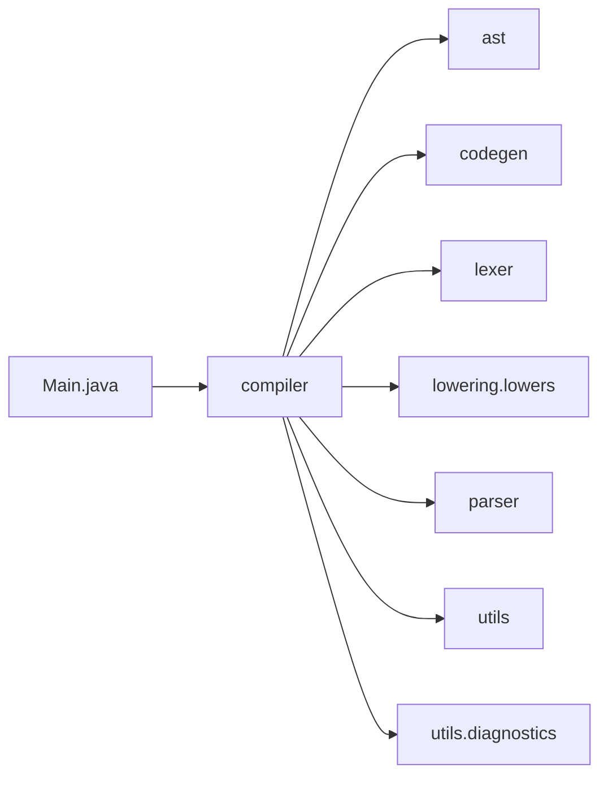
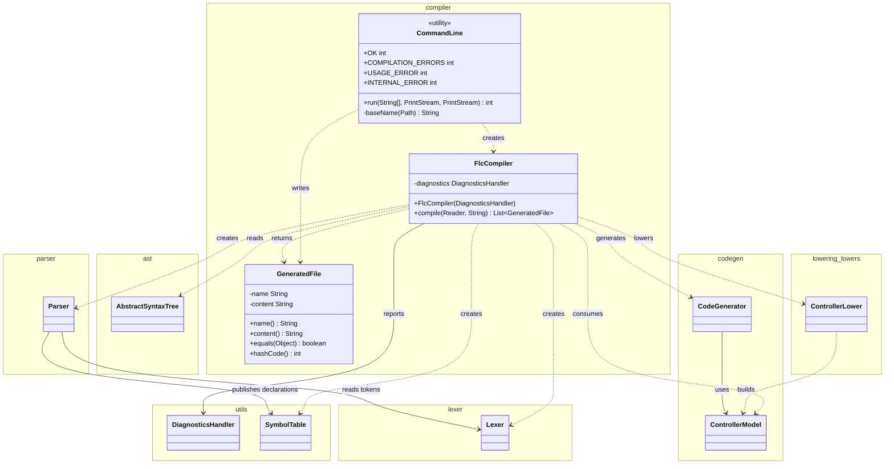
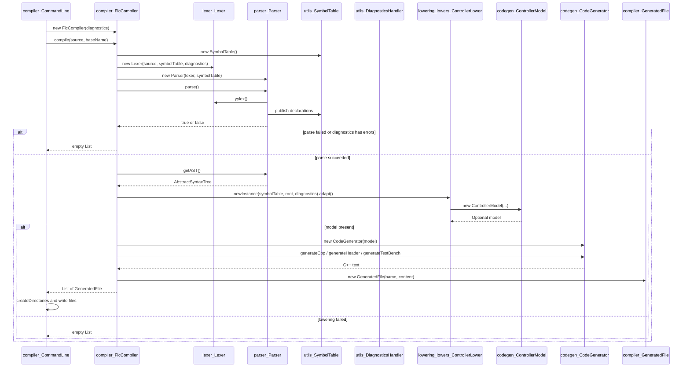

# Compiler

End-to-end orchestration of the FCL to Vivado HLS C++ pipeline and its command line.

Last update: 2026-11-04

## Purpose

The `compiler` package is the outermost layer of the application. It composes the lexer, parser, lowering, and code generation phases and exposes the result as in-memory files.

The package has two entry points:

* `compiler.FlcCompiler` is the library entry point. `compile(Reader, String)` runs the whole pipeline and returns a `List<compiler.GeneratedFile>` without touching the file system.
* `compiler.CommandLine` is the process entry point. `run(String[], PrintStream, PrintStream)` validates the arguments, reads the FCL source as UTF-8, calls `FlcCompiler`, prints diagnostics, writes the generated files, and returns an exit status.

`compiler.GeneratedFile` is the immutable name and content pair returned by the library entry point. `Main.java` in the default package is the JAR entry point and delegates to `CommandLine`.

The package does not implement lexing, parsing, lowering, or C++ generation. It only wires the phases together and defines the process boundary.

## Package Dependencies

Generated by `scripts/generate_diagrams.py compiler` in `doc/diagrams/compiler_package_flowchart.mmd`:



Every edge is an import dependency directed from the importing unit to the imported package. The edges come from the `import` statements of `src/main/java/compiler/*.java` and from `src/main/java/Main.java`. Package labels use underscores, so `lowering_lowers` denotes `lowering.lowers` and `utils_diagnostics` denotes `utils.diagnostics`.

| Importing package | Imported package    | Source imports                      |
|-------------------|---------------------|-------------------------------------|
| `compiler`        | `ast`               | `AbstractSyntaxTree`                |
| `compiler`        | `codegen`           | `CodeGenerator`, `ControllerModel`  |
| `compiler`        | `lexer`             | `Lexer`                             |
| `compiler`        | `lowering_lowers`   | `ControllerLower`                   |
| `compiler`        | `parser`            | `Parser`                            |
| `compiler`        | `utils`             | `DiagnosticsHandler`, `SymbolTable` |
| `compiler`        | `utils_diagnostics` | `Diagnostic`                        |
| `main`            | `compiler`          | `CommandLine`                       |

No package under `src/main/java` imports `compiler`; the package is a top-level consumer of the rest of the application. `Main.java` belongs to the default package and is the only caller of `compiler.CommandLine`.

## Class Structure

Generated by `scripts/generate_diagrams.py compiler` in `doc/diagrams/compiler_class_diagram.mmd`:



The diagram derives its relationships from fields, constructor calls, method signatures, and return values. `CommandLine` is a final utility class with a private constructor. `FlcCompiler` is a final class with one field. `GeneratedFile` is a final immutable value with no dependency beyond `java.util.Objects`.

## Class Table

| Class                    | Responsibility                                                                                       | Pattern                |
|--------------------------|------------------------------------------------------------------------------------------------------|------------------------|
| `compiler_CommandLine`   | Parses the arguments, reads the source, runs the compiler, prints diagnostics, and writes the files. | Command-line facade    |
| `compiler_FlcCompiler`   | Chains lexer, parser, lowering, and code generation and returns the generated files in memory.       | Pipeline facade        |
| `compiler_GeneratedFile` | Immutable file name and text content produced by the compiler; value equality over both fields.      | Immutable value object |

**Table sources:** `src/main/java/compiler/CommandLine.java`, `src/main/java/compiler/FlcCompiler.java`, and `src/main/java/compiler/GeneratedFile.java`.

## Pipeline Behaviour

### Library Entry Point

`src/main/java/compiler/FlcCompiler.java` owns the phase sequence. The constructor requires a non-null `utils.DiagnosticsHandler`, and `compile` requires non-null `source` and `baseName`.

`compile(Reader, String)` performs these steps in order:

1. Creates a `utils.SymbolTable`.
2. Creates a `lexer.Lexer` over the reader, the symbol table, and the diagnostics handler, and passes it to a new `parser.Parser`.
3. Calls `parser.parse()`. If it returns `false` or the diagnostics handler already has errors, returns `Collections.emptyList()`.
4. Reads the `ast.AbstractSyntaxTree` with `parser.getAST()`.
5. Calls `lowering.lowers.ControllerLower.newInstance(symbolTable, root, diagnostics).adapt()`. If the returned `Optional<codegen.ControllerModel>` is empty, returns `Collections.emptyList()`.
6. Creates a `codegen.CodeGenerator` with the model and returns three `GeneratedFile` values in this order: `<base>_out.cpp` from `generateCpp()`, `<base>_out.h` from `generateHeader()`, and `<base>_outTB.cpp` from `generateTestBench(header)`.

The list is created with `Arrays.asList`, so it has a fixed size but its elements are immutable. The method declares `IOException` because it reads from the supplied `Reader`; runtime exceptions from the phases are not caught here.

The `DiagnosticsHandler` belongs to the caller. `FlcCompiler` adds diagnostics to it but does not clear or inspect it after the initial `hasErrors()` check. Warnings do not stop the pipeline.

### Command Line Entry Point

`src/main/java/compiler/CommandLine.java` implements `run(String[] args, PrintStream out, PrintStream err)`. It accepts one or two arguments: the FCL program and an optional output directory. With one argument the output directory is the directory of the program.

The method follows this sequence:

1. If the number of arguments is not one or two, prints the usage text to `err` and returns `USAGE_ERROR`.
2. Converts the program argument to an absolute `Path` and resolves the output directory.
3. Opens the program with `Files.newBufferedReader` using UTF-8 and calls `new FlcCompiler(diagnostics).compile(source, baseName(program))`.
4. Catches `IOException` from reading, prints `Cannot read <program>: <message>`, and returns `USAGE_ERROR`.
5. Catches `RuntimeException` from the compiler, prints the collected diagnostics, prints `Internal compiler error, please report it with the program: <exception>`, prints the stack trace, and returns `INTERNAL_ERROR`.
6. Prints every collected diagnostic with `Diagnostic.getMessage()` to `err`.
7. If the returned list is empty, prints `No code generated: <file name> has errors` and returns `COMPILATION_ERRORS`.
8. Creates the output directory with `Files.createDirectories`, writes every `GeneratedFile` as UTF-8, and prints `Generated <target>` for each file to `out`.
9. Catches `IOException` from writing, prints `Cannot write to <directory>: <message>`, and returns `USAGE_ERROR`.
10. Returns `OK`.

The base name is the program file name without its extension and with spaces replaced by underscores. `pendulo invertido.fcl` therefore produces `pendulo_invertido_out.cpp`, `pendulo_invertido_out.h`, and `pendulo_invertido_outTB.cpp`.

| Constant                         | Value | Meaning                                                                     |
|----------------------------------|-------|-----------------------------------------------------------------------------|
| `CommandLine.OK`                 | 0     | Code generated; warnings may have been printed.                             |
| `CommandLine.COMPILATION_ERRORS` | 1     | The program has errors or uses an unsupported feature; nothing was written. |
| `CommandLine.USAGE_ERROR`        | 2     | Wrong arguments, or a file could not be read or written.                    |
| `CommandLine.INTERNAL_ERROR`     | 3     | Unexpected failure of the compiler itself.                                  |

`Main.main` calls `CommandLine.run(args, System.out, System.err)` and calls `System.exit(status)` only when the status is not `OK`. A successful compilation returns from `main` and the JVM exits with status 0.

### Generated File Value

`src/main/java/compiler/GeneratedFile.java` stores a file name without a directory and the complete text of the file. Both constructor arguments are checked with `Objects.requireNonNull`.

`name()` and `content()` expose the two fields. `equals` and `hashCode` compare both fields, so two generated files are equal only when both the name and the content match. `toString` returns `GeneratedFile{<name>, <content length> chars}`.

The class is intentionally independent of the file system: callers decide where to write the files, and tests can compare the values directly.

## Pipeline Sequence

Generated by `scripts/generate_diagrams.py compiler` in `doc/diagrams/compiler_pipeline_sequence.mmd`:



The sequence shows the two failure exits before writing: a parse error or an existing diagnostic error returns an empty list, and an absent controller model returns an empty list. Only a present model reaches the generator and the file-writing loop in `CommandLine`.

## Generated Outputs

| File               | Producer                          | Content                                                                      |
|--------------------|-----------------------------------|------------------------------------------------------------------------------|
| `<base>_out.cpp`   | `CodeGenerator.generateCpp`       | Types, slopes, buffers, fuzzifier, rule evaluation, defuzzifiers, controller |
| `<base>_out.h`     | `CodeGenerator.generateHeader`    | Types and declarations used by the implementation and the test bench         |
| `<base>_outTB.cpp` | `CodeGenerator.generateTestBench` | Test bench that includes `<base>_out.h` and prints the controller result     |

The header name passed to `generateTestBench` is the same `<base>_out.h` value returned in the second `GeneratedFile`.

## Charts

Chart: `assets/loc_per_module.png` — lines of code per module in `src/main/java`; the compiler module has 230 lines in 3 source files, excluding `package-info.java`.

Chart: `assets/cyclomatic_complexity.png` — average cyclomatic complexity per package estimated from decision points in `src/main/java`; compiler averages 3.3 over 7 estimated methods, with total complexity 23.

Chart: `assets/test_coverage.png` — line coverage per package from `target/site/jacoco/jacoco.xml`; compiler reaches 78% line coverage, against 89% overall.

Chart: `assets/package_coupling.png` — afferent and efferent coupling per package from the import analysis; compiler has afferent coupling 0, efferent coupling 6, and instability 1.00.

The efferent count is measured in distinct top-level project packages. The flowchart above shows seven edges because `lowering.lowers` and `utils.diagnostics` are subpackages of `lowering` and `utils` respectively.

The numeric values above come from `doc/stats.json`, produced by `scripts/extract_stats.py`.

## How to Test

| Test class                           | Verification                                                                                                                                                                                                                                                                                |
|--------------------------------------|---------------------------------------------------------------------------------------------------------------------------------------------------------------------------------------------------------------------------------------------------------------------------------------------|
| `integration.compiler.CommandLineIT` | Program compiled next to itself with the program name as base name; output directory creation; spaces replaced by underscores; warnings printed while code is generated; unsupported `OR` and syntax errors produce no files; missing program and wrong argument count return usage errors. |
| `integration.compiler.LucaGoldenIT`  | The three reference programs under `src/test/resources/golden/luca/` compile without errors, produce exactly the expected file names, and match the reference C++ as token sequences.                                                                                                       |

`CommandLineIT` covers the process boundary: argument validation, UTF-8 reading, file naming, directory creation, diagnostics, and the four exit statuses. `LucaGoldenIT` covers the library boundary: `FlcCompiler.compile` must return the three expected files with equivalent C++ content.

Run the full suite:

```bash
mvn -q test
```

Run only the compiler integration tests:

```bash
mvn -q -Dit.test=CommandLineIT,LucaGoldenIT test
```

The reference outputs live in `src/test/resources/golden/luca/<base>/expected/`; the adjacent `README.md` explains their origin and how to regenerate them.

## File Tree

Source: `src/main/java/compiler/` and the JAR entry point.

```text
src/main/java/
├── Main.java
└── compiler/
    ├── CommandLine.java
    ├── FlcCompiler.java
    ├── GeneratedFile.java
    └── package-info.java
```

## Usage in Thesis

The module-to-chapter mapping in `scripts/synthesize_thesis_context.py` assigns this module to `doc/thesis/04.5-pipeline-compilador.md`, which describes the end-to-end pipeline, the command-line interface, the exit codes, and the generated files. The package is the implementation reference for that chapter.
