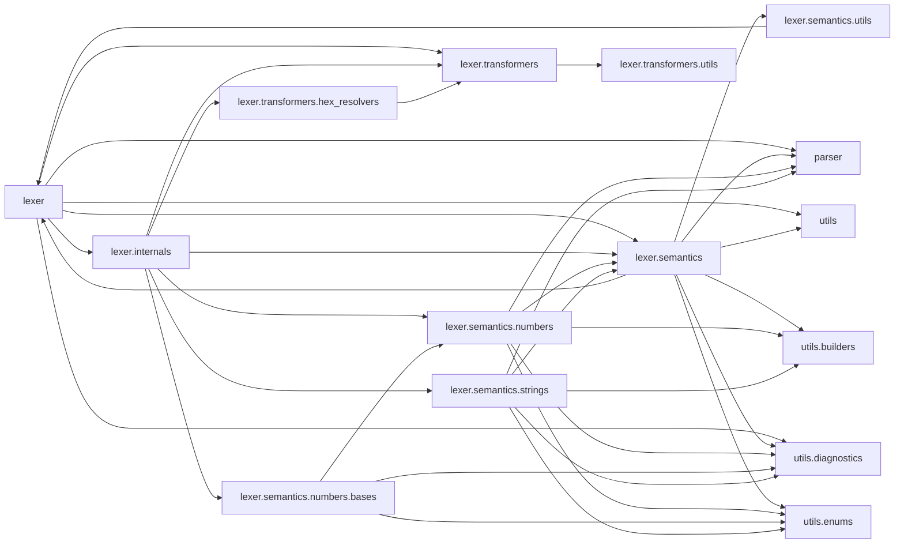
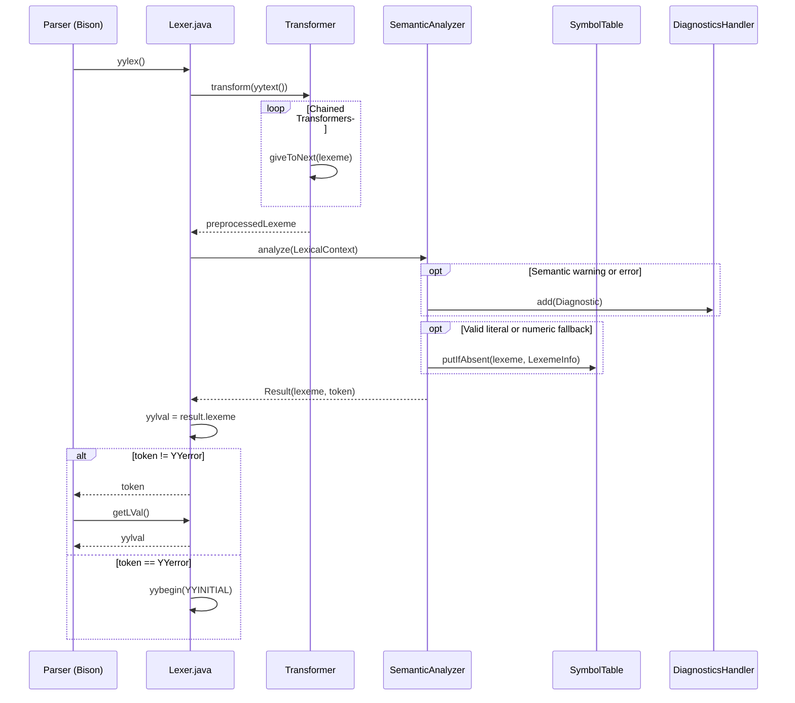

# Lexical Analyzer

Recognizes FCL lexemes, normalizes them, and communicates tokens and associated values to the parser.

**Sources:** `src/main/java/lexer/Lexer.flex`, `src/main/java/lexer/Lexer.java` and `src/main/java/lexer/semantics/SemanticAnalyzer.java`. `Lexer.java` identifies itself in its header as code generated by JFlex 1.8.2; the current Maven plugin configuration in `pom.xml` specifies version 1.9.1 of the JFlex plugin.

## Package Dependencies

Directed edges from the importing package to the imported one, extracted from the `import` statements of `src/main/java/lexer/**/*.java` using `scripts/generate_diagrams.py lexer`. Wildcard imports are attributed to the imported package; the chart does not represent runtime calls.



## Class Structure

Declarations, inheritance, and interface implementation extracted from the Java files in `src/main/java/lexer/`; the two associations of the scanner with the registries come from the fields in `src/main/java/lexer/Lexer.flex`.

```mermaid
classDiagram
    namespace lexer {
        class Lexer
    }
    namespace lexer_internals {
        class LexicalPreprocessors
        class LexicalAnalyzers
    }
    namespace lexer_transformers {
        class Transformer
        class UnderscoreRemover
        class UpperCaseConverter
        class StripLeadingZeros
        class StripTrailingZeros
        class StripBaseNumberLeadingZeros
        class OmitLeadingZeroMagnitudes
        class OmitTrailingZeroMagnitudes
        class OmitLeadingZerosInMagnitudes
        class OmitTrailingZerosInMagnitudes
        class StringEscapeResolver
        class Nothing
    }
    namespace lexer_transformers_hex_resolvers {
        class HexResolver
        class StringHexResolver
        class WStringHexResolver
    }
    namespace lexer_transformers_utils {
        class ExponentFinder
    }
    namespace lexer_semantics {
        class SemanticAnalyzer
        class Identifiers
        class Intervals
        class Dates
        class DayTimes
        class DateAndDayTimes
    }
    namespace lexer_semantics_numbers {
        class NumbersAnalyzer
        class Naturals
        class Integers
        class Reals
    }
    namespace lexer_semantics_numbers_bases {
        class BaseNumbersAnalyzer
        class Binary
        class Octal
        class Hexadecimal
    }
    namespace lexer_semantics_strings {
        class StringsAnalyzer
        class Strings
        class WStrings
    }
    namespace lexer_semantics_utils {
        class ReservedWords
    }
    SemanticAnalyzer <|-- DateAndDayTimes
    SemanticAnalyzer <|-- Dates
    SemanticAnalyzer <|-- DayTimes
    SemanticAnalyzer <|-- Identifiers
    SemanticAnalyzer <|-- Intervals
    NumbersAnalyzer <|-- Integers
    NumbersAnalyzer <|-- Naturals
    SemanticAnalyzer <|-- NumbersAnalyzer
    NumbersAnalyzer <|-- Reals
    NumbersAnalyzer <|-- BaseNumbersAnalyzer
    BaseNumbersAnalyzer <|-- Binary
    BaseNumbersAnalyzer <|-- Hexadecimal
    BaseNumbersAnalyzer <|-- Octal
    StringsAnalyzer <|-- Strings
    SemanticAnalyzer <|-- StringsAnalyzer
    StringsAnalyzer <|-- WStrings
    Transformer <|-- Nothing
    Transformer <|-- StringEscapeResolver
    Transformer <|-- StripLeadingZeros
    Transformer <|-- StripTrailingZeros
    Transformer <|-- StripBaseNumberLeadingZeros
    Transformer <|-- UnderscoreRemover
    Transformer <|-- UpperCaseConverter
    Transformer <|-- OmitLeadingZeroMagnitudes
    Transformer <|-- OmitTrailingZeroMagnitudes
    Transformer <|-- OmitLeadingZerosInMagnitudes
    Transformer <|-- OmitTrailingZerosInMagnitudes
    Transformer <|-- HexResolver
    HexResolver <|-- StringHexResolver
    HexResolver <|-- WStringHexResolver
    Lexer --> LexicalPreprocessors : uses
    Lexer --> LexicalAnalyzers : uses

```



| Class                                                 | Responsibility                                                               | Pattern or role         |
|-------------------------------------------------------|------------------------------------------------------------------------------|-------------------------|
| `lexer.Lexer`                                         | Executes JFlex rules, preserves `yylval`, and returns the token to parser.   | Generated scanner       |
| `lexer.internals.LexicalPreprocessors`                | Declares static strings by lexical category.                                 | String registry         |
| `lexer.internals.LexicalAnalyzers`                    | Declares analyzer instances by category.                                     | Strategy registry       |
| `lexer.transformers.Transformer`                      | Defines `transform` and delegates with `giveToNext`.                         | Chain of responsibility |
| `lexer.transformers.UnderscoreRemover`                | Removes underscore separators from the lexeme.                               | Transformer             |
| `lexer.transformers.UpperCaseConverter`               | Converts the lexeme to uppercase.                                            | Transformer             |
| `lexer.transformers.StripLeadingZeros`                | Removes leading zeros in the decimal integer part.                           | Transformer             |
| `lexer.transformers.StripTrailingZeros`               | Removes trailing zeros from reals.                                           | Transformer             |
| `lexer.transformers.StripBaseNumberLeadingZeros`      | Removes leading zeros after the base prefix.                                 | Transformer             |
| `lexer.transformers.OmitLeadingZeroMagnitudes`        | Omits null leading magnitudes of intervals.                                  | Transformer             |
| `lexer.transformers.OmitTrailingZeroMagnitudes`       | Omits null trailing magnitudes of intervals.                                 | Transformer             |
| `lexer.transformers.OmitLeadingZerosInMagnitudes`     | Removes leading zeros within interval magnitudes.                            | Transformer             |
| `lexer.transformers.OmitTrailingZerosInMagnitudes`    | Removes trailing zeros from the fraction of interval magnitudes.             | Transformer             |
| `lexer.transformers.Nothing`                          | Returns the lexeme unmodified.                                               | Identity transformer    |
| `lexer.transformers.StringEscapeResolver`             | Substitutes control and quote escapes.                                       | Transformer             |
| `lexer.transformers.hex_resolvers.HexResolver`        | Resolves hexadecimal escapes according to the width indicated by subclasses. | Transformation template |
| `lexer.transformers.hex_resolvers.StringHexResolver`  | Configures STRING hexadecimal escapes (2 digits).                            | Specialization          |
| `lexer.transformers.hex_resolvers.WStringHexResolver` | Configures WSTRING hexadecimal escapes (4 digits).                           | Specialization          |
| `lexer.transformers.utils.ExponentFinder`             | Locates the exponent of a real literal.                                      | Utility                 |
| `lexer.semantics.SemanticAnalyzer`                    | Defines `analyze`, the lexical context, and result.                          | Strategy interface      |
| `lexer.semantics.numbers.NumbersAnalyzer`             | Shares analysis, warning, recovery, and publication of numbers.              | Template method         |
| `lexer.semantics.numbers.Naturals`                    | Determines subtype and value of decimal naturals.                            | Specialization          |
| `lexer.semantics.numbers.Integers`                    | Determines subtype and value of signed decimal integers.                     | Specialization          |
| `lexer.semantics.numbers.Reals`                       | Determines subtype and value of real literals.                               | Specialization          |
| `lexer.semantics.numbers.bases.BaseNumbersAnalyzer`   | Interprets numbers with base prefix and assigns subtype by value.            | Template method         |
| `lexer.semantics.numbers.bases.Binary`                | Defines base, maximum length, and diagnostics for binary numbers.            | Specialization          |
| `lexer.semantics.numbers.bases.Octal`                 | Defines base, maximum length, and diagnostics for octal numbers.             | Specialization          |
| `lexer.semantics.numbers.bases.Hexadecimal`           | Defines base, maximum length, and diagnostics for hexadecimal numbers.       | Specialization          |
| `lexer.semantics.Intervals`                           | Validates durations and stores a `Duration`.                                 | Strategy                |
| `lexer.semantics.Dates`                               | Validates dates and stores a `LocalDate`.                                    | Strategy                |
| `lexer.semantics.DayTimes`                            | Validates times and stores a `LocalTime`.                                    | Strategy                |
| `lexer.semantics.DateAndDayTimes`                     | Validates date-times and stores a `LocalDateTime`.                           | Strategy                |
| `lexer.semantics.strings.StringsAnalyzer`             | Trims long strings, issues warning, and publishes the value.                 | Template method         |
| `lexer.semantics.strings.Strings`                     | Selects the STRING subtype.                                                  | Specialization          |
| `lexer.semantics.strings.WStrings`                    | Selects the WSTRING subtype.                                                 | Specialization          |
| `lexer.semantics.Identifiers`                         | Distinguishes reserved word, boolean, and identifier.                        | Strategy                |
| `lexer.semantics.utils.ReservedWords`                 | Associates reserved words with token identifiers.                            | Registry                |

**Table sources:** `src/main/java/lexer/internals/LexicalPreprocessors.java`, `src/main/java/lexer/internals/LexicalAnalyzers.java`, `src/main/java/lexer/transformers/`, `src/main/java/lexer/semantics/` and `src/main/java/lexer/Lexer.flex`.

## Normalization and Validation

| Category                              | Transformation Sequence                                                                                                                                          | Analyzer                               |
|---------------------------------------|------------------------------------------------------------------------------------------------------------------------------------------------------------------|----------------------------------------|
| `DATES`, `DAYTIMES`, `DATE_AND_TIMES` | `Nothing`                                                                                                                                                        | `Dates`, `DayTimes`, `DateAndDayTimes` |
| `INTERVALS`                           | `UnderscoreRemover → UpperCaseConverter → OmitLeadingZeroMagnitudes → OmitTrailingZeroMagnitudes → OmitLeadingZerosInMagnitudes → OmitTrailingZerosInMagnitudes` | `Intervals`                            |
| `NATURALS`, `INTEGERS`                | `UnderscoreRemover → StripLeadingZeros`                                                                                                                          | `Naturals`, `Integers`                 |
| `BINARY`, `OCTAL`, `HEXADECIMAL`      | `UnderscoreRemover → StripBaseNumberLeadingZeros`                                                                                                                | `Binary`, `Octal`, `Hexadecimal`       |
| `REALS`                               | `UnderscoreRemover → StripTrailingZeros → StripLeadingZeros`                                                                                                     | `Reals`                                |
| `STRINGS`, `WSTRINGS`                 | `StringHexResolver` or `WStringHexResolver → StringEscapeResolver`                                                                                               | `Strings`, `WStrings`                  |
| `IDENTIFIERS`                         | `UpperCaseConverter`                                                                                                                                             | `Identifiers`                          |

**Source:** `src/main/java/lexer/internals/LexicalPreprocessors.java` and `src/main/java/lexer/internals/LexicalAnalyzers.java`.

Chart: `assets/transformer_chain_lengths.png` — number of `new` instances in each static chain of `src/main/java/lexer/internals/LexicalPreprocessors.java`, including the `Nothing` instance in temporal categories; chart generated by `scripts/extract_stats.py`.

### Chain Object for Intervals

Instances and order extracted from the `INTERVALS` declaration in `src/main/java/lexer/internals/LexicalPreprocessors.java`:

```mermaid
flowchart LR
    root["LexicalPreprocessors.INTERVALS"] --> node0["UnderscoreRemover"]
    node0 --> node1["UpperCaseConverter"]
    node1 --> node2["OmitLeadingZeroMagnitudes"]
    node2 --> node3["OmitTrailingZeroMagnitudes"]
    node3 --> node4["OmitLeadingZerosInMagnitudes"]
    node4 --> node5["OmitTrailingZerosInMagnitudes"]
    node5 --> endNode["null"]

```



### Results and Errors

* `SemanticAnalyzer.LexicalContext` carries `preprocessedLexeme`, line, `SymbolTable`, and `DiagnosticsHandler`; `SemanticAnalyzer.Result` carries **`lexeme` and `token**`, in that order in the constructor. `processAndSaveYylval` saves `result.lexeme` in `yylval` and returns `result.token`. Sources: `src/main/java/lexer/semantics/SemanticAnalyzer.java`, `src/main/java/lexer/Lexer.flex`.
* `NumbersAnalyzer` returns `NUMERIC_LITERAL`; when the subtype is `UNKNOWN`, it logs a warning and stores the recovery `ParsedValue`, whose key may differ from the original lexeme. `Naturals`, `Integers`, `Reals`, and base analyzers provide their respective recoveries. Sources: `src/main/java/lexer/semantics/numbers/NumbersAnalyzer.java`, `src/main/java/lexer/semantics/numbers/Naturals.java`, `src/main/java/lexer/semantics/numbers/Integers.java`, `src/main/java/lexer/semantics/numbers/Reals.java`, `src/main/java/lexer/semantics/numbers/bases/BaseNumbersAnalyzer.java`.
* `Dates`, `DayTimes`, and `DateAndDayTimes` store `LocalDate`, `LocalTime`, and `LocalDateTime`; `Intervals` stores `Duration` and verifies limits of subordinate magnitudes and accumulated nanoseconds. In their error paths, a diagnostic is added and `YYerror` is returned. The temporal actions of `Lexer.flex` only return `TIME_LITERAL` if there is no `YYerror`; otherwise, they reset the state and continue scanning. Sources: `src/main/java/lexer/semantics/Dates.java`, `src/main/java/lexer/semantics/DayTimes.java`, `src/main/java/lexer/semantics/DateAndDayTimes.java`, `src/main/java/lexer/semantics/Intervals.java`, `src/main/java/lexer/Lexer.flex`.
* `StringsAnalyzer` applies **`MAX_STRING_LENGTH = 255` to STRING and WSTRING** alike, measures Java's `content.length()` after resolving escapes, truncates content and key, issues `StringLengthWarning`, and returns `STRING_LITERAL`. Hexadecimal escapes are interpreted via `StringHexResolver` with two digits and `WStringHexResolver` with four. Sources: `src/main/java/lexer/semantics/strings/StringsAnalyzer.java`, `src/main/java/lexer/semantics/strings/Strings.java`, `src/main/java/lexer/semantics/strings/WStrings.java`, `src/main/java/lexer/transformers/hex_resolvers/StringHexResolver.java`, `src/main/java/lexer/transformers/hex_resolvers/WStringHexResolver.java`.
* `Identifiers` returns the direct token for a reserved word other than `TRUE` or `FALSE`; for booleans it registers `Subtype.BOOL` and returns `BOOLEAN_LITERAL`; for identifiers it registers initial metadata and returns `IDENTIFIER`. Sources: `src/main/java/lexer/semantics/Identifiers.java`, `src/main/java/lexer/semantics/utils/ReservedWords.java`.

## Analysis Sequence

Flow verified with `src/main/java/lexer/Lexer.flex`, `src/main/java/lexer/semantics/SemanticAnalyzer.java`, `src/main/java/lexer/semantics/numbers/NumbersAnalyzer.java`, `src/main/java/lexer/semantics/strings/StringsAnalyzer.java` and `src/main/java/parser/Parser.java`:



## How to Test

| Class in `src/test/java`                                                                                    | Verification                                                        |
|-------------------------------------------------------------------------------------------------------------|---------------------------------------------------------------------|
| `unit/lexer/LexerTokenizationTest.java`                                                                     | Recognition of identifiers, strings, numbers, dates, and intervals. |
| `unit/lexer/LexerSymbolTableTest.java`                                                                      | Subtypes, values, canonical keys, and string truncation.            |
| `unit/lexer/LexerDiagnosticHandlerTest.java`                                                                | Range and length warnings, and temporal errors.                     |
| `unit/lexer/transformers/StringEscapeResolverTest.java`                                                     | Interpretation of standard escapes.                                 |
| `unit/lexer/transformers/StringHexResolverTest.java`, `unit/lexer/transformers/WStringHexResolverTest.java` | String hexadecimal escapes.                                         |
| `unit/lexer/transformers/OmitLeadingZeroMagnitudesTest.java`                                                | Removal of null leading magnitudes in intervals.                    |
| `unit/lexer/transformers/OmitTrailingZeroMagnitudesTest.java`                                               | Removal of null trailing magnitudes in intervals.                   |
| `unit/lexer/transformers/OmitLeadingZerosInMagnitudesTest.java`                                             | Removal of leading zeros within interval magnitudes.                |
| `unit/lexer/transformers/OmitTrailingZerosInMagnitudesTest.java`                                            | Removal of trailing zeros from the fraction of interval magnitudes. |

```bash
mvn -q -Dtest=LexerTokenizationTest,LexerSymbolTableTest,LexerDiagnosticHandlerTest,StringEscapeResolverTest,StringHexResolverTest,WStringHexResolverTest,OmitLeadingZeroMagnitudesTest,OmitTrailingZeroMagnitudesTest,OmitLeadingZerosInMagnitudesTest,OmitTrailingZerosInMagnitudesTest test

```

## File Tree

Generation file and versioned source classes; the local backup `Lexer.java~` is omitted. Source: `src/main/java/lexer/`.

```text
src/main/java/lexer/
    internals/
        LexicalAnalyzers.java
        LexicalPreprocessors.java
        package-info.java
    semantics/
        numbers/
            bases/
                BaseNumbersAnalyzer.java
                Binary.java
                Hexadecimal.java
                Octal.java
                package-info.java
            Integers.java
            Naturals.java
            NumbersAnalyzer.java
            Reals.java
            package-info.java
        strings/
            Strings.java
            StringsAnalyzer.java
            WStrings.java
            package-info.java
        utils/
            ReservedWords.java
            package-info.java
        DateAndDayTimes.java
        Dates.java
        DayTimes.java
        Identifiers.java
        Intervals.java
        SemanticAnalyzer.java
        package-info.java
    transformers/
        hex_resolvers/
            HexResolver.java
            StringHexResolver.java
            WStringHexResolver.java
            package-info.java
        utils/
            ExponentFinder.java
            package-info.java
        Nothing.java
        OmitLeadingZeroMagnitudes.java
        OmitLeadingZerosInMagnitudes.java
        OmitTrailingZeroMagnitudes.java
        OmitTrailingZerosInMagnitudes.java
        StringEscapeResolver.java
        StripBaseNumberLeadingZeros.java
        StripLeadingZeros.java
        StripTrailingZeros.java
        Transformer.java
        UnderscoreRemover.java
        UpperCaseConverter.java
        package-info.java
    Lexer.flex
    Lexer.java
    package-info.java

```

## Usage in Thesis

According to `.opencode/agents/thesis-writer.md`, this module provides transformers, analyzers, and diagnostics to the chapter `doc/thesis/05-analisis-lexico.md`, and maintainability and testing decisions to the chapter `doc/thesis/07-mantenibilidad.md`. No coverage percentage is claimed: `scripts/extract_stats.py` contains default values that do not equate to JaCoCo measurements of the lexer.