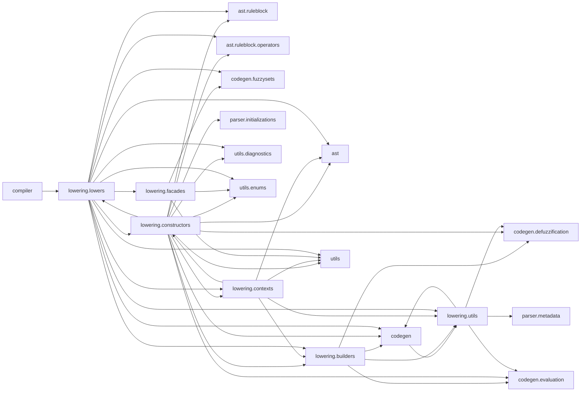
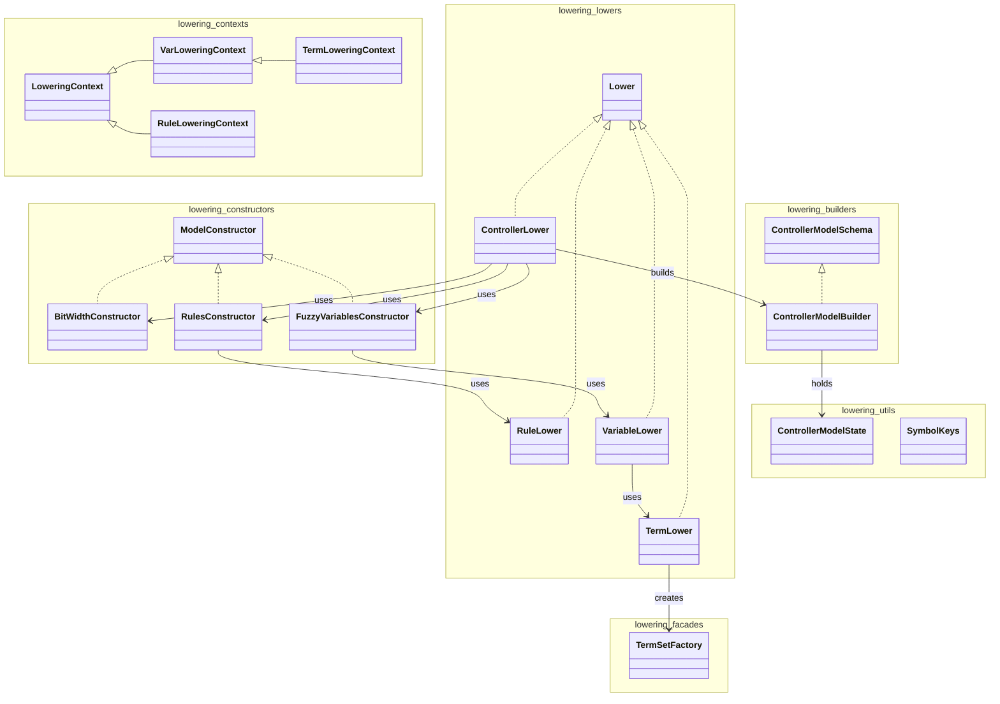
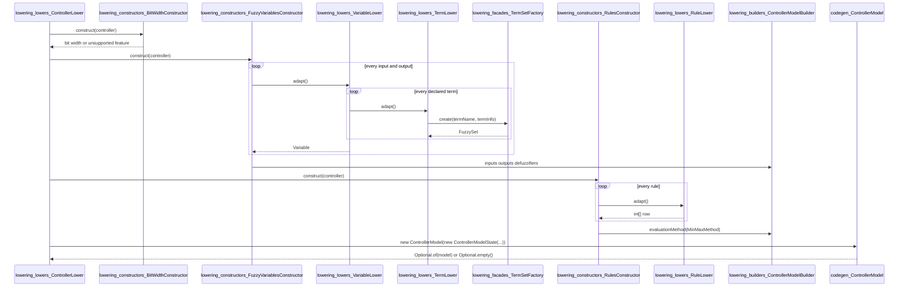

# Lowering

Translates the parser symbol table and RULEBLOCK AST into an immutable `codegen.ControllerModel` and reports unsupported FCL features.

Last update: 2026-11-04

## Purpose

The `lowering` package is the bridge between the parser output and the code generator input. It reads the symbol table, the `ast.AbstractSyntaxTree` of the rule block, and the declaration order of the function block variables, and produces a `codegen.ControllerModel`. The model is immutable: `codegen.ControllerModel` copies the input and output lists and the defuzzifier map into unmodifiable collections.

The entry point is:

```java
ControllerLower.newInstance(symbolTable, root, diagnostics).adapt()
```

`ControllerLower.newInstance` creates a `lowering.contexts.LoweringContext` with a `lowering.utils.SymbolKeys` built from the function block name. The symbol table is read-only for the lowerer: it calls `get` on it and never writes entries. The `@SuppressFBWarnings` on the `ControllerLower` constructor documents that the shared symbol table is intentional and that the lowering only reads it.

`adapt()` returns `Optional<ControllerModel>`. A supported program produces `Optional.of(model)`; any reported error produces `Optional.empty()` and leaves the diagnostics in the `DiagnosticsHandler`.

## Package Dependencies

Generated by `scripts/generate_diagrams.py lowering` in `doc/diagrams/lowering_package_flowchart.mmd`:



Every edge is an import dependency directed from the importing package to the imported package, taken from the `import` statements of `src/main/java/lowering/**/*.java` and from the imports of the `codegen` and `compiler` consumers.

The `codegen --> lowering_utils` edge is a back reference: `codegen.ControllerModel` imports `lowering.utils.ControllerModelState` for its constructor. The `compiler --> lowering_lowers` edge is the pipeline entry, where `compiler.FlcCompiler` calls `ControllerLower.newInstance(...).adapt()`.

## Class Structure

Generated by `scripts/generate_diagrams.py lowering` in `doc/diagrams/lowering_class_diagram.mmd`:



`Lower<T>` and `ModelConstructor` are interfaces. `Lower<T>` declares `Optional<T> adapt()` and is implemented by `ControllerLower`, `VariableLower`, `TermLower`, and `RuleLower`. `ModelConstructor` declares `boolean construct(ControllerModelBuilder)` and is implemented by the three pipeline stages. `ControllerModelSchema` is a third interface; it fixes the signature of the bit-width step and is implemented by `ControllerModelBuilder`.

The contexts form an inheritance chain: `LoweringContext` holds the symbol table, `SymbolKeys`, `DiagnosticsHandler`, and AST; `VarLoweringContext` extends it with a variable key and the `BitWidthConstructor`; `TermLoweringContext` extends `VarLoweringContext` with a term key; `RuleLoweringContext` extends `LoweringContext` directly with the builder, rule block name, rule number, and rule node.

The builder and factory roles are separate from the lowering strategy objects. `ControllerModelBuilder` accumulates the five model fields in a mutable `ControllerModelState` and can build a `ControllerModel`. `TermSetFactory` is a stateless factory that maps a parser term subtype to a `codegen.fuzzysets` instance.

## Class Table

| Class                                             | Responsibility                                                                                                                | Pattern        |
|---------------------------------------------------|-------------------------------------------------------------------------------------------------------------------------------|----------------|
| `lowering_builders_ControllerModelBuilder`        | Accumulates bit width, input and output lists, evaluation method, and defuzzifiers; exposes them through getters and `build`. | Builder        |
| `lowering_builders_ControllerModelSchema`         | Builder schema interface that fixes the signature of the bit-width step.                                                      | Builder schema |
| `lowering_constructors_BitWidthConstructor`       | Reads `PRAGMA bit_width`, validates the range, and answers whether a point fits in the selected width.                        | Strategy       |
| `lowering_constructors_FuzzyVariablesConstructor` | Lowers every input and output in declaration order and registers a centroid defuzzifier for each output.                      | Strategy       |
| `lowering_constructors_ModelConstructor`          | Interface of a pipeline stage that writes one part of the model into the builder.                                             | Strategy       |
| `lowering_constructors_RulesConstructor`          | Enforces one RULEBLOCK with `ACCU: MAX`, lowers every rule, and installs a `MinMaxMethod`.                                    | Strategy       |
| `lowering_contexts_LoweringContext`               | Carries the symbol table, symbol keys, diagnostics handler, and AST shared by the lowerers.                                   | Context        |
| `lowering_contexts_RuleLoweringContext`           | Adds the builder, RULEBLOCK name, rule number, and rule node to the base context.                                             | Context        |
| `lowering_contexts_TermLoweringContext`           | Adds the term key to the variable lowering context.                                                                           | Context        |
| `lowering_contexts_VarLoweringContext`            | Adds the variable key and bit-width constructor to the base context.                                                          | Context        |
| `lowering_facades_TermSetFactory`                 | Maps SINGLETON, LINEAR, TRIANGLE, or TRAPEZOID points to the matching `codegen.fuzzysets` object.                             | Factory        |
| `lowering_lowers_ControllerLower`                 | Entry point; runs the three constructors in order and returns the optional controller model.                                  | Facade         |
| `lowering_lowers_Lower`                           | Generic lowering step that returns an `Optional` of its target type.                                                          | Strategy       |
| `lowering_lowers_RuleLower`                       | Converts one rule AST into an `int[]` row of term indices with `-1` for unused cells.                                         | Strategy       |
| `lowering_lowers_TermLower`                       | Validates membership points and delegates shape creation to `TermSetFactory`.                                                 | Strategy       |
| `lowering_lowers_VariableLower`                   | Validates the FUZZIFY or DEFUZZIFY block and lowers every term of one variable.                                               | Strategy       |
| `lowering_utils_ControllerModelState`             | Mutable carrier of the five `ControllerModel` constructor fields.                                                             | Mutable state  |
| `lowering_utils_SymbolKeys`                       | Builds and resolves symbol table keys and strips the function block prefix from names.                                        | Naming policy  |

**Table sources:** `src/main/java/lowering/builders/ControllerModelBuilder.java`, `src/main/java/lowering/builders/ControllerModelSchema.java`, `src/main/java/lowering/constructors/BitWidthConstructor.java`, `src/main/java/lowering/constructors/FuzzyVariablesConstructor.java`, `src/main/java/lowering/constructors/ModelConstructor.java`, `src/main/java/lowering/constructors/RulesConstructor.java`, `src/main/java/lowering/contexts/LoweringContext.java`, `src/main/java/lowering/contexts/RuleLoweringContext.java`, `src/main/java/lowering/contexts/TermLoweringContext.java`, `src/main/java/lowering/contexts/VarLoweringContext.java`, `src/main/java/lowering/facades/TermSetFactory.java`, `src/main/java/lowering/lowers/ControllerLower.java`, `src/main/java/lowering/lowers/Lower.java`, `src/main/java/lowering/lowers/RuleLower.java`, `src/main/java/lowering/lowers/TermLower.java`, `src/main/java/lowering/lowers/VariableLower.java`, `src/main/java/lowering/utils/ControllerModelState.java`, and `src/main/java/lowering/utils/SymbolKeys.java`.

## Lowering Pipeline

`ControllerLower.adapt()` creates a `ControllerModelBuilder`, then runs the constructors in this fixed order:

1. `BitWidthConstructor`
2. `FuzzyVariablesConstructor`
3. `RulesConstructor`

Each constructor returns `false` when the program cannot be lowered. `adapt()` then returns `Optional.empty()` without running the later stages. On success it creates a `ControllerModelState` from the builder getters and passes it to `new ControllerModel(...)`.

### Bit Width

`BitWidthConstructor` reads the pragma key `MAIN@option#BIT_WIDTH` through `ctx.keys.pragma("bit_width")`.

* Pragma absent: the width is `DEFAULT_BIT_WIDTH = 8` and a `GeneratorWarning` reports `no PRAGMA bit_width in an OPTION block, using 8bits`.
* Pragma present: the constructor reads `((Initialization) pragma.initialValue).variableValue()` and parses it as an integer.
* Valid range: `ControllerModel.MIN_BIT_WIDTH = 1` to `ControllerModel.MAX_BIT_WIDTH = 30`. A value outside the range adds an `UnsupportedFeature` and sets the internal width to `-1`, so `construct` returns `false`.
* A non-numeric pragma value raises a `RuntimeException`; it is not converted into a diagnostic.

`analyzeIfRepresentable(BigDecimal)` returns `true` only when the width is valid and the point is strictly smaller than `1 << bitWidth`. A point equal to `2^N` is therefore rejected, as are larger points. Negative points are rejected separately by `TermLower`.

### Variables and Terms

`FuzzyVariablesConstructor` reads the function block entry with `ctx.symbolTable.get(ctx.keys.functionBlock())`. Its `parameters` list defines the inputs and outputs in declaration order. That order fixes both the controller signature and the output packing order.

For each parameter key it creates a `VarLoweringContext` and a `VariableLower`, then calls `adapt()`:

* `Source.IN` variables are appended to the input list; all others are appended to the output list.
* Every output gets a `new CentroidDefuzzifier()` stored in a `LinkedHashMap` under the short variable name.
* A variable that fails to lower sets `invalidController = true`; the loop continues so that diagnostics for the remaining variables are also collected.
* After the loop, an empty input list or an empty output list adds the `UnsupportedFeature` `the controller needs at least one input with FUZZIFY and one output with DEFUZZIFY`.
* If any variable failed, `construct` returns `false`; otherwise it stores the lists and defuzzifiers in the builder and returns `true`.

`VariableLower` performs the per-variable checks:

* It resolves the component key: `@fuzzifier` for inputs and `@defuzzifier` for outputs. A missing component adds `UnsupportedFeature` and aborts the variable.
* The variable must be `Type.SIMPLE` or `Type.SUBRANGE` with subtype `SINT`, `INT`, `DINT`, `LINT`, `USINT`, `UINT`, `UDINT`, or `ULINT`. `REAL` and every other type add `UnsupportedFeature` and abort the variable.
* For outputs, it first adds a `GeneratorWarning` that `DEFAULT` is ignored, then requires `Subtype.COGS`. Any other method adds `UnsupportedFeature` and aborts the variable.
* Every term in the component `parameters` list is lowered through `TermLower`. If any term fails, the whole variable fails.
* The result is a `codegen.Variable` built from the short name and the lowered sets. An output must contain only `SingletonFuzzySet` instances.

`TermLower` resolves the term key and checks the term subtype and points:

* `Subtype.VARIABLE` is rejected because points are given by variables.
* `Subtype.COMPLEX` is rejected as a shape the generator does not support.
* Every value in `termInfo.parameters` must be an integer. A non-zero value with a positive scale after `stripTrailingZeros` is reported as a non-integer point.
* A negative point or a point not representable with the selected width is reported with the `cannot be representable` message.
* Valid terms are passed to `TermSetFactory.create`.

`TermSetFactory` uses `termInfo.inferiorLimits` as the X coordinates and `termInfo.superiorLimits[0]` for the ramp direction:

| Subtype     | Points | Result                                                                       |
|-------------|--------|------------------------------------------------------------------------------|
| `SINGLETON` | 1      | `SingletonFuzzySet`                                                          |
| `LINEAR`    | 2      | `ZShapeFuzzySet` if `superiorLimits[0]` equals 1, otherwise `SShapeFuzzySet` |
| `TRIANGLE`  | 3      | `TriangularFuzzySet`                                                         |
| `TRAPEZOID` | 4      | `TrapezoidFuzzySet`                                                          |
| Other       | Any    | `IllegalArgumentException`                                                   |

### Rules

`RulesConstructor` reads `ctx.ast.children()` and requires exactly one rule block. Zero or more than one adds `UnsupportedFeature` and returns `false`.

For the single `RuleBlockNode`:

* The accumulation operator must be `Operator.MAX`; any other operator adds `UnsupportedFeature` and returns `false`.
* `accumulationMethod.children()` must not be empty; otherwise the rule block has no rules and the constructor returns `false`.
* Each rule is lowered by a `RuleLower` with a `RuleLoweringContext` that carries the rule block name and a one-based rule number. The first failing rule stops the loop and returns `false`.
* The lowered rows are wrapped in `new MinMaxMethod(loweredRules)` and stored as the evaluation method.

`RuleLower` converts one rule into an `int[inputCount + outputCount]` row:

* A `WithNode` is accepted only when its weight is numerically equal to `1`. Any other weight adds `UnsupportedFeature`. A plain `IfNode` needs no weight check.
* Conditions are flattened recursively. A single `IsNode` is one condition. An `OperatorNode` is accepted only with `Operator.MIN`; `MAX`, `ASUM`, and `BSUM` are reported as `OR`, any other operator is reported as an unsupported `AND`, and the children are flattened in order.
* `NotNode` is rejected. An `IdentifierNode` used as a condition is rejected as a variable used as a condition. Any other node is reported as an unexpected condition.
* The row is filled with `UNUSED = -1`. Conditions are placed in the input section starting at offset `0`; conclusions are placed in the output section starting at offset `inputKeys.size()`.
* Every conclusion must be an `IsNode`; any other conclusion adds `UnsupportedFeature`.
* A variable that is not in the input or output list, a term that does not belong to that variable, and a variable used more than once are reported as `UndeclaredReference`. This includes an output used in a condition and an input used in a conclusion, because each is looked up only in the list for its required direction.
* After all placements, every input cell and every output cell must have been written. An unused input or output adds `UnsupportedFeature` naming the variable, the rule, and the rule block.

### Model Construction

When all three constructors return `true`, `ControllerLower` builds the model with a new state object:

```java
new ControllerModel(new ControllerModelState(
        controller.bitWidth(),
        controller.inputs(),
        controller.outputs(),
        controller.evaluationMethod(),
        controller.defuzzifiers()))
```

The builder's own `build()` method is not used by `ControllerLower`; the getters are copied into a fresh `ControllerModelState`. `ControllerModel` then validates the bit-width range, the presence of at least one input and one output, the defuzzifier of every output, and the non-null evaluation method, and copies the collections into unmodifiable views.

## Diagnostics

All diagnostics go to the shared `utils.DiagnosticsHandler`. Errors stop model construction; the warning does not.

| Diagnostic            | Severity | Trigger                                                                     |
|-----------------------|----------|-----------------------------------------------------------------------------|
| `UnsupportedFeature`  | Error    | `PRAGMA bit_width` outside `1..30`.                                         |
| `UnsupportedFeature`  | Error    | No input with FUZZIFY or no output with DEFUZZIFY.                          |
| `UnsupportedFeature`  | Error    | Variable type is not an integer type.                                       |
| `UnsupportedFeature`  | Error    | Input without a FUZZIFY block.                                              |
| `UnsupportedFeature`  | Error    | Output without a DEFUZZIFY block.                                           |
| `UnsupportedFeature`  | Error    | Defuzzification method other than `CoGS`.                                   |
| `UnsupportedFeature`  | Error    | Output term is not a singleton.                                             |
| `UnsupportedFeature`  | Error    | Term points are given by variables.                                         |
| `UnsupportedFeature`  | Error    | Term shape is `COMPLEX`.                                                    |
| `UnsupportedFeature`  | Error    | Term point is not an integer.                                               |
| `UnsupportedFeature`  | Error    | Term point is negative or cannot be represented with the current bit width. |
| `UnsupportedFeature`  | Error    | RULEBLOCK count is not exactly one.                                         |
| `UnsupportedFeature`  | Error    | ACCU method is not `MAX`.                                                   |
| `UnsupportedFeature`  | Error    | RULEBLOCK has no rules.                                                     |
| `UnsupportedFeature`  | Error    | Rule uses `OR`.                                                             |
| `UnsupportedFeature`  | Error    | Rule uses `AND` other than `MIN`.                                           |
| `UnsupportedFeature`  | Error    | Rule uses `NOT`.                                                            |
| `UnsupportedFeature`  | Error    | Rule conclusion is not an `IS`.                                             |
| `UnsupportedFeature`  | Error    | Rule condition is a bare variable or an unexpected node.                    |
| `UnsupportedFeature`  | Error    | Rule weight `WITH` is not 1.                                                |
| `UnsupportedFeature`  | Error    | Input or output is not used in a rule.                                      |
| `GeneratorWarning`    | Warning  | No `PRAGMA bit_width`; the width defaults to 8.                             |
| `GeneratorWarning`    | Warning  | Output `DEFAULT` is ignored.                                                |
| `UndeclaredReference` | Error    | Rule variable is not declared for the required direction.                   |
| `UndeclaredReference` | Error    | Term is not declared for the variable.                                      |
| `UndeclaredReference` | Error    | Variable is used more than once in a rule.                                  |

Diagnostics are collected in the shared handler, but the stages do not all behave the same way. `ControllerLower.adapt()` stops after the first constructor that returns `false`, so later stages do not run. `FuzzyVariablesConstructor` continues through the remaining variables after a failure, which lets `ControllerLowerIT.Every_problem_is_reported_at_once` collect several `UnsupportedFeature` messages from one program. `RulesConstructor` stops at the first rule that fails.

## Symbol Keys

`lowering.utils.SymbolKeys` is the only class that knows how the parser names function block symbols. Names are upper-cased with `Locale.ROOT`. `shortName` removes everything through the last `#`, so `MAIN#ANGLE` becomes `ANGLE` and `MAIN#ANGLE#NL` becomes `NL`.

| Key                      | Meaning                                                                                    | Example                  |
|--------------------------|--------------------------------------------------------------------------------------------|--------------------------|
| `<FB>`                   | Function block entry; its `parameters` list holds inputs and outputs in declaration order. | `MAIN`                   |
| `<FB>#<VAR>`             | Variable entry.                                                                            | `MAIN#ANGLE`             |
| `<FB>#<VAR>@fuzzifier`   | FUZZIFY block of an input.                                                                 | `MAIN#ANGLE@fuzzifier`   |
| `<FB>#<VAR>@defuzzifier` | DEFUZZIFY block of an output.                                                              | `MAIN#ANGLE@defuzzifier` |
| `<FB>#<VAR>#<TERM>`      | Linguistic term of a variable.                                                             | `MAIN#ANGLE#NL`          |
| `<FB>@option#<NAME>`     | Pragma of an OPTION block.                                                                 | `MAIN@option#BIT_WIDTH`  |

The pragma key uses `parser.metadata.PragmaMetadata.SCOPE_SUFFIX`, whose value is `@option`.

## Supported Constructs and Restrictions

| Construct              | Accepted                                                                                            | Rejected                                                                                                                                       |
|------------------------|-----------------------------------------------------------------------------------------------------|------------------------------------------------------------------------------------------------------------------------------------------------|
| Bit width              | Integer `1..30` in `OPTION PRAGMA bit_width`; absent means 8 with a warning.                        | Values outside `1..30`; non-numeric values raise a runtime exception.                                                                          |
| Variable types         | `SIMPLE` or `SUBRANGE` of `SINT`, `INT`, `DINT`, `LINT`, `USINT`, `UINT`, `UDINT`, or `ULINT`.      | `REAL` and every other type.                                                                                                                   |
| Blocks                 | FUZZIFY for every input; DEFUZZIFY for every output.                                                | A missing block for any input or output.                                                                                                       |
| Defuzzification method | `METHOD : CoGS`.                                                                                    | Any other method.                                                                                                                              |
| Output terms           | Singletons only.                                                                                    | Ramps, triangles, trapezoids, and any non-singleton output term.                                                                               |
| RULEBLOCK count        | Exactly one.                                                                                        | Zero or more than one.                                                                                                                         |
| Accumulation           | `ACCU : MAX`.                                                                                       | Any other ACCU method.                                                                                                                         |
| Rules                  | `IF` conditions `THEN` conclusions; `AND : MIN`; `WITH` weight 1; every input and output used once. | `OR`, `NOT`, other `AND` methods, weights other than 1, non-`IS` conclusions, empty rule blocks, repeated variables, unused inputs or outputs. |
| Points                 | Integers `x` with `0 <= x < 2^N`.                                                                   | Points given by variables or functions, non-integers, negative values, and values `>= 2^N`.                                                    |
| Term shapes            | `SINGLETON`, `LINEAR`, `TRIANGLE`, `TRAPEZOID`.                                                     | `COMPLEX` and terms whose points are variables.                                                                                                |

## Lowering Sequence

Generated by `scripts/generate_diagrams.py lowering` in `doc/diagrams/lowering_controller_sequence.mmd`:



The sequence shows the fixed constructor order. The bit-width stage runs first because term validation needs the width. `FuzzyVariablesConstructor` then lowers every declared input and output, and for each one `VariableLower` lowers all its terms through `TermLower` and `TermSetFactory`. Only after the variables are in the builder does `RulesConstructor` run, because `RuleLower` needs the ordered input and output lists to place each term index in the right row cell.

## Charts

Chart: `assets/lowering_overview.png` — type distribution of the lowering package: 18 types, with builders 2, constructors 4, contexts 4, facades 1, lowers 5, and utils 2.

Chart: `assets/loc_per_module.png` — non-comment lines of code per module from `src/main/java`; lowering has 1046 lines across 18 source files.

Chart: `assets/cyclomatic_complexity.png` — average cyclomatic complexity per module; lowering averages 2.6 over 41 estimated methods, with total complexity 107.

Chart: `assets/test_coverage.png` — line coverage per package; lowering reaches 89% line coverage, equal to the overall 89%.

## How to Test

| Test class                                      | Coverage                                                                                                                                                                                                                                                                      |
|-------------------------------------------------|-------------------------------------------------------------------------------------------------------------------------------------------------------------------------------------------------------------------------------------------------------------------------------|
| `integration.lowering.ControllerLowerIT`        | Starts from a supported program with two inputs, one output, and two rules, then changes one part per test. Covers declaration order, term shapes, rule rows, the `DEFAULT` warning, the missing-pragma warning, every unsupported case, and every undeclared-reference case. |
| `integration.simulation.ControllerSimulationIT` | Builds models through `ControllerLower.newInstance(...).adapt()` and compares `QuantizedSimulator` against `ReferenceSimulator` on the pendulum and truck examples, including the case where no rule fires.                                                                   |

Run the full suite:

```bash
mvn -q test
```

Run only the lowering integration tests:

```bash
mvn -q -Dtest=ControllerLowerIT test
```

Run only the simulation integration tests that consume the lowering output:

```bash
mvn -q -Dtest=ControllerSimulationIT test
```

## File Tree

```text
src/main/java/lowering/
├── package-info.java
├── builders/
│   ├── ControllerModelBuilder.java
│   └── ControllerModelSchema.java
├── constructors/
│   ├── BitWidthConstructor.java
│   ├── FuzzyVariablesConstructor.java
│   ├── ModelConstructor.java
│   └── RulesConstructor.java
├── contexts/
│   ├── LoweringContext.java
│   ├── RuleLoweringContext.java
│   ├── TermLoweringContext.java
│   └── VarLoweringContext.java
├── facades/
│   └── TermSetFactory.java
├── lowers/
│   ├── ControllerLower.java
│   ├── Lower.java
│   ├── RuleLower.java
│   ├── TermLower.java
│   └── VariableLower.java
└── utils/
    ├── ControllerModelState.java
    └── SymbolKeys.java
```

## Usage in Thesis

This module feeds `doc/thesis/04.2-lowering.md`, which describes the lowering phase, its classes, and its diagnostics. It is adjacent to `doc/thesis/04.1-arbol-sintaxis-ruleblock.md`, which defines the AST consumed here; `doc/thesis/04.3-generacion-codigo.md`, which consumes the `ControllerModel` produced here; and `doc/thesis/04.5-pipeline-compilador.md`, which places lowering between parsing and code generation.
