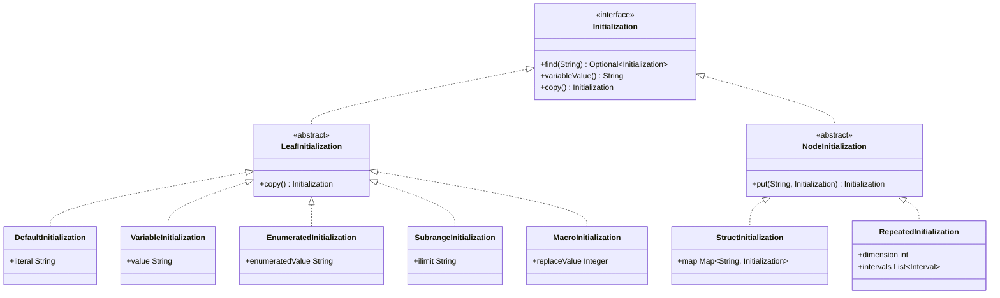
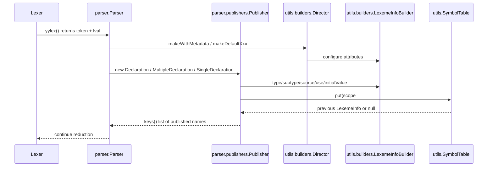
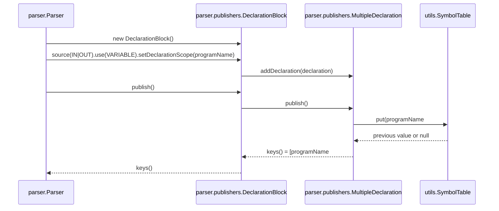
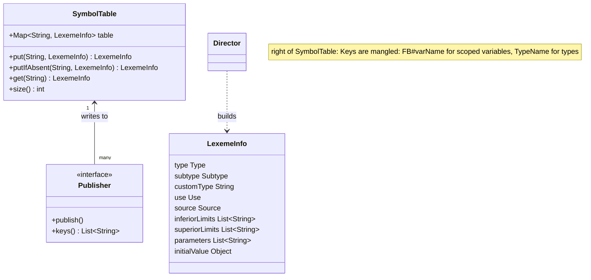

# Parser Module Documentation

One-line description: The IEC 61131-7 parser builds on Bison-generated LALR(1) grammar (Parser.y) to drive syntax analysis, publish symbol declarations to the symbol table, and construct initializations and rule-block ASTs.

Last update: 2026-10-29

## Purpose

The parser package (`parser` and subpackages) consumes tokens from the lexer through the Bison-generated `Parser` class, executes semantic actions bound to grammar reductions, and populates the `utils.SymbolTable` through `Publisher` implementations. It owns declaration publishing, type metadata, initializations (primitive, enumerated, subrange, array, struct, macro), fuzzify/defuzzify/rule-block linguistic terms, and facade utilities for array ranges, dimensions, macros, identifiers, and membership-function classification.

## Package Diagram

```mermaid
flowchart TD
    lexer_Lexer:::external --> parser_Parser
    parser_Parser --> utils_SymbolTable:::util
    parser_Parser --> utils_DiagnosticsHandler:::util
    parser_Parser --> utils_builders_Director:::builder
    parser_Parser --> utils_builders_LexemeInfoBuilder:::builder
    parser_Parser --> parser_facades_RuleblockASTBuilder:::facade
    parser_publishers_Publisher:::pub --> utils_SymbolTable
    parser_publishers_Publisher:::pub --> utils_builders_LexemeInfoMutator:::builder
    parser_publishers_Declaration:::pub --> parser_publishers_Publisher
    parser_initializations_Factory:::init --> utils_builders_Director
    parser_initializations_Initialization:::init --> parser_initializations_leafs_DefaultInitialization
    parser_initializations_Initialization:::init --> parser_initializations_nodes_StructInitialization
    parser_initializations_Initialization:::init --> parser_initializations_nodes_RepeatedInitialization
    classDef external fill:#e1f5e1,stroke:#333;
    classDef util fill:#fff3e0,stroke:#333;
    classDef builder fill:#e3f2fd,stroke:#333;
    classDef pub fill:#fce4ec,stroke:#333;
    classDef facade fill:#e8eaf6,stroke:#333;
    classDef init fill:#f3e5f5,stroke:#333;
```



The flow moves from the lexer into `parser_Parser`, which coordinates `utils_builders_Director` and `utils_builders_LexemeInfoBuilder` recipes, delegates declaration publishing to `parser_publishers_Publisher` implementations, and writes results into `utils_SymbolTable`. Metadata objects implement `utils_builders_LexemeInfoView` to describe symbol attributes.

## Class Diagram

```mermaid
classDiagram
    %% parser
    class parser_Parser {
        <<Bison>> <<LLR1>> <<parser>>
        +Parser(Lexer, SymbolTable)
        +getNumberOfErrors() int
        symbolTable SymbolTable
        programName String
        ast AbstractSyntaxTree
    }
    parser_Parser ..|> parser_publishers_Publisher : uses
    parser_Parser ..|> parser_facades_RuleblockASTBuilder : uses

    %% parser.publishers
    namespace parser_publishers {
        class Publisher {
            <<interface>>
            +setDeclarationScope(String)
            +publish()
            +keys() List~String~
        }
        class Declaration {
            <<abstract>>
            +setDeclarationScope(String)
            +type(Type) Declaration
            +subtype(Subtype) Declaration
            +customType(String) Declaration
            +source(Source) Declaration
            +use(Use) Declaration
            +inferiorLimits(List~String~) Declaration
            +superiorLimits(List~String~) Declaration
            +parameters(List~String~) Declaration
            +initialValue(Object) Declaration
            builder LexemeInfoBuilder
        }
        class DeclarationGroup {
            +setDeclarationScope(String)
            +publish()
            +keys() List~String~
            declarations List~Declaration~
        }
        class DeclarationBlock {
            +addDeclaration(Declaration)
        }
        class MultipleDeclaration {
            +publish()
            +keys() List~String~
            symbolTable SymbolTable
            identifiers List~String~
        }
        class SingleDeclaration {
            +identifier(String) SingleDeclaration
            +publish()
            +keys() List~String~
            symbolTable SymbolTable
            identifier String
        }
        class ComponentDeclaration {
            +source(Source) ComponentDeclaration
            +publish()
            termDeclarations TermBlock
        }
        class StructureDeclaration {
            +identifier(String) StructureDeclaration
            +publish()
            structBlock StructureBlock
        }
        class EnumeratedTypeDeclaration {
            +publish()
        }
        class StructureBlock {
            +addField(SingleDeclaration)
            +getInitializationInfo() List~PathInitializationInfo~
        }
        class TermBlock {
            +addTerm(SingleDeclaration)
            +getTermNames() List~String~
        }
        class AnnonymousEnumeratedVariable {
            +publish()
        }
        class AnnonymousEnumeratedField {
            +publish()
        }
    }
    Publisher <|.. Declaration
    DeclarationGroup <|.. DeclarationBlock
    DeclarationGroup <|.. StructureBlock
    DeclarationGroup <|.. TermBlock
    Declaration <|.. MultipleDeclaration
    Declaration <|.. SingleDeclaration
    SingleDeclaration <|.. ComponentDeclaration
    SingleDeclaration <|.. StructureDeclaration
    SingleDeclaration <|.. EnumeratedTypeDeclaration
    MultipleDeclaration <|.. AnnonymousEnumeratedVariable
    SingleDeclaration <|.. AnnonymousEnumeratedField

    %% parser.facades
    namespace parser_facades {
        class DimensionCalculator {
            <<utility>>
            +calculate(List~String~, List~String~) int
        }
        class RangesParser {
            <<utility>>
            +parse(List~String~, List~String~, List~String~) void
        }
        class MacrosPublisher {
            +publish(SymbolTable, List~String~, String) void
        }
        class IdentifierParser {
            +parse(String, String) ParsedIdentifier
        }
        class MembershipFunctionClassifier {
            +classify(List~String~, List~String~) MembershipFunctionShape
        }
        class RuleblockASTBuilder {
            +build(TreeNode, List~Operator~) RuleBlockNode
        }
    }

    %% parser.initializations
    namespace parser_initializations {
        class Initialization {
            <<interface>>
            +find(String) Optional~Initialization~
            +variableValue() String
            +copy() Initialization
        }
        class Factory {
            <<utility>>
            +createPrimitiveInitialization(SymbolTable, Subtype) DefaultInitialization
        }
    }
    namespace parser_initializations_leafs {
        class LeafInitialization {
            <<abstract>>
            +find(String) Optional~Initialization~
            +copy() Initialization
        }
        class DefaultInitialization {
            +bool(SymbolTable) DefaultInitialization
            +real(SymbolTable) DefaultInitialization
            +integer(SymbolTable) DefaultInitialization
            +string(SymbolTable) DefaultInitialization
            +wstring(SymbolTable) DefaultInitialization
        }
        class VariableInitialization {
            +VariableInitialization(String)
            +variableValue() String
        }
        class EnumeratedInitialization {
            +EnumeratedInitialization(List~String~)
            +variableValue() String
        }
        class SubrangeInitialization {
            +SubrangeInitialization(String, String)
            +variableValue() String
        }
        class MacroInitialization {
            +MacroInitialization(SymbolTable, Integer)
            +variableValue() String
        }
    }
    namespace parser_initializations_nodes {
        class NodeInitialization {
            <<abstract>>
            +put(String, Initialization) Initialization
            +find(String) Optional~Initialization~
        }
        class StructInitialization {
            +put(String, Initialization) Initialization
            +find(String) Optional~Initialization~
            +variableValue() String
        }
        class RepeatedInitialization {
            +put(String, Initialization) Initialization
            +find(String) Optional~Initialization~
            +variableValue() String
        }
    }
    Initialization <|.. LeafInitialization
    Initialization <|.. NodeInitialization
    LeafInitialization <|.. DefaultInitialization
    LeafInitialization <|.. VariableInitialization
    LeafInitialization <|.. EnumeratedInitialization
    LeafInitialization <|.. SubrangeInitialization
    LeafInitialization <|.. MacroInitialization
    NodeInitialization <|.. StructInitialization
    NodeInitialization <|.. RepeatedInitialization
    Factory ..> DefaultInitialization : creates

    %% utils
    namespace utils {
        class SymbolTable {
            +put(String, LexemeInfo) LexemeInfo
            +putIfAbsent(String, LexemeInfo) LexemeInfo
            +get(String) LexemeInfo
            +size() int
        }
        class LexemeInfo {
            type Type
            subtype Subtype
            customType String
            use Use
            source Source
            inferiorLimits List~String~
            superiorLimits List~String~
            parameters List~String~
            initialValue Object
        }
    }
    namespace utils_builders {
        class Director {
            <<utility>>
            +makeWithMetadata(LexemeInfoMutator, LexemeInfoView) void
            +makeLiteral(LexemeInfoMutator) void
            +makeIntegerZeroConstant(LexemeInfoMutator) String
            +makeDefaultInteger(LexemeInfoMutator) String
            +makeDefaultReal(LexemeInfoMutator) String
            +makeDefaultBoolean(LexemeInfoMutator) String
            +makeTrueBoolean(LexemeInfoMutator) String
            +makeDefaultString(LexemeInfoMutator) String
            +makeDefaultWString(LexemeInfoMutator) String
        }
        class LexemeInfoBuilder {
            <<implements>> LexemeInfoMutator, LexemeInfoView
            +build() LexemeInfo
        }
        class LexemeInfoMutator {
            <<interface>>
            +type(Type) LexemeInfoMutator
            +subtype(Subtype) LexemeInfoMutator
            +customType(String) LexemeInfoMutator
            +source(Source) LexemeInfoMutator
            +use(Use) LexemeInfoMutator
            +inferiorLimits(List~String~) LexemeInfoMutator
            +superiorLimits(List~String~) LexemeInfoMutator
            +parameters(List~String~) LexemeInfoMutator
            +initialValue(Object) LexemeInfoMutator
        }
        class LexemeInfoView {
            <<interface>>
            +type() Type
            +subtype() Subtype
            +customType() String
            +source() Source
            +use() Use
            +inferiorLimits() List~String~
            +superiorLimits() List~String~
            +parameters() List~String~
            +initialValue() Object
        }
    }
    LexemeInfoBuilder ..|> LexemeInfoMutator : implements
    LexemeInfoBuilder ..|> LexemeInfoView : implements
    Publisher ..|> LexemeInfoMutator : extends
    Declaration ..> LexemeInfoBuilder : holds
```



## Class Table

| Class                                                 | Responsibility                                                                                           | Pattern          |
|-------------------------------------------------------|----------------------------------------------------------------------------------------------------------|------------------|
| parser_Parser                                         | Bison-generated LALR(1) parser; drives syntax analysis and invokes semantic actions that publish symbols | Parser           |
| parser_publishers_Publisher                           | Interface declaring setDeclarationScope, publish, and keys; extends LexemeInfoMutator                    | Interface        |
| parser_publishers_Declaration                         | Abstract base holding a LexemeInfoBuilder and exposing fluent mutator setters                            | Abstract base    |
| parser_publishers_DeclarationGroup                    | Groups multiple declarations and forwards mutator/publish/keys calls to each                             | Composite        |
| parser_publishers_DeclarationBlock                    | Groups IO variable declarations (VAR_INPUT / VAR_OUTPUT)                                                 | Composite        |
| parser_publishers_MultipleDeclaration                 | Publishes several identifiers sharing the same type and attributes                                       | Composite        |
| parser_publishers_SingleDeclaration                   | Publishes a single identifier under scope#name key                                                       | Composite        |
| parser_publishers_ComponentDeclaration                | Publishes a fuzzifier or defuzzifier component together with its term block                              | Composite        |
| parser_publishers_StructureDeclaration                | Publishes a structure declaration and delegates to its field block                                       | Composite        |
| parser_publishers_EnumeratedTypeDeclaration           | Publishes an enumerated type and registers its enum macros                                               | Composite        |
| parser_publishers_StructureBlock                      | Groups structure field declarations and exposes initialization info per field                            | Composite        |
| parser_publishers_TermBlock                           | Groups linguistic terms and exposes term names                                                           | Composite        |
| parser_publishers_AnnonymousEnumeratedVariable        | Publishes an anonymous enumerated variable and its enum literal macros                                   | Composite        |
| parser_publishers_AnnonymousEnumeratedField           | Publishes an anonymous enumerated field and its enum literal macros                                      | Composite        |
| parser_facades_DimensionCalculator                    | Computes total array element count as product of dimension sizes                                         | Utility Facade   |
| parser_facades_RangesParser                           | Splits alternating range tokens into inferior and superior limit lists                                   | Utility Facade   |
| parser_facades_MacrosPublisher                        | Publishes enumerated macro literals under a scope prefix                                                 | Facade           |
| parser_facades_IdentifierParser                       | Splits an identifier into scope and name using the # separator (inline mangling)                         | Utility Facade   |
| parser_facades_MembershipFunctionClassifier           | Classifies membership function shape from point/degree lists                                             | Utility Facade   |
| parser_facades_RuleblockASTBuilder                    | Builds the rule-block AST from a TreeNode using operator configuration                                   | Builder          |
| parser_initializations_Initialization                 | Interface for path-based lookup, value rendering, and copying                                            | Composite        |
| parser_initializations_Factory                        | Static utility creating default primitive initializations for BOOL/INT/REAL/STRING/WSTRING               | Factory          |
| parser_initializations_leafs_LeafInitialization       | Abstract base for atomic (leaf) initializations; find resolves only empty path                           | Abstract base    |
| parser_initializations_leafs_DefaultInitialization    | Default literal initialization registered in the symbol table via Director                               | Factory method   |
| parser_initializations_leafs_VariableInitialization   | Initialization referencing another variable by name                                                      | Leaf             |
| parser_initializations_leafs_EnumeratedInitialization | Initialization holding the selected enumerated literal                                                   | Leaf             |
| parser_initializations_leafs_SubrangeInitialization   | Lower bound initialization for a subrange type                                                           | Leaf             |
| parser_initializations_leafs_MacroInitialization      | Enum literal macro; registers an INT literal in the symbol table                                         | Leaf             |
| parser_initializations_nodes_NodeInitialization       | Abstract base for composite initializations supporting put and find                                      | Abstract base    |
| parser_initializations_nodes_StructInitialization     | Struct initialization with named fields and nested path access                                           | Composite        |
| parser_initializations_nodes_RepeatedInitialization   | Array initialization over disjoint contiguous intervals                                                  | Composite        |
| parser_metadata_FunctionBlockMetadata                 | Symbol table entry of the function block; parameters are interface variable keys                         | Metadata View    |
| parser_metadata_PrimitiveMetadata                     | Primitive type metadata with default initialization from Factory                                         | Metadata View    |
| parser_metadata_ArrayMetadata                         | Array metadata with bounds and RepeatedInitialization default                                            | Metadata View    |
| parser_metadata_StringMetadata                        | String metadata with length bounds and default initialization                                            | Metadata View    |
| parser_metadata_EnumeratedMetadata                    | Enumerated type metadata with parameter values                                                           | Metadata View    |
| parser_metadata_SubrangeMetadata                      | Subrange metadata with inferior/superior limits                                                          | Metadata View    |
| parser_metadata_StructureMetadata                     | Structure metadata with field names and StructInitialization                                             | Metadata View    |
| parser_metadata_MacroMetadata                         | Macro metadata registering an enum ordinal literal                                                       | Metadata View    |
| parser_metadata_CustomMetadata                        | Custom type metadata copying the referenced type's initial value                                         | Metadata View    |
| parser_metadata_TermMetadata                          | Linguistic term metadata with classified membership-function shape                                       | Metadata View    |
| parser_metadata_FuzzifierMetadata                     | Fuzzifier component metadata listing term names                                                          | Metadata View    |
| parser_metadata_DefuzzifierMetadata                   | Defuzzifier component metadata with range, terms, and default value                                      | Metadata View    |
| parser_metadata_PragmaMetadata                        | Pragma entry under <fb>@option#<NAME> with value literal key                                             | Metadata View    |
| parser_tree_TreeNode                                  | Tree node with label, symbol reference, and children for rule blocks                                     | Tree Composite   |
| parser_tree_Label                                     | Enumeration of rule-block tree labels (AND, OR, IF, IS, NOT, ...)                                        | Enum             |
| parser_utils_ParsedIdentifier                         | Holds mangled complete name, scope, and base identifier                                                  | Value object     |
| parser_utils_PathInitializationInfo                   | Pairs a field name with its initialization value                                                         | Value object     |
| parser_utils_ConditionParsingContext                  | Builds a condition tree from operands and operators during parsing                                       | Context          |
| parser_utils_ArrayParsingContext                      | Holds max array value and per-path initialization info                                                   | Context          |
| parser_utils_MembershipFunctionShape                  | Recognized membership-function subtype and defining x coordinates                                        | Value object     |
| utils_builders_Director                               | Predefined recipes (makeLiteral, makeDefaultXxx, makeWithMetadata) for LexemeInfo                        | Director Builder |
| utils_builders_LexemeInfoBuilder                      | Fluent builder implementing LexemeInfoMutator and LexemeInfoView                                         | Builder          |
| utils_builders_LexemeInfoMutator                      | Fluent interface to set LexemeInfo semantic attributes                                                   | Fluent interface |
| utils_builders_LexemeInfoView                         | Read-only view of LexemeInfo attributes                                                                  | View             |
| utils_SymbolTable                                     | Map from symbol name to LexemeInfo; put, putIfAbsent, get, size                                          | Registry         |
| utils_LexemeInfo                                      | Immutable DTO holding type, subtype, customType, use, source, limits, parameters, initialValue           | Value object     |

Excluded: deprecated LucaInfo (utils.LucaInfo) and local-only Parser.y / Luca.y references per EXCLUDE_PATTERNS. Old classes ContextHandler, ParsingContext, NameMangler do not exist.

## Sources by Subpackage

| Subpackage                   | Directory                                   |
|------------------------------|---------------------------------------------|
| parser                       | src/main/java/parser/                       |
| parser.publishers            | src/main/java/parser/publishers/            |
| parser.facades               | src/main/java/parser/facades/               |
| parser.initializations       | src/main/java/parser/initializations/       |
| parser.initializations.leafs | src/main/java/parser/initializations/leafs/ |
| parser.initializations.nodes | src/main/java/parser/initializations/nodes/ |
| parser.metadata              | src/main/java/parser/metadata/              |
| parser.tree                  | src/main/java/parser/tree/                  |
| parser.utils                 | src/main/java/parser/utils/                 |
| utils.builders               | src/main/java/utils/builders/               |
| utils                        | src/main/java/utils/                        |

## Architecture Overview

The parser follows a Publisher + Director + Builder architecture. The Bison-generated `Parser` reduces grammar rules and, in semantic actions, builds `Publisher` instances, configures them through `Director` recipes and `LexemeInfoBuilder`, then calls `publish()` to write into `utils.SymbolTable`. Mangling (`FB#varName` for scoped variables, `TypeName` for types) is inline in Publisher implementations and `IdentifierParser`; there is no separate NameMangler class.

```
                 Parser.y semantic action
                        |
                        v
                 +-------------+
                 |   Director  |  makeWithMetadata / makeDefaultXxx recipes
                 +-------------+
                        |
                        v (configures)
                 +-------------+
                 | LexemeInfo  |  fluent build of semantic attributes
                 |   Builder   |
                 +-------------+
                        |
                        v (passed to)
                 +-------------+        publish()        +--------------+
                 |  Publisher  | ----------------------> | SymbolTable  |
                 | (Declaration|        keys()           | (LexemeInfo) |
                 |  / Multiple)|                          +--------------+
                 +-------------+
                        |
                        v (inline mangling scope#name)
                 SymbolTable keys e.g. MAIN#X, MAIN#Y
```

## Key Components

### LexemeInfoMutator

`utils.builders.LexemeInfoMutator` is the fluent interface for setting semantic attributes on a lexeme: `type`, `subtype`, `customType`, `source`, `use`, `inferiorLimits`, `superiorLimits`, `parameters`, `initialValue`. Every setter returns the mutator for chaining. `parser.publishers.Publisher` extends this interface, so publishers can be configured with the same fluent API before publishing.

### LexemeInfoBuilder

`utils.builders.LexemeInfoBuilder` implements both `LexemeInfoMutator` and `LexemeInfoView`. It holds the mutable attributes (`type`, `subtype`, `customType`, `use`, `source`, `inferiorLimit`, `superiorLimit`, `parameters`, `initialValue`) and `build()` produces an immutable `utils.LexemeInfo`. Used by `Declaration` and directly in semantic actions (e.g. linguistic terms).

### Director

`utils.builders.Director` is a static utility providing predefined recipes:

| Recipe                         | Effect                                                               |
|--------------------------------|----------------------------------------------------------------------|
| makeWithMetadata(schema, view) | Copies all attributes from a LexemeInfoView into a LexemeInfoMutator |
| makeLiteral(schema)            | Sets type=SIMPLE, use=LITERAL, source=NONE                           |
| makeDefaultInteger(schema)     | Returns "0"; subtype INT, initialValue 0                             |
| makeDefaultReal(schema)        | Returns "0.0"; subtype REAL, initialValue 0.0                        |
| makeDefaultBoolean(schema)     | Returns "FALSE"; subtype BOOL, initialValue false                    |
| makeTrueBoolean(schema)        | Returns "TRUE"; subtype BOOL, initialValue true                      |
| makeDefaultString(schema)      | Returns "''"; subtype STRING, initialValue ""                        |
| makeDefaultWString(schema)     | Returns '""'; subtype WSTRING, initialValue ""                       |

These recipes guarantee consistent literal/default registration across semantic actions.

### Publisher Hierarchy

`parser.publishers.Publisher` (interface) declares `setDeclarationScope(String)`, `publish()`, and `List<String> keys()`. It extends `LexemeInfoMutator`.

```
Publisher (interface)
├── Declaration (abstract)  -- holds LexemeInfoBuilder
│   ├── MultipleDeclaration  -- many identifiers, same attributes
│   ├── SingleDeclaration    -- one identifier, key scope#name
│   │   ├── ComponentDeclaration  -- fuzzifier/defuzzifier + terms
│   │   ├── StructureDeclaration  -- struct + field block
│   │   ├── EnumeratedTypeDeclaration -- enum + macro registration
│   │   └── AnnonymousEnumeratedField -- anonymous enum field + macros
│   └── DeclarationGroup (composite)
│       ├── DeclarationBlock  -- IO variable declarations
│       ├── StructureBlock    -- struct fields + init info
│       └── TermBlock         -- linguistic terms
└── MultipleDeclaration
    └── AnnonymousEnumeratedVariable -- anonymous enum variable + macros
```

Keys are mangled inline: scoped variables use `FB#varName`, types use `TypeName`. Example: `x, y : INT` in block `MAIN` publishes as `MAIN#X`, `MAIN#Y`.

### Factory and Initialization Hierarchy

`parser.initializations.Factory.createPrimitiveInitialization(SymbolTable, Subtype)` returns a `DefaultInitialization` and supports BOOL, REAL/LREAL, STRING, WSTRING, and all integer subtypes SINT through ULINT (throws IllegalArgumentException otherwise).

```
Initialization (interface: find, variableValue, copy)
├── LeafInitialization (abstract; find only empty path)
│   ├── DefaultInitialization   -- BOOL / INT / REAL / STRING / WSTRING default
│   ├── VariableInitialization  -- reference to another variable
│   ├── EnumeratedInitialization -- selected enum literal
│   ├── SubrangeInitialization  -- lower bound of subrange
│   └── MacroInitialization     -- enum ordinal, registered as INT literal
└── NodeInitialization (abstract; put / find over paths)
    ├── StructInitialization    -- named fields, nested # paths
    └── RepeatedInitialization  -- array over disjoint intervals
```

Path syntax uses `#` as separator (e.g. `RGB#R`, `2#X`, `0..3#field`).

## Charts

Chart: `assets/parser_grammar_stats.png` — Bison grammar statistics: declared tokens, non-terminals, and initialization types, counted from `src/main/java/parser/Parser.y` and `src/main/java/parser/Parser.java`.
Chart: `assets/loc_per_module.png` — non-comment lines of code per module (lexer, parser, utils), counted from `src/main/java`.
Chart: `assets/cyclomatic_complexity.png` — average cyclomatic complexity per package, estimated from decision points in `src/main/java`.

## Supported Grammar Summary

### Grammar Metrics

| Metric               | Value           | Source                                                           |
|----------------------|-----------------|------------------------------------------------------------------|
| Declared tokens      | 82              | Parser.java SymbolKind terminals TYPE..ARRAY                     |
| Non-terminals        | 141             | Parser.java SymbolKind S_YYACCEPT..last production               |
| Initialization types | 7               | Default, Variable, Enumerated, Subrange, Macro, Struct, Repeated |
| Parser generator     | GNU Bison 3.8.2 | Parser.java bisonVersion                                         |

### Main IEC 61131-7 Blocks

| Block                 | Tokens                                   | Purpose                                   |
|-----------------------|------------------------------------------|-------------------------------------------|
| Function block        | FUNCTION_BLOCK ... END_FUNCTION_BLOCK    | Top-level program unit with name and body |
| Fuzzify               | FUZZIFY ... END_FUZZIFY                  | Linguistic fuzzifier component            |
| Defuzzify             | DEFUZZIFY ... END_DEFUZZIFY              | Linguistic defuzzifier component          |
| Rule block            | RULEBLOCK ... END_RULEBLOCK              | Fuzzy rule with operators and activation  |
| Option                | OPTION ... END_OPTION                    | Manufacturer-specific pragmas             |
| Variable declarations | VAR / VAR_INPUT / VAR_OUTPUT ... END_VAR | Declared variables with scope             |

### Fuzzify / Defuzzify

Fuzzify blocks declare linguistic terms (`TERM name := value;` or membership functions) and are published as components with source FUZZIFY. Defuzzify blocks add an optional `RANGE ( lo .. hi );`, a default value, and a defuzzification method (COG, COGS, COA, LM, RM) and are published with source DEFUZZIFY. Both register term names as parameters.

### Rule Block

A rule block declares OR/AND operators, an activation method, an accumulation method, and rules (`IF condition WITH body`). The parser builds a `TreeNode` via `ConditionParsingContext` and converts it to a `RuleBlockNode` AST using `RuleblockASTBuilder` with an operator configuration list.

### Variable Declarations Annex B

Variables are declared under `VAR`, `VAR_INPUT`, or `VAR_OUTPUT` with optional RETAIN/NON_RETAIN retain spec and an initialization list. Each `DeclarationBlock` is configured with source (IN/OUT), use VARIABLE, declaration scope (function block name), then published. Keys are `scope#identifier`.

### Data Types

Elementary types: BOOL, SINT/INT/DINT/LINT, USINT/UINT/UDINT/ULINT, REAL/LREAL, STRING, WSTRING, TIME, DATE, DATE_AND_TIME, TIME_OF_DAY, BYTE/WORD/DWORD/LWORD, plus bit-string and date types. User-defined types: enumerated, subrange, array, structure.

### Initializations

Initialization grammar covers simple spec (numeric/string/boolean constant), boolean spec (edge), custom spec (constant/identifier/structure), enumerated spec, array spec (with repeated initial elements), structure spec (field inits), string spec, and standard function block spec.

### Data Type Declaration

`TYPE ... END_TYPE` encloses a list of type declarations (`type_name_declaration`), each with a type specification (structure, enumerated, subrange, array, string).

## Key Semantic Actions

Excerpt from `src/main/java/parser/Parser.y` (reflected in generated `Parser.java`):

| Grammar rule                               | Semantic action                                                                                                                                                                                                                                                       | Effect                                                                   |
|--------------------------------------------|-----------------------------------------------------------------------------------------------------------------------------------------------------------------------------------------------------------------------------------------------------------------------|--------------------------------------------------------------------------|
| function_block_declaration                 | `SingleDeclaration functionBlock = new SingleDeclaration(symbolTable); Director.makeWithMetadata(functionBlock, new FunctionBlockMetadata(list)); functionBlock.identifier(programName).publish();`                                                                   | Publishes the function block under its name with interface variable keys |
| io_var_decl: VAR_INPUT                     | `yyval = Source.IN;`                                                                                                                                                                                                                                                  | Sets input source direction                                              |
| io_var_decl: VAR_OUTPUT                    | `yyval = Source.OUT;`                                                                                                                                                                                                                                                 | Sets output source direction                                             |
| fb_io_var_declarations                     | `DeclarationBlock.source(...).use(Use.VARIABLE).setDeclarationScope(programName).publish(); yyval = keys();`                                                                                                                                                          | Publishes IO variables under `programName#identifier` and returns keys   |
| fuzzify block                              | `ComponentDeclaration fuzzifierDeclaration = new ComponentDeclaration(symbolTable, termBlock); Director.makeWithMetadata(..., new FuzzifierMetadata(termBlock)); fuzzifierDeclaration.identifier(programName + '#' + name).publish();`                                | Publishes fuzzifier component scoped to the function block               |
| defuzzify block                            | `ComponentDeclaration defuzzifierDeclaration = new ComponentDeclaration(symbolTable, termBlock); Director.makeWithMetadata(..., new DefuzzifierMetadata(range, termBlock, subtype, default)); defuzzifierDeclaration.identifier(programName + '#' + name).publish();` | Publishes defuzzifier component with range, terms, default               |
| linguistic_term                            | `yyval = new SingleDeclaration(symbolTable, builder).identifier(name);`                                                                                                                                                                                               | Declares a linguistic term as a single declaration                       |
| linguistic_term_value: IDENTIFIER          | `Director.makeWithMetadata(builder, new CustomMetadata(symbolTable, ref));`                                                                                                                                                                                           | Resolves a custom term reference                                         |
| linguistic_term_value: membership_function | `Director.makeWithMetadata(builder, new TermMetadata(points));`                                                                                                                                                                                                       | Classifies membership-function shape via MembershipFunctionClassifier    |
| defuzz_method: COG/COGS/COA/LM/RM          | `yyval = Subtype.COG;` etc.                                                                                                                                                                                                                                           | Maps method token to Subtype                                             |
| default_val: numeric_constant              | `yyval = new VariableInitialization(value);`                                                                                                                                                                                                                          | Wraps a default value literal                                            |
| rule_block                                 | `RuleblockASTBuilder.build(componentNode, configuration);`                                                                                                                                                                                                            | Builds the rule-block AST from the tree                                  |

## Initializations Hierarchy and Usage



### Default Value Table

| Initialization class          | Default literal  | Subtype support                                  | Registered in SymbolTable                |
|-------------------------------|------------------|--------------------------------------------------|------------------------------------------|
| DefaultInitialization.bool    | FALSE            | BOOL                                             | Yes, via Director.makeDefaultBoolean     |
| DefaultInitialization.integer | 0                | SINT, INT, LINT, DINT, USINT, UINT, UDINT, ULINT | Yes, via Director.makeDefaultInteger     |
| DefaultInitialization.real    | 0.0              | REAL, LREAL                                      | Yes, via Director.makeDefaultReal        |
| DefaultInitialization.string  | ''               | STRING                                           | Yes, via Director.makeDefaultString      |
| DefaultInitialization.wstring | ""               | WSTRING                                          | Yes, via Director.makeDefaultWString     |
| VariableInitialization        | variable name    | n/a                                              | No                                       |
| EnumeratedInitialization      | first enum value | INT                                              | No                                       |
| SubrangeInitialization        | lower bound      | subtype                                          | No                                       |
| MacroInitialization           | ordinal value    | INT                                              | Yes, via MacroInitialization constructor |
| StructInitialization          | {field=value...} | STRUCT                                           | No                                       |
| RepeatedInitialization        | \[val...]        | ARRAY                                            | No                                       |

## Lexer Parser SymbolTable Flow



## Publisher to SymbolTable Sequence



## Symbol Table Population from the Parser



### Population Table

| Symbol kind           | Published key form       | Metadata class        | Example key            |
|-----------------------|--------------------------|-----------------------|------------------------|
| Function block        | function block name      | FunctionBlockMetadata | MAIN                   |
| IO variable           | scope#identifier         | via Declaration       | MAIN#X                 |
| Fuzzifier component   | programName#termName     | FuzzifierMetadata     | MAIN#TEMP              |
| Defuzzifier component | programName#termName     | DefuzzifierMetadata   | MAIN#OUTPUT            |
| Linguistic term       | identifier               | TermMetadata          | TEMP                   |
| Enumerated macro      | enumeratedName#macroName | via MacrosPublisher   | COLOR#RED              |
| Structure field       | structureName#fieldName  | StructureMetadata     | STRUCT#R               |
| Array element         | arrayName\[index]        | ArrayMetadata         | ARR\[0]                |
| Pragma                | <fb>@option#NAME         | PragmaMetadata        | MAIN\@option#BIT_WIDTH |
| Default literal       | literal spelling         | DefaultInitialization | 0, FALSE, 0.0          |

## Facade Utilities

### DimensionCalculator

`src/main/java/parser/facades/DimensionCalculator.java`

```java
public static int calculate(List<String> inferiorLimits, List<String> superiorLimits) {
    int dimension = 1;
    for (int i = 0; i < inferiorLimits.size(); i++) {
        int ilimit = Integer.parseInt(inferiorLimits.get(i));
        int slimit = Integer.parseInt(superiorLimits.get(i));
        dimension *= (slimit + 1 - ilimit);
    }
    return dimension;
}
```

Computes the total number of array elements as the product of all dimension sizes. Used by `ArrayMetadata` to size the `RepeatedInitialization`.

### RangesParser

`src/main/java/parser/facades/RangesParser.java`

```java
public static void parse(List<String> ranges, List<String> inferiorLimits, List<String> superiorLimits) {
    boolean toInferior = true;
    for (String rangeLimit : ranges) {
        if (toInferior) {
            inferiorLimits.add(rangeLimit);
        } else {
            superiorLimits.add(rangeLimit);
        }
        toInferior = !toInferior;
    }
}
```

Splits alternating range-limit tokens into inferior and superior limit lists. Used by `ArrayMetadata`, `StringMetadata`, and `SubrangeMetadata`.

### MacrosPublisher

`src/main/java/parser/facades/MacrosPublisher.java`

```java
public static void publish(SymbolTable symbolTable, List<String> macroNames, String prefix) {
    LexemeInfoBuilder macroBuilder = new LexemeInfoBuilder();
    for (int i = 0; i < macroNames.size(); i++) {
        String macroName = macroNames.get(i);
        Director.makeWithMetadata(macroBuilder, new MacroMetadata(symbolTable, i));
        symbolTable.put(prefix + macroName, macroBuilder.build());
    }
}
```

Publishes enumerated macro literals under a scope prefix (e.g. `COLOR#RED`). Used by `EnumeratedTypeDeclaration.publish()`.

### IdentifierParser

`src/main/java/parser/facades/IdentifierParser.java`

```java
public static ParsedIdentifier parse(String identifier, String possibleScope) {
    int octothorpeIdx = identifier.indexOf('#');
    if (-1 == octothorpeIdx) {
        if (possibleScope != null && !possibleScope.isEmpty()) {
            return new ParsedIdentifier(possibleScope + '#' + identifier, possibleScope, identifier);
        }
        return new ParsedIdentifier(identifier, "", identifier);
    }
    String name = identifier.substring(octothorpeIdx + 1);
    String scope = identifier.substring(0, octothorpeIdx);
    return new ParsedIdentifier(identifier, scope, name);
}
```

Splits a possibly mangled identifier into complete name, scope, and base name. There is no separate `NameMangler` class; mangling is inline in Publisher implementations and `IdentifierParser`.

### MembershipFunctionClassifier

`src/main/java/parser/facades/MembershipFunctionClassifier.java`

Classifies a membership function shape from x coordinates and degrees: VARIABLE (x given by identifier), SINGLETON (one point degree 1), COMPLEX (invalid), LINEAR (1,0 or 0,1), TRIANGLE (0,1,0), TRAPEZOID (0,1,1,0). Used by `TermMetadata`.

### RuleblockASTBuilder

`src/main/java/parser/facades/RuleblockASTBuilder.java`

```java
public static RuleBlockNode build(TreeNode ruleblockTree, List<Operator> configuration) {
    if (configuration.size() != 4) {
        throw new IllegalArgumentException("ASTBuilder: missing configuration parameters.");
    }
    // ...
}
```

Builds the rule-block AST from a `TreeNode` using operator configuration (OR, AND, activation, accumulation). Maps tree labels (IDENTIFIER, IS, OR, AND, NOT, IF, WITH, ACCUMULATION, COMPONENT) to AST nodes.

## Differences from Previous Architecture

| Aspect              | Previous (removed)          | Current                                                                         |
|---------------------|-----------------------------|---------------------------------------------------------------------------------|
| Declaration context | ContextHandler              | Publisher implementations (Declaration, MultipleDeclaration, SingleDeclaration) |
| Parsing context     | ParsingContext              | ConditionParsingContext / ArrayParsingContext / PathInitializationInfo          |
| Name mangling       | NameMangler class           | Inline scope#name in Publisher; IdentifierParser utility                        |
| Symbol-table writes | Direct ContextHandler calls | Publisher.publish() writing LexemeInfo via SymbolTable.put                      |
| Default values      | scattered literal handling  | Director recipes + Factory.createPrimitiveInitialization                        |
| Deprecated class    | LucaInfo (utils.LucaInfo)   | Excluded; LexemeInfo is the current DTO                                         |

## How to Test

Parser module tests live in `src/test/java`:

| Test class                       | Directory                                                                        | Coverage                                 |
|----------------------------------|----------------------------------------------------------------------------------|------------------------------------------|
| ParserTest                       | src/test/java/unit/parser/ParserTest.java                                        | Parser grammar and semantic actions      |
| StructInitializationTest         | src/test/java/unit/parser/initializations/StructInitializationTest.java          | Struct initialization paths              |
| RepeatedInitializationTest       | src/test/java/unit/parser/initializations/RepeatedInitializationTest.java        | Repeated/array initialization intervals  |
| MembershipFunctionClassifierTest | src/test/java/unit/parser/facades/MembershipFunctionClassifierTest.java          | Membership-function shape classification |
| PrimitiveIT                      | src/test/java/integration/lexer/parser/symboltable/PrimitiveIT.java              | Primitive type symbol-table population   |
| ArrayIT                          | src/test/java/integration/lexer/parser/symboltable/ArrayIT.java                  | Array symbol-table population            |
| StructIT                         | src/test/java/integration/lexer/parser/symboltable/StructIT.java                 | Structure symbol-table population        |
| EnumerateIT                      | src/test/java/integration/lexer/parser/symboltable/EnumerateIT.java              | Enumerated type population               |
| FuzzifierIT / DefuzzifierIT      | src/test/java/integration/lexer/parser/symboltable/                              | Fuzzify/defuzzify population             |
| FunctionBlockInterfaceIT         | src/test/java/integration/lexer/parser/symboltable/FunctionBlockInterfaceIT.java | Function block interface keys            |
| RuleBlockIT                      | src/test/java/integration/lexer/parser/ast/RuleBlockIT.java                      | Rule-block AST                           |

Run the module tests with Maven:

```
mvn test -Dtest=ParserTest,StructInitializationTest,RepeatedInitializationTest,MembershipFunctionClassifierTest
mvn verify -Dit.test=*IT
```

## File Tree

```
src/main/java/parser/
├── Parser.java
├── Parser.y
├── Luca.y
├── package-info.java
├── facades/
│   ├── DimensionCalculator.java
│   ├── IdentifierParser.java
│   ├── MacrosPublisher.java
│   ├── MembershipFunctionClassifier.java
│   ├── RangesParser.java
│   └── RuleblockASTBuilder.java
├── initializations/
│   ├── Factory.java
│   ├── Initialization.java
│   ├── leafs/
│   │   ├── DefaultInitialization.java
│   │   ├── EnumeratedInitialization.java
│   │   ├── LeafInitialization.java
│   │   ├── MacroInitialization.java
│   │   ├── SubrangeInitialization.java
│   │   └── VariableInitialization.java
│   └── nodes/
│       ├── NodeInitialization.java
│       ├── RepeatedInitialization.java
│       └── StructInitialization.java
├── metadata/
│   ├── ArrayMetadata.java
│   ├── CustomMetadata.java
│   ├── DefuzzifierMetadata.java
│   ├── EnumeratedMetadata.java
│   ├── FunctionBlockMetadata.java
│   ├── FuzzifierMetadata.java
│   ├── MacroMetadata.java
│   ├── PragmaMetadata.java
│   ├── PrimitiveMetadata.java
│   ├── StringMetadata.java
│   ├── StructureMetadata.java
│   ├── SubrangeMetadata.java
│   └── TermMetadata.java
├── publishers/
│   ├── AnnonymousEnumeratedVariable.java
│   ├── AnnonymousEnumeratedField.java
│   ├── ComponentDeclaration.java
│   ├── Declaration.java
│   ├── DeclarationBlock.java
│   ├── DeclarationGroup.java
│   ├── EnumeratedTypeDeclaration.java
│   ├── MultipleDeclaration.java
│   ├── Publisher.java
│   ├── SingleDeclaration.java
│   ├── StructureBlock.java
│   ├── StructureDeclaration.java
│   └── TermBlock.java
├── tree/
│   ├── Label.java
│   └── TreeNode.java
└── utils/
    ├── ArrayParsingContext.java
    ├── ConditionParsingContext.java
    ├── MembershipFunctionShape.java
    ├── ParsedIdentifier.java
    └── PathInitializationInfo.java
```
