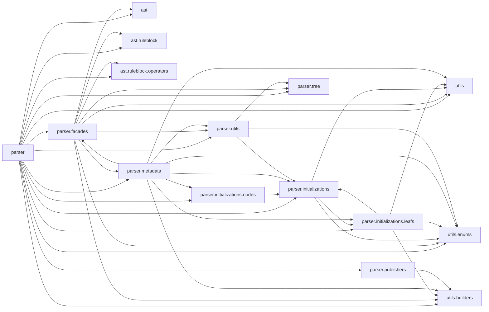
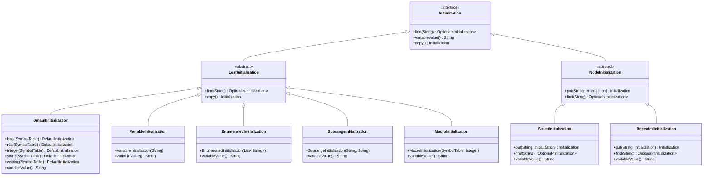
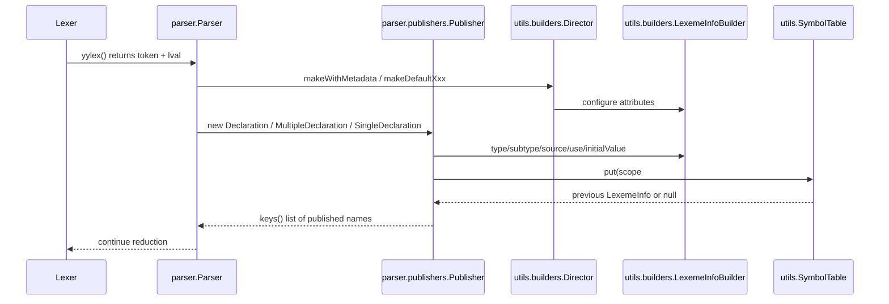
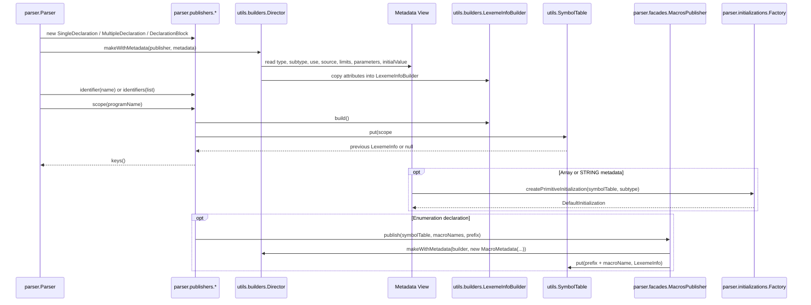
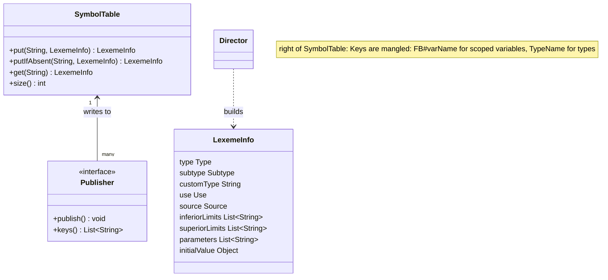

# Parser Module Documentation

One-line description: The IEC 61131-7 parser builds on the Bison-generated LALR(1) grammar to drive syntax analysis, publish symbol declarations to the symbol table, and construct initializations and rule-block ASTs.

Last update: 2026-11-04

## Purpose

The parser package consumes tokens from the lexer through the Bison-generated `Parser` class, executes semantic actions bound to grammar reductions, and populates the `utils.SymbolTable` through `Publisher` implementations. It owns declaration publishing, type metadata, initializations (primitive, enumerated, subrange, array, struct, macro), fuzzify/defuzzify/rule-block linguistic terms, and facade utilities for array ranges, dimensions, macros, identifiers, and membership-function classification.

## Package Diagram



The flow moves from the lexer into `parser_Parser`, which coordinates `utils_builders_Director` and `utils_builders_LexemeInfoBuilder` recipes, delegates declaration publishing to `parser_publishers_Publisher` implementations, and writes results into `utils_SymbolTable`. Metadata objects implement `utils_builders_LexemeInfoView` to describe symbol attributes.

## Class Diagram

```mermaid
classDiagram
    namespace parser {
        class Parser {
            <<Bison_3_8_2>>
            +Parser(Lexer, SymbolTable)
            +parse() boolean
            +getNumberOfErrors() int
        }
    }
    namespace parser_publishers {
        class Publisher {
            <<interface>>
            +scope(String) Publisher
            +keys() List~String~
            +publish() void
        }
        class Declaration {
            <<abstract>>
            #declarationScope String
            #builder LexemeInfoBuilder
            +scope(String) Declaration
            +type(Type) Declaration
            +subtype(Subtype) Declaration
            +customType(String) Declaration
            +source(Source) Declaration
            +use(Use) Declaration
            +inferiorLimits(List~String~) Declaration
            +superiorLimits(List~String~) Declaration
            +parameters(List~String~) Declaration
            +initialValue(Object) Declaration
        }
        class Block {
            <<abstract>>
            #declarations List~ConcreteDecl~
            +add(ConcreteDecl) void
            +scope(String) Block
            +keys() List~String~
            +publish() void
        }
        class DeclarationBlock {
            +add(Declaration) void
        }
        class MultipleDeclaration {
            #identifiers List~String~
            +identifiers(List~String~) MultipleDeclaration
            +publish() void
            +keys() List~String~
        }
        class SingleDeclaration {
            #identifier String
            +identifier(String) SingleDeclaration
            +publish() void
            +keys() List~String~
        }
        class FuzzyDeclaration {
            +source(Source) FuzzyDeclaration
            +publish() void
        }
        class StructureDeclaration {
            +identifier(String) StructureDeclaration
            +publish() void
        }
        class StructureBlock {
            +add(SingleDeclaration) void
            +getInitializationInfo() List~PathInitializationInfo~
        }
        class FuzzyBlock {
            +add(SingleDeclaration) void
            +getTermNames() List~String~
        }
        class EnumeratedTypeDeclaration {
            +publish()
        }
        class AnnonymousEnumeratedVariable {
            +publish()
        }
        class AnnonymousEnumeratedField {
            +publish()
        }
    }
    namespace parser_facades {
        class DimensionCalculator {
            <<utility>>
            +calculate(List~String~, List~String~) int
        }
        class IdentifierParser {
            +parse(String, String) ParsedIdentifier
        }
        class MacrosPublisher {
            +publish(SymbolTable, List~String~, String)
        }
        class MembershipFunctionClassifier {
            +classify(List~String~, List~String~) MembershipFunctionShape
        }
        class RangesParser {
            <<utility>>
            +parse(List~String~, List~String~, List~String~)
        }
        class RuleblockASTBuilder {
            +build(ParserTreeNode, List~Operator~) RuleBlockNode
        }
        class SymbolTableCleaner {
            +clean(SymbolTable) void
        }
    }
    namespace parser_initializations {
        class Initialization {
            <<interface>>
            +find(String) Optional~Initialization~
            +variableValue() String
            +copy() Initialization
        }
        class Factory {
            <<utility>>
            +createPrimitiveInitialization(SymbolTable, Subtype) DefaultInitialization
        }
    }
    namespace parser_initializations_leafs {
        class LeafInitialization {
            <<abstract>>
            +find(String) Optional~Initialization~
        }
        class DefaultInitialization {
            +bool(SymbolTable) DefaultInitialization
            +real(SymbolTable) DefaultInitialization
            +integer(SymbolTable) DefaultInitialization
            +string(SymbolTable) DefaultInitialization
            +wstring(SymbolTable) DefaultInitialization
        }
        class VariableInitialization {
            +variableValue() String
        }
        class EnumeratedInitialization {
            +variableValue() String
        }
        class SubrangeInitialization {
            +variableValue() String
        }
        class MacroInitialization {
            +variableValue() String
        }
    }
    namespace parser_initializations_nodes {
        class NodeInitialization {
            <<abstract>>
            +put(String, Initialization) Initialization
        }
        class StructInitialization {
            +put(String, Initialization) Initialization
            +find(String) Optional~Initialization~
        }
        class RepeatedInitialization {
            +put(String, Initialization) Initialization
            +find(String) Optional~Initialization~
        }
    }
    namespace parser_metadata {
        class FunctionBlockMetadata
        class PrimitiveMetadata
        class ArrayMetadata
        class StringMetadata
        class EnumeratedMetadata
        class SubrangeMetadata
        class StructureMetadata
        class MacroMetadata
        class CustomMetadata
        class TermMetadata
        class FuzzifierMetadata
        class DefuzzifierMetadata
        class PragmaMetadata
    }
    namespace parser_tree {
        class ParserTreeNode {
            +label() ParserLabel
            +symbolReference() String
            +children() List~ParserTreeNode~
        }
        class ParserLabel
    }
    namespace parser_utils {
        class ParsedIdentifier {
            +mangled() String
            +scope() String
            +name() String
        }
        class PathInitializationInfo {
            +name() String
            +initialValue() Initialization
        }
        class ConditionParsingContext {
            +addOperator(ParserLabel)
            +addOperand(ParserTreeNode)
            +getConditionNode() ParserTreeNode
        }
        class ArrayParsingContext {
            +getMaxValue() int
            +getPathsInfo() List~PathInitializationInfo~
        }
        class MembershipFunctionShape {
            +subtype() Subtype
            +parameters() List~String~
        }
    }
    namespace utils {
        class SymbolTable {
            +put(String, LexemeInfo) LexemeInfo
            +putIfAbsent(String, LexemeInfo) LexemeInfo
            +get(String) LexemeInfo
            +size() int
        }
        class LexemeInfo
    }
    namespace utils_builders {
        class LexemeInfoMutator {
            <<interface>>
            +type(Type)
            +subtype(Subtype)
            +initialValue(Object)
        }
        class LexemeInfoView {
            <<interface>>
            +type() Type
            +subtype() Subtype
            +initialValue() Object
        }
        class LexemeInfoBuilder {
            +build() LexemeInfo
        }
        class Director {
            <<utility>>
            +makeWithMetadata(LexemeInfoMutator, LexemeInfoView) void
            +makeLiteral(LexemeInfoMutator) void
            +makeIntegerZeroConstant(LexemeInfoMutator) String
            +makeBooleanTrueConstant(LexemeInfoMutator) String
            +makeDefaultInteger(LexemeInfoMutator) String
            +makeDefaultReal(LexemeInfoMutator) String
            +makeDefaultBoolean(LexemeInfoMutator) String
            +makeDefaultString(LexemeInfoMutator) String
            +makeDefaultWString(LexemeInfoMutator) String
        }
    }
    namespace ast_ruleblock {
        class RuleBlockNode
    }
    namespace ast_ruleblock_operators {
        class Operator
    }
    utils_builders_LexemeInfoMutator <|-- parser_publishers_Publisher
    parser_publishers_Publisher <|.. parser_publishers_Declaration
    parser_publishers_Publisher <|.. parser_publishers_Block
    parser_publishers_Declaration <|-- parser_publishers_MultipleDeclaration
    parser_publishers_Declaration <|-- parser_publishers_SingleDeclaration
    parser_publishers_Block <|-- parser_publishers_DeclarationBlock
    parser_publishers_Block <|-- parser_publishers_StructureBlock
    parser_publishers_Block <|-- parser_publishers_FuzzyBlock
    parser_publishers_SingleDeclaration <|-- parser_publishers_FuzzyDeclaration
    parser_publishers_SingleDeclaration <|-- parser_publishers_StructureDeclaration
    parser_publishers_SingleDeclaration <|-- parser_publishers_EnumeratedTypeDeclaration
    parser_publishers_SingleDeclaration <|-- parser_publishers_AnnonymousEnumeratedField
    parser_publishers_MultipleDeclaration <|-- parser_publishers_AnnonymousEnumeratedVariable
    parser_initializations_Initialization <|.. parser_initializations_leafs_LeafInitialization
    parser_initializations_Initialization <|.. parser_initializations_nodes_NodeInitialization
    parser_initializations_leafs_LeafInitialization <|-- parser_initializations_leafs_DefaultInitialization
    parser_initializations_leafs_LeafInitialization <|-- parser_initializations_leafs_VariableInitialization
    parser_initializations_leafs_LeafInitialization <|-- parser_initializations_leafs_EnumeratedInitialization
    parser_initializations_leafs_LeafInitialization <|-- parser_initializations_leafs_SubrangeInitialization
    parser_initializations_leafs_LeafInitialization <|-- parser_initializations_leafs_MacroInitialization
    parser_initializations_nodes_NodeInitialization <|-- parser_initializations_nodes_StructInitialization
    parser_initializations_nodes_NodeInitialization <|-- parser_initializations_nodes_RepeatedInitialization
    utils_builders_LexemeInfoMutator <|.. utils_builders_LexemeInfoBuilder
    utils_builders_LexemeInfoView <|.. utils_builders_LexemeInfoBuilder
    utils_SymbolTable --> utils_LexemeInfo : stores
    utils_builders_LexemeInfoBuilder ..> utils_LexemeInfo : builds
    utils_builders_Director ..> utils_builders_LexemeInfoMutator : configures
    utils_builders_Director ..> utils_builders_LexemeInfoView : reads
    parser_Parser --> parser_publishers_Publisher : creates
    parser_Parser --> parser_facades_RuleblockASTBuilder : builds AST
    parser_Parser --> utils_SymbolTable : writes
    parser_publishers_Declaration --> utils_builders_LexemeInfoBuilder : holds
    parser_publishers_FuzzyDeclaration --> parser_publishers_FuzzyBlock : publishes terms
    parser_publishers_StructureDeclaration --> parser_publishers_StructureBlock : publishes fields
    parser_publishers_StructureBlock ..> parser_utils_PathInitializationInfo : exposes
    parser_publishers_EnumeratedTypeDeclaration ..> parser_facades_MacrosPublisher : registers macros
    parser_publishers_AnnonymousEnumeratedField ..> parser_facades_MacrosPublisher : registers macros
    parser_publishers_AnnonymousEnumeratedVariable ..> parser_facades_MacrosPublisher : registers macros
    parser_facades_MacrosPublisher ..> parser_metadata_MacroMetadata : builds
    parser_facades_MacrosPublisher --> utils_SymbolTable : writes
    parser_facades_IdentifierParser ..> parser_utils_ParsedIdentifier : returns
    parser_facades_MembershipFunctionClassifier ..> parser_utils_MembershipFunctionShape : returns
    parser_facades_RuleblockASTBuilder ..> parser_tree_ParserTreeNode : traverses
    parser_facades_RuleblockASTBuilder ..> ast_ruleblock_RuleBlockNode : returns
    parser_facades_RuleblockASTBuilder ..> ast_ruleblock_operators_Operator : configured by
    parser_initializations_Factory ..> parser_initializations_leafs_DefaultInitialization : creates
    parser_initializations_nodes_StructInitialization --> parser_initializations_Initialization : fields
    parser_initializations_nodes_RepeatedInitialization --> parser_initializations_Initialization : intervals
    parser_metadata_TermMetadata ..> parser_facades_MembershipFunctionClassifier : classifies
    parser_metadata_ArrayMetadata ..> parser_facades_DimensionCalculator : sizes
    parser_metadata_ArrayMetadata ..> parser_facades_RangesParser : splits ranges
    parser_metadata_ArrayMetadata ..> parser_initializations_nodes_RepeatedInitialization : creates
    parser_utils_ConditionParsingContext --> parser_tree_ParserTreeNode : builds
    utils_builders_LexemeInfoView <|.. parser_metadata_FunctionBlockMetadata
    utils_builders_LexemeInfoView <|.. parser_metadata_PrimitiveMetadata
    utils_builders_LexemeInfoView <|.. parser_metadata_ArrayMetadata
    utils_builders_LexemeInfoView <|.. parser_metadata_StringMetadata
    utils_builders_LexemeInfoView <|.. parser_metadata_EnumeratedMetadata
    utils_builders_LexemeInfoView <|.. parser_metadata_SubrangeMetadata
    utils_builders_LexemeInfoView <|.. parser_metadata_StructureMetadata
    utils_builders_LexemeInfoView <|.. parser_metadata_MacroMetadata
    utils_builders_LexemeInfoView <|.. parser_metadata_CustomMetadata
    utils_builders_LexemeInfoView <|.. parser_metadata_TermMetadata
    utils_builders_LexemeInfoView <|.. parser_metadata_FuzzifierMetadata
    utils_builders_LexemeInfoView <|.. parser_metadata_DefuzzifierMetadata
    utils_builders_LexemeInfoView <|.. parser_metadata_PragmaMetadata
```



## Class Table

| Class                                                 | Responsibility                                                                                            | Pattern          |
|-------------------------------------------------------|-----------------------------------------------------------------------------------------------------------|------------------|
| parser_Parser                                         | Bison-generated LALR(1) parser; drives syntax analysis and invokes semantic actions that publish symbols  | Generator        |
| parser_publishers_Publisher                           | Interface declaring scope, publish, and keys; extends LexemeInfoMutator                                   | Interface        |
| parser_publishers_Declaration                         | Abstract base holding a LexemeInfoBuilder and exposing fluent mutator setters                             | Abstract base    |
| parser_publishers_Block                               | Abstract composite grouping declarations and forwarding mutator and publish calls to each                 | Composite        |
| parser_publishers_DeclarationBlock                    | Groups IO and variable declarations such as VAR_INPUT, VAR_OUTPUT, and VAR                                | Composite        |
| parser_publishers_StructureBlock                      | Groups structure field declarations and exposes initialization info per field                             | Composite        |
| parser_publishers_FuzzyBlock                          | Groups linguistic terms of a fuzzifier or defuzzifier                                                     | Composite        |
| parser_publishers_MultipleDeclaration                 | Publishes several identifiers sharing the same type and attributes                                        | Composite        |
| parser_publishers_SingleDeclaration                   | Publishes a single identifier under the scope name key                                                    | Composite        |
| parser_publishers_FuzzyDeclaration                    | Publishes a fuzzifier or defuzzifier component with its term block and suffixed keys                      | Composite        |
| parser_publishers_StructureDeclaration                | Publishes a structure declaration and delegates to its field block                                        | Composite        |
| parser_publishers_EnumeratedTypeDeclaration           | Publishes an enumerated type and registers its enum macros                                                | Composite        |
| parser_publishers_AnnonymousEnumeratedVariable        | Publishes an anonymous enumerated variable and its enum literal macros                                    | Composite        |
| parser_publishers_AnnonymousEnumeratedField           | Publishes an anonymous enumerated field and its enum literal macros                                       | Composite        |
| parser_facades_DimensionCalculator                    | Computes total array element count as product of dimension sizes                                          | Utility Facade   |
| parser_facades_RangesParser                           | Splits alternating range tokens into inferior and superior limit lists                                    | Utility Facade   |
| parser_facades_MacrosPublisher                        | Publishes enumerated macro literals under a scope prefix                                                  | Facade           |
| parser_facades_IdentifierParser                       | Splits an identifier into scope and name using the hash separator                                         | Utility Facade   |
| parser_facades_MembershipFunctionClassifier           | Classifies membership function shape from point and degree lists                                          | Utility Facade   |
| parser_facades_RuleblockASTBuilder                    | Builds the rule block AST from a tree node using operator configuration                                   | Builder          |
| parser_facades_SymbolTableCleaner                     | Removes symbol table entries whose use is unknown                                                         | Utility Facade   |
| parser_initializations_Initialization                 | Interface for path based lookup, value rendering, and copying                                             | Composite        |
| parser_initializations_Factory                        | Static utility creating default primitive initializations for BOOL, integer, REAL, LREAL, STRING, WSTRING | Factory          |
| parser_initializations_leafs_LeafInitialization       | Abstract base for atomic initializations; find resolves only the empty path                               | Abstract base    |
| parser_initializations_leafs_DefaultInitialization    | Default literal initialization registered in the symbol table via Director                                | Factory method   |
| parser_initializations_leafs_VariableInitialization   | Initialization referencing another variable by name                                                       | Leaf             |
| parser_initializations_leafs_EnumeratedInitialization | Initialization holding the selected enumerated literal                                                    | Leaf             |
| parser_initializations_leafs_SubrangeInitialization   | Lower bound initialization for a subrange type                                                            | Leaf             |
| parser_initializations_leafs_MacroInitialization      | Enum literal macro; registers an INT literal in the symbol table                                          | Leaf             |
| parser_initializations_nodes_NodeInitialization       | Abstract base for composite initializations supporting put and find                                       | Abstract base    |
| parser_initializations_nodes_StructInitialization     | Struct initialization with named fields and nested path access                                            | Composite        |
| parser_initializations_nodes_RepeatedInitialization   | Array initialization over disjoint contiguous intervals                                                   | Composite        |
| parser_metadata_FunctionBlockMetadata                 | Symbol table entry of the function block; parameters are interface variable keys                          | Metadata View    |
| parser_metadata_PrimitiveMetadata                     | Primitive type metadata with default initialization from Factory                                          | Metadata View    |
| parser_metadata_ArrayMetadata                         | Array metadata with bounds and RepeatedInitialization default                                             | Metadata View    |
| parser_metadata_StringMetadata                        | String metadata with length bounds and default initialization                                             | Metadata View    |
| parser_metadata_EnumeratedMetadata                    | Enumerated type metadata with parameter values                                                            | Metadata View    |
| parser_metadata_SubrangeMetadata                      | Subrange metadata with inferior and superior limits                                                       | Metadata View    |
| parser_metadata_StructureMetadata                     | Structure metadata with field names and StructInitialization                                              | Metadata View    |
| parser_metadata_MacroMetadata                         | Macro metadata registering an enum ordinal literal                                                        | Metadata View    |
| parser_metadata_CustomMetadata                        | Custom type metadata copying the referenced type initial value                                            | Metadata View    |
| parser_metadata_TermMetadata                          | Linguistic term metadata with classified membership function shape                                        | Metadata View    |
| parser_metadata_FuzzifierMetadata                     | Fuzzifier component metadata listing term names                                                           | Metadata View    |
| parser_metadata_DefuzzifierMetadata                   | Defuzzifier component metadata with range, terms, and default value                                       | Metadata View    |
| parser_metadata_PragmaMetadata                        | Pragma entry under function block scope and option name with value literal key                            | Metadata View    |
| parser_tree_ParserTreeNode                            | Tree node with label, symbol reference, and children for rule blocks                                      | Tree Composite   |
| parser_tree_ParserLabel                               | Enumeration of rule block tree labels                                                                     | Enum             |
| parser_utils_ParsedIdentifier                         | Holds mangled complete name, scope, and base identifier                                                   | Value object     |
| parser_utils_PathInitializationInfo                   | Pairs a field name with its initialization value                                                          | Value object     |
| parser_utils_ConditionParsingContext                  | Builds a condition tree from operands and operators during parsing                                        | Context          |
| parser_utils_ArrayParsingContext                      | Holds max array value and per path initialization info                                                    | Context          |
| parser_utils_MembershipFunctionShape                  | Recognized membership function subtype and defining x coordinates                                         | Value object     |
| utils_SymbolTable                                     | Map from symbol name to LexemeInfo; put, putIfAbsent, get, size                                           | Registry         |
| utils_LexemeInfo                                      | Immutable DTO holding type, subtype, customType, use, source, limits, parameters, initialValue            | Value object     |
| utils_builders_Director                               | Predefined recipes for LexemeInfo literals, defaults, and metadata copies                                 | Director Builder |
| utils_builders_LexemeInfoBuilder                      | Fluent builder implementing LexemeInfoMutator and LexemeInfoView                                          | Builder          |
| utils_builders_LexemeInfoMutator                      | Fluent interface to set LexemeInfo semantic attributes                                                    | Fluent interface |
| utils_builders_LexemeInfoView                         | Read only view of LexemeInfo attributes                                                                   | View             |

Excluded: deprecated types and local only files. The old declaration context classes ContextHandler, ParsingContext, and NameMangler do not exist in the current source.

## Sources by Subpackage

| Subpackage                       | Directory                                       |
|----------------------------------|-------------------------------------------------|
| parser                           | src/main/java/parser/                           |
| parser.facades                   | src/main/java/parser/facades/                   |
| parser.initializations           | src/main/java/parser/initializations/           |
| parser.initializations.leafs     | src/main/java/parser/initializations/leafs/     |
| parser.initializations.nodes     | src/main/java/parser/initializations/nodes/     |
| parser.metadata                  | src/main/java/parser/metadata/                  |
| parser.publishers                | src/main/java/parser/publishers/                |
| parser.publishers.leafs          | src/main/java/parser/publishers/leafs/          |
| parser.publishers.leafs.multiple | src/main/java/parser/publishers/leafs/multiple/ |
| parser.publishers.leafs.single   | src/main/java/parser/publishers/leafs/single/   |
| parser.publishers.nodes          | src/main/java/parser/publishers/nodes/          |
| parser.tree                      | src/main/java/parser/tree/                      |
| parser.utils                     | src/main/java/parser/utils/                     |
| utils                            | src/main/java/utils/                            |
| utils.builders                   | src/main/java/utils/builders/                   |

## Architecture Overview

The parser follows a Publisher, Director, and Builder architecture. The Bison generated `Parser` reduces grammar rules and, in semantic actions, builds `Publisher` instances, configures them through `Director` recipes and `LexemeInfoBuilder`, then calls `publish` to write into `utils.SymbolTable`. Mangling uses the hash separator inline in publisher implementations and `IdentifierParser`; there is no separate NameMangler class.

```
                 Parser.y semantic action
                        |
                        v
                 +-------------+
                 |   Director  |  makeWithMetadata / makeDefaultXxx recipes
                 +-------------+
                        |
                        v
                 +-------------+
                 | LexemeInfo  |  fluent build of semantic attributes
                 |   Builder   |
                 +-------------+
                        |
                        v (passed to)
                 +-------------+        publish()        +--------------+
                 |  Publisher  | ----------------------> | SymbolTable  |
                 | (Declaration|        keys()           | (LexemeInfo) |
                 |  / Block    )                          +--------------+
                 +-------------+
                        |
                        v (inline mangling scope#name)
                 SymbolTable keys e.g. MAIN#X, MAIN#Y
```

## Key Components

### LexemeInfoMutator

`utils.builders.LexemeInfoMutator` is the fluent interface for setting semantic attributes on a lexeme: `type`, `subtype`, `customType`, `source`, `use`, `inferiorLimits`, `superiorLimits`, `parameters`, `initialValue`. Every setter returns the mutator for chaining. `parser.publishers.Publisher` extends this interface, so publishers can be configured with the same fluent API before publishing.

### LexemeInfoBuilder

`utils.builders.LexemeInfoBuilder` implements both `utils.builders.LexemeInfoMutator` and `utils.builders.LexemeInfoView`. It holds the mutable attributes and `build` produces an immutable `utils.LexemeInfo`. Used by `Declaration` and directly in semantic actions for linguistic terms.

### Director

`utils.builders.Director` is a static utility providing predefined recipes:

| Recipe                  | Effect                                                                 |
|-------------------------|------------------------------------------------------------------------|
| makeWithMetadata        | Copies all attributes from a LexemeInfoView into a LexemeInfoMutator   |
| makeLiteral             | Sets type SIMPLE, use LITERAL, source NONE                             |
| makeIntegerZeroConstant | Returns 0; subtype INT, initialValue 0                                 |
| makeBooleanTrueConstant | Returns TRUE; subtype BOOL, initialValue true                          |
| makeDefaultInteger      | Delegates to makeIntegerZeroConstant; returns 0                        |
| makeDefaultReal         | Returns 0.0; subtype REAL, initialValue 0.0                            |
| makeDefaultBoolean      | Returns FALSE; subtype BOOL, initialValue false                        |
| makeDefaultString       | Returns the empty STRING literal; subtype STRING, initialValue empty   |
| makeDefaultWString      | Returns the empty WSTRING literal; subtype WSTRING, initialValue empty |

These recipes guarantee consistent literal and default registration across semantic actions.

### Publisher Hierarchy

`parser.publishers.Publisher` is the interface that declares `scope`, `keys`, and `publish`. It extends `utils.builders.LexemeInfoMutator`. Implementations live under `parser.publishers.leafs` for declarations and `parser.publishers.nodes` for blocks.

```
Publisher (interface)
├── leafs.Declaration (abstract)  -- holds LexemeInfoBuilder and declarationScope
│   ├── leafs.multiple.MultipleDeclaration  -- many identifiers, same attributes
│   │   └── leafs.multiple.AnnonymousEnumeratedVariable -- anonymous enum variable + macros
│   └── leafs.single.SingleDeclaration    -- one identifier, key scope#name
│       ├── leafs.single.FuzzyDeclaration  -- fuzzifier/defuzzifier + terms (@fuzzifier/@defuzzifier suffix)
│       ├── leafs.single.StructureDeclaration  -- struct + field block
│       ├── leafs.single.EnumeratedTypeDeclaration -- enum + macro registration
│       └── leafs.single.AnnonymousEnumeratedField -- anonymous enum field + macros
└── nodes.Block (abstract, generic over declaration type)  -- groups declarations
    ├── nodes.DeclarationBlock  -- IO/variable declarations
    ├── nodes.StructureBlock    -- struct fields + init info
    └── nodes.FuzzyBlock        -- linguistic terms
```

`Block` forwards `scope`, `type`, `subtype`, `customType`, `source`, `use`, `inferiorLimits`, `superiorLimits`, `parameters`, and `initialValue` to every child declaration before publishing. Keys are mangled inline: scoped variables use `FB#varName`, types use type names. Example: `x, y : INT` in block `MAIN` publishes as `MAIN#X`, `MAIN#Y`.

### Factory and Initialization Hierarchy

`parser.initializations.Factory.createPrimitiveInitialization(SymbolTable, Subtype)` returns a `parser.initializations.leafs.DefaultInitialization` and supports BOOL, LREAL, REAL, STRING, WSTRING, and all integer subtypes SINT through ULINT; it throws `IllegalArgumentException` otherwise.

```
parser.initializations.Initialization (interface: find, variableValue, copy)
├── parser.initializations.leafs.LeafInitialization (abstract; find only empty path)
│   ├── parser.initializations.leafs.DefaultInitialization   -- BOOL / INT / REAL / STRING / WSTRING default
│   ├── parser.initializations.leafs.VariableInitialization  -- reference to another variable
│   ├── parser.initializations.leafs.EnumeratedInitialization -- selected enum literal
│   ├── parser.initializations.leafs.SubrangeInitialization  -- lower bound of subrange
│   └── parser.initializations.leafs.MacroInitialization     -- enum ordinal, registered as INT literal
└── parser.initializations.nodes.NodeInitialization (abstract; put / find over paths)
    ├── parser.initializations.nodes.StructInitialization    -- named fields, nested # paths
    └── parser.initializations.nodes.RepeatedInitialization  -- array over disjoint intervals
```

Path syntax uses `#` as separator, for example `RGB#R` or `2#X`.

## Initializations Hierarchy and Usage



### Default Value Table

| Initialization class          | Default literal   | Subtype support                                  | Registered in SymbolTable                |
|-------------------------------|-------------------|--------------------------------------------------|------------------------------------------|
| DefaultInitialization.bool    | FALSE             | BOOL                                             | Yes, via Director.makeDefaultBoolean     |
| DefaultInitialization.integer | 0                 | SINT, INT, LINT, DINT, USINT, UINT, UDINT, ULINT | Yes, via Director.makeDefaultInteger     |
| DefaultInitialization.real    | 0.0               | REAL, LREAL                                      | Yes, via Director.makeDefaultReal        |
| DefaultInitialization.string  | empty string      | STRING                                           | Yes, via Director.makeDefaultString      |
| DefaultInitialization.wstring | empty wide string | WSTRING                                          | Yes, via Director.makeDefaultWString     |
| VariableInitialization        | variable name     | n/a                                              | No                                       |
| EnumeratedInitialization      | first enum value  | INT                                              | No                                       |
| SubrangeInitialization        | lower bound       | subtype                                          | No                                       |
| MacroInitialization           | ordinal value     | INT                                              | Yes, via MacroInitialization constructor |
| StructInitialization          | brace value       | STRUCT                                           | No                                       |
| RepeatedInitialization        | interval list     | ARRAY                                            | No                                       |

## Lexer Parser SymbolTable Flow



## Publisher to SymbolTable Sequence



## Symbol Table Population from the Parser



### Population Table

| Symbol kind           | Published key form       | Metadata class        | Example key            |
|-----------------------|--------------------------|-----------------------|------------------------|
| Function block        | function block name      | FunctionBlockMetadata | MAIN                   |
| IO variable           | scope#identifier         | via Declaration       | MAIN#X                 |
| Fuzzifier component   | programName#termName     | FuzzifierMetadata     | MAIN#TEMP              |
| Defuzzifier component | programName#termName     | DefuzzifierMetadata   | MAIN#OUTPUT            |
| Linguistic term       | identifier               | TermMetadata          | TEMP                   |
| Enumerated macro      | enumeratedName#macroName | via MacrosPublisher   | COLOR#RED              |
| Structure field       | structureName#fieldName  | StructureMetadata     | STRUCT#R               |
| Array element         | arrayName\[index]        | ArrayMetadata         | ARR\[0]                |
| Pragma                | <fb>@option#NAME         | PragmaMetadata        | MAIN\@option#BIT_WIDTH |
| Default literal       | literal spelling         | DefaultInitialization | 0, FALSE, 0.0          |

## Charts

Chart: `assets/parser_grammar_stats.png` — Bison grammar statistics: declared tokens, non-terminals, and initialization types, counted from `src/main/java/parser/Parser.y` and `src/main/java/parser/Parser.java`.

Chart: `assets/loc_per_module.png` — non-comment lines of code per module, counted from `src/main/java`.

Chart: `assets/cyclomatic_complexity.png` — average cyclomatic complexity per package, estimated from decision points in `src/main/java`.

Chart: `assets/test_coverage.png` — line coverage per package from the JaCoCo report; the parser package records 87 percent.

## Supported Grammar Summary

### Grammar Metrics

| Metric               | Value           | Source                                                           |
|----------------------|-----------------|------------------------------------------------------------------|
| Declared tokens      | 82              | src/main/java/parser/Parser.y %token declarations                |
| Non-terminals        | 141             | src/main/java/parser/Parser.java SymbolKind S_YYACCEPT and above |
| Initialization types | 7               | concrete parser.initializations leafs and nodes classes          |
| Parser generator     | GNU Bison 3.8.2 | src/main/java/parser/Parser.java bisonVersion                    |

### Main IEC 61131-7 Blocks

| Block                 | Tokens                                   | Purpose                                   |
|-----------------------|------------------------------------------|-------------------------------------------|
| Function block        | FUNCTION_BLOCK ... END_FUNCTION_BLOCK    | Top-level program unit with name and body |
| Fuzzify               | FUZZIFY ... END_FUZZIFY                  | Linguistic fuzzifier component            |
| Defuzzify             | DEFUZZIFY ... END_DEFUZZIFY              | Linguistic defuzzifier component          |
| Rule block            | RULEBLOCK ... END_RULEBLOCK              | Fuzzy rule with operators and activation  |
| Option                | OPTION ... END_OPTION                    | Manufacturer-specific pragmas             |
| Variable declarations | VAR / VAR_INPUT / VAR_OUTPUT ... END_VAR | Declared variables with scope             |

### Fuzzify / Defuzzify

Fuzzify blocks declare linguistic terms (`TERM name := value;` or membership functions) and are published as components with source FUZZIFY. Defuzzify blocks add an optional `RANGE ( lo .. hi );`, a default value, and a defuzzification method (COG, COGS, COA, LM, RM) and are published with source DEFUZZIFY. Both register term names as parameters.

### Rule Block

A rule block declares OR/AND operators, an activation method, an accumulation method, and rules (`IF condition WITH body`). The parser builds a tree node through `ConditionParsingContext` and converts it to a rule block AST using `RuleblockASTBuilder` with an operator configuration list.

### Variable Declarations Annex B

Variables are declared under `VAR`, `VAR_INPUT`, or `VAR_OUTPUT` with optional retain and initialization lists. Each `DeclarationBlock` is configured with source, use, and declaration scope, then published. Keys use the hash separator.

### Data Types

Elementary types: BOOL, SINT/INT/DINT/LINT, USINT/UINT/UDINT/ULINT, REAL/LREAL, STRING, WSTRING, TIME, DATE, DATE_AND_TIME, TIME_OF_DAY, BYTE/WORD/DWORD/LWORD, plus bit-string and date types. User-defined types: enumerated, subrange, array, structure.

### Initializations

Initialization grammar covers simple spec, boolean spec, custom spec, enumerated spec, array spec, structure spec, string spec, and standard function block spec.

### Data Type Declaration

`TYPE ... END_TYPE` encloses type declarations such as structure, enumerated, subrange, array, and string.

## Key Semantic Actions

Excerpt from `src/main/java/parser/Parser.y` (reflected in generated `src/main/java/parser/Parser.java`):

| Grammar rule                               | Semantic action                                                                                                                                                                                                                                             | Effect                                                                                      |
|--------------------------------------------|-------------------------------------------------------------------------------------------------------------------------------------------------------------------------------------------------------------------------------------------------------------|---------------------------------------------------------------------------------------------|
| program                                    | SymbolTableCleaner.clean(symbolTable)                                                                                                                                                                                                                       | Removes symbol table entries whose use is unknown                                           |
| function_block_declaration                 | SingleDeclaration functionBlock = new SingleDeclaration(symbolTable); Director.makeWithMetadata(functionBlock, new FunctionBlockMetadata(list)); functionBlock.identifier(programName).publish(); ast = new AbstractSyntaxTree(programName, ruleBlockNodes) | Publishes the function block under its name with interface variable keys and builds the AST |
| fb_io_var_declarations                     | DeclarationBlock.source(Source).use(Use.VARIABLE).scope(programName).publish(); yyval = keys()                                                                                                                                                              | Publishes IO variables under programName#identifier and returns keys                        |
| io_var_decl: VAR_INPUT                     | yyval = Source.IN                                                                                                                                                                                                                                           | Sets input source direction                                                                 |
| io_var_decl: VAR_OUTPUT                    | yyval = Source.OUT                                                                                                                                                                                                                                          | Sets output source direction                                                                |
| fuzzify_block                              | Director.makeWithMetadata(fuzzifierDeclaration, new FuzzifierMetadata(fuzzyBlock)); fuzzifierDeclaration.identifier(...).scope(programName).publish()                                                                                                       | Publishes fuzzifier component scoped to the function block                                  |
| defuzzify_block                            | Director.makeWithMetadata(defuzzifierDeclaration, new DefuzzifierMetadata(range, fuzzyBlock, subtype, default)); defuzzifierDeclaration.identifier(...).scope(programName).publish()                                                                        | Publishes defuzzifier component with range, terms, default                                  |
| linguistic_term                            | yyval = new SingleDeclaration(this.symbolTable, builder).identifier(name);                                                                                                                                                                                  | Declares a linguistic term as a single declaration                                          |
| linguistic_term_value: IDENTIFIER          | Director.makeWithMetadata(customTermBuilder, new CustomMetadata(this.symbolTable, ref));                                                                                                                                                                    | Resolves a custom term reference                                                            |
| linguistic_term_value: membership_function | Director.makeWithMetadata(termBuilder, new TermMetadata(points));                                                                                                                                                                                           | Classifies membership function shape via MembershipFunctionClassifier                       |
| defuzz_method: COG                         | yyval = Subtype.COG                                                                                                                                                                                                                                         | Maps method token to Subtype                                                                |
| default_val: numeric_constant              | yyval = new VariableInitialization(value);                                                                                                                                                                                                                  | Wraps a default value literal                                                               |
| rule_block                                 | yyval = RuleblockASTBuilder.build(componentNode, configuration);                                                                                                                                                                                            | Builds the rule block AST from the tree                                                     |

## Facade Utilities

### DimensionCalculator

Source: `src/main/java/parser/facades/DimensionCalculator.java`.

```java
public static int calculate(List<String> inferiorLimits, List<String> superiorLimits) {
    int dimension = 1;
    for (int i = 0; i < inferiorLimits.size(); i++) {
        int ilimit = Integer.parseInt(inferiorLimits.get(i));
        int slimit = Integer.parseInt(superiorLimits.get(i));
        dimension *= (slimit + 1 - ilimit);
    }
    return dimension;
}
```

Computes the total number of array elements as the product of all dimension sizes.

### RangesParser

Source: `src/main/java/parser/facades/RangesParser.java`.

```java
public static void parse(final List<String> ranges, final List<String> inferiorLimits,
        final List<String> superiorLimits) {
    boolean toInferior = true;
    for (String rangeLimit : ranges) {
        if (toInferior) {
            inferiorLimits.add(rangeLimit);
        } else {
            superiorLimits.add(rangeLimit);
        }
        toInferior = !toInferior;
    }
}
```

Splits alternating range limit tokens into inferior and superior limit lists.

### MacrosPublisher

Source: `src/main/java/parser/facades/MacrosPublisher.java`.

```java
public static void publish(final SymbolTable symbolTable, final List<String> macroNames, final String prefix) {
    LexemeInfoBuilder macroBuilder = new LexemeInfoBuilder();
    for (int i = 0; i < macroNames.size(); i++) {
        String macroName = macroNames.get(i);
        Director.makeWithMetadata(macroBuilder, new MacroMetadata(symbolTable, i));
        symbolTable.put(prefix + macroName, macroBuilder.build());
    }
}
```

Publishes enumerated macro literals under a scope prefix.

### IdentifierParser

Source: `src/main/java/parser/facades/IdentifierParser.java`.

```java
public static ParsedIdentifier parse(final String identifier, final String possibleScope) {
    int octothorpeIdx = identifier.indexOf('#');
    if (-1 == octothorpeIdx) {
        if (possibleScope != null && !possibleScope.isEmpty()) {
            return new ParsedIdentifier(possibleScope + '#' + identifier, possibleScope, identifier);
        }
        return new ParsedIdentifier(identifier, "", identifier);
    }
    String name = identifier.substring(octothorpeIdx + 1);
    String scope = identifier.substring(0, octothorpeIdx);
    return new ParsedIdentifier(identifier, scope, name);
}
```

Splits a possibly mangled identifier into complete name, scope, and base name.

### MembershipFunctionClassifier

Source: `src/main/java/parser/facades/MembershipFunctionClassifier.java`.

Classifies a membership function shape from x coordinates and degrees. It returns VARIABLE when an x coordinate is a variable, SINGLETON for one point with degree 1, and COMPLEX for empty lists, mismatched sizes, non-ascending x values, or degrees other than 0 and 1. Redundant points on a flat segment or flat extension are removed before classification: the remaining pattern 1,0 or 0,1 is LINEAR, 0,1,0 is TRIANGLE, 0,1,1,0 is TRAPEZOID, and any other pattern is COMPLEX.

### RuleblockASTBuilder

Source: `src/main/java/parser/facades/RuleblockASTBuilder.java`.

```java
public static RuleBlockNode build(final ParserTreeNode ruleblockTree, final List<Operator> configuration) {
    if (configuration.size() != 4) {
        throw new IllegalArgumentException("ASTBuilder: missing configuration parameters.");
    }
    AbstractAstNode ruleblockAST = getASTWithTreeTraversal(ruleblockTree, configuration);
    if (!(ruleblockAST instanceof RuleBlockNode)) {
        throw new IllegalArgumentException("ASTBuilder: invalid ruleblock tree.");
    }
    return (RuleBlockNode) ruleblockAST;
}
```

Builds the rule block AST from a `ParserTreeNode` using operator configuration (OR, AND, activation, accumulation).

## Differences from Previous Architecture

| Aspect                 | Previous (removed)          | Current                                                                |
|------------------------|-----------------------------|------------------------------------------------------------------------|
| Declaration context    | ContextHandler              | Publisher implementations such as Declaration, Block, DeclarationBlock |
| Parsing context        | ParsingContext              | ConditionParsingContext, ArrayParsingContext, PathInitializationInfo   |
| Name mangling          | NameMangler class           | Inline scope#name in Publisher implementations and IdentifierParser    |
| Symbol-table writes    | Direct ContextHandler calls | Publisher publish methods writing LexemeInfo via SymbolTable put       |
| Default values         | Scattered literal handling  | Director recipes and Factory createPrimitiveInitialization             |
| Legacy metadata holder | Prior DTO design            | Excluded; LexemeInfo is the current DTO                                |

## How to Test

| Test class                       | Directory                                                                 | Coverage                                    |
|----------------------------------|---------------------------------------------------------------------------|---------------------------------------------|
| ParserTest                       | src/test/java/unit/parser/ParserTest.java                                 | Parser grammar and semantic actions         |
| StructInitializationTest         | src/test/java/unit/parser/initializations/StructInitializationTest.java   | Struct initialization paths                 |
| RepeatedInitializationTest       | src/test/java/unit/parser/initializations/RepeatedInitializationTest.java | Repeated and array initialization intervals |
| MembershipFunctionClassifierTest | src/test/java/unit/parser/facades/MembershipFunctionClassifierTest.java   | Membership function shape classification    |

Integration tests live in `src/test/java/integration/lexer/parser/`:

| Test class               | Directory                                                                        | Coverage                               |
|--------------------------|----------------------------------------------------------------------------------|----------------------------------------|
| PrimitiveIT              | src/test/java/integration/lexer/parser/symboltable/PrimitiveIT.java              | Primitive type symbol table population |
| ArrayIT                  | src/test/java/integration/lexer/parser/symboltable/ArrayIT.java                  | Array symbol table population          |
| StructIT                 | src/test/java/integration/lexer/parser/symboltable/StructIT.java                 | Structure symbol table population      |
| EnumerateIT              | src/test/java/integration/lexer/parser/symboltable/EnumerateIT.java              | Enumerated type population             |
| FuzzifierIT              | src/test/java/integration/lexer/parser/symboltable/FuzzifierIT.java              | Fuzzify block population               |
| DefuzzifierIT            | src/test/java/integration/lexer/parser/symboltable/DefuzzifierIT.java            | Defuzzify block population             |
| FunctionBlockInterfaceIT | src/test/java/integration/lexer/parser/symboltable/FunctionBlockInterfaceIT.java | Function block interface keys          |
| OptionIT                 | src/test/java/integration/lexer/parser/symboltable/OptionIT.java                 | Option pragma publication              |
| DeclarationErrorsIT      | src/test/java/integration/lexer/parser/symboltable/DeclarationErrorsIT.java      | Declaration error cases                |
| RuleBlockIT              | src/test/java/integration/lexer/parser/ast/RuleBlockIT.java                      | Rule block AST                         |

Run the module tests with Maven:

```
mvn test -Dtest=ParserTest,StructInitializationTest,RepeatedInitializationTest,MembershipFunctionClassifierTest
mvn verify -Dit.test=*IT
```

## File Tree

```
src/main/java/parser/
├── Parser.java
├── Parser.y
├── package-info.java
├── facades/
│   ├── DimensionCalculator.java
│   ├── IdentifierParser.java
│   ├── MacrosPublisher.java
│   ├── MembershipFunctionClassifier.java
│   ├── RangesParser.java
│   ├── RuleblockASTBuilder.java
│   └── SymbolTableCleaner.java
├── initializations/
│   ├── Factory.java
│   ├── Initialization.java
│   ├── leafs/
│   │   ├── DefaultInitialization.java
│   │   ├── EnumeratedInitialization.java
│   │   ├── LeafInitialization.java
│   │   ├── MacroInitialization.java
│   │   ├── SubrangeInitialization.java
│   │   └── VariableInitialization.java
│   └── nodes/
│       ├── NodeInitialization.java
│       ├── RepeatedInitialization.java
│       └── StructInitialization.java
├── metadata/
│   ├── ArrayMetadata.java
│   ├── CustomMetadata.java
│   ├── DefuzzifierMetadata.java
│   ├── EnumeratedMetadata.java
│   ├── FunctionBlockMetadata.java
│   ├── FuzzifierMetadata.java
│   ├── MacroMetadata.java
│   ├── PragmaMetadata.java
│   ├── PrimitiveMetadata.java
│   ├── StringMetadata.java
│   ├── StructureMetadata.java
│   ├── SubrangeMetadata.java
│   └── TermMetadata.java
├── publishers/
│   ├── Publisher.java
│   ├── leafs/
│   │   ├── Declaration.java
│   │   ├── multiple/
│   │   │   ├── AnnonymousEnumeratedVariable.java
│   │   │   └── MultipleDeclaration.java
│   │   └── single/
│   │       ├── AnnonymousEnumeratedField.java
│   │       ├── EnumeratedTypeDeclaration.java
│   │       ├── FuzzyDeclaration.java
│   │       ├── SingleDeclaration.java
│   │       └── StructureDeclaration.java
│   └── nodes/
│       ├── Block.java
│       ├── DeclarationBlock.java
│       ├── FuzzyBlock.java
│       └── StructureBlock.java
├── tree/
│   ├── ParserLabel.java
│   └── ParserTreeNode.java
└── utils/
    ├── ArrayParsingContext.java
    ├── ConditionParsingContext.java
    ├── MembershipFunctionShape.java
    ├── ParsedIdentifier.java
    └── PathInitializationInfo.java
```

## Usage in Thesis

According to the module to chapter mapping, this module provides grammar, publisher, initialization, and rule block content to the thesis chapter `doc/thesis/06-analisis-sintactico.md`, and maintainability and testing decisions to the thesis chapter `doc/thesis/07-mantenibilidad.md`.
