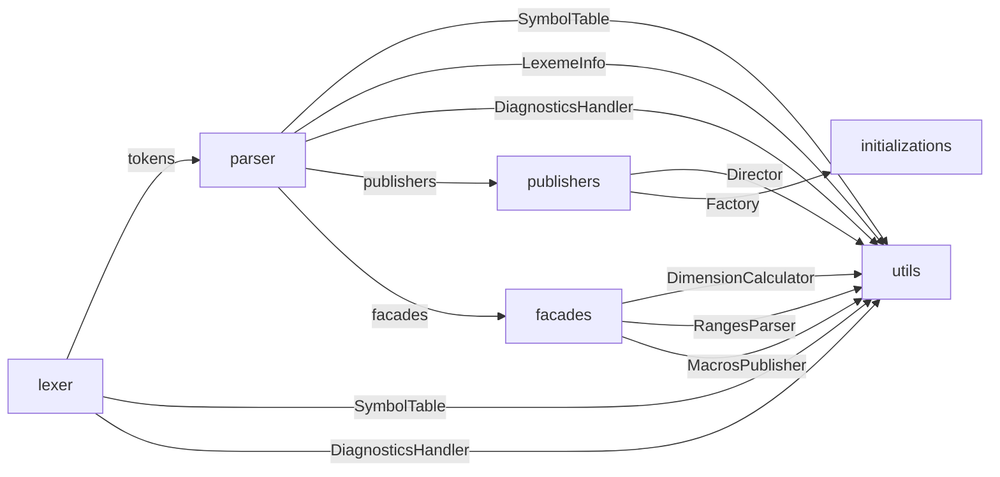
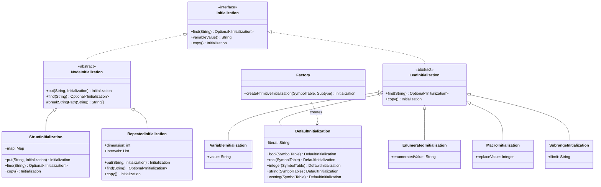
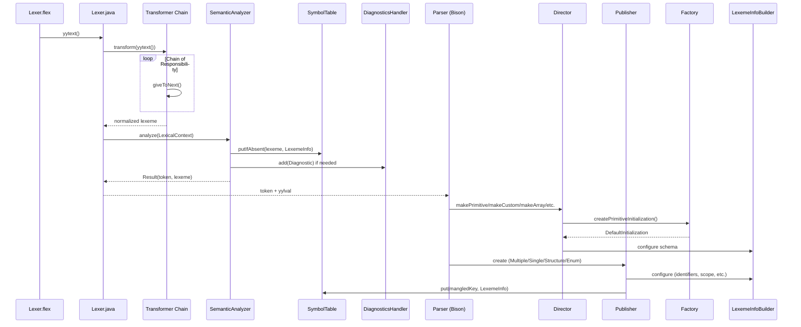
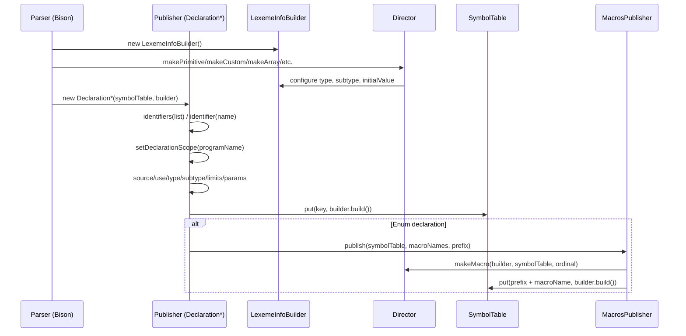

# Parser

Syntax analysis module generated with **GNU Bison 3.8.2** (LALR(1)) from `src/main/java/parser/Parser.y`; implements the **IEC 61131-7** grammar and **IEC 61131-3 Annex B**.

*Last update: 2026-10-20 (Architecture rewritten to reflect current Publisher/Director pattern)*

## Package Diagram



## Class Diagram

```mermaid
classDiagram
    namespace parser {
        class Parser {
            +parse()
        }
    }
    namespace parser_publishers {
        class Publisher {
            <<interface>>
            +setDeclarationScope(String)
            +publish()
        }
        class LexemeInfoSchema {
            <<interface>>
            +type(Type)
            +subtype(Subtype)
            +customType(String)
            +source(Source)
            +use(Use)
            +inferiorLimits(List~String~)
            +superiorLimits(List~String~)
            +parameters(List~String~)
            +initialValue(Object)
        }
        class DeclarationGroup {
            +declarations: List~Declaration~
            +publish()
            +setDeclarationScope(String)
        }
        class Declaration {
            #builder: LexemeInfoBuilder
            #declarationScope: String
            +type(Type)
            +subtype(Subtype)
            +customType(String)
            +source(Source)
            +use(Use)
            +inferiorLimits(List~String~)
            +superiorLimits(List~String~)
            +parameters(List~String~)
            +initialValue(Object)
            +publish()
        }
        class MultipleDeclaration {
            +identifiers: List~String~
            +identifiers(List~String~)
            +publish()
        }
        class SingleDeclaration {
            +identifier: String
            +identifier(String)
            +publish()
        }
        class DeclarationBlock {
            +addDeclaration(Declaration)
        }
        class StructureBlock {
            +addField(SingleDeclaration)
            +getStructInitializationInfo() List~PathInitializationInfo~
        }
        class StructureDeclaration {
            +structBlock: StructureBlock
            +identifier(String)
            +publish()
        }
        class AnnonymousEnumeratedVariable {
            +publish()
        }
        class AnnonymousEnumeratedField {
            +publish()
        }
        class EnumeratedTypeDeclaration {
            +publish()
        }
        DeclarationGroup ..|> Publisher
        Declaration ..|> Publisher
        Declaration ..|> LexemeInfoSchema
        DeclarationGroup ..|> LexemeInfoSchema
        MultipleDeclaration --|> Declaration
        SingleDeclaration --|> Declaration
        DeclarationBlock --|> DeclarationGroup
        StructureBlock --|> DeclarationGroup
        StructureDeclaration --|> SingleDeclaration
        AnnonymousEnumeratedVariable --|> MultipleDeclaration
        AnnonymousEnumeratedField --|> SingleDeclaration
        EnumeratedTypeDeclaration --|> SingleDeclaration
    }
    namespace parser_facades {
        class DimensionCalculator {
            +calculate(inferior, superior) int
        }
        class RangesParser {
            +parse(ranges, inferior, superior)
        }
        class MacrosPublisher {
            +publish(SymbolTable, List~String~, String)
        }
        class UnderlyingScopeSearcher {
            +search(SymbolTable, String) String
        }
    }
    namespace parser_initializations {
        class Factory {
            +createPrimitiveInitialization(SymbolTable, Subtype) Initialization
        }
        class Initialization {
            <<interface>>
            +find(String) Optional~Initialization~
            +variableValue() String
            +copy() Initialization
        }
        class NodeInitialization {
            <<abstract>>
            +put(String, Initialization) Initialization
            +find(String) Optional~Initialization~
            #breakStringPath(String) String[]
        }
        class LeafInitialization {
            <<abstract>>
            +find(String) Optional~Initialization~
            +copy() Initialization
        }
    }
    namespace parser_initializations_nodes {
        class StructInitialization {
            +map: Map
            +put(String, Initialization)
            +find(String) Optional~Initialization~
            +copy() Initialization
        }
        class RepeatedInitialization {
            +dimension: int
            +intervals: List
            +put(String, Initialization)
            +find(String) Optional~Initialization~
            +copy() Initialization
        }
    }
    namespace parser_initializations_leafs {
        class VariableInitialization {
            +value: String
        }
        class DefaultInitialization {
            -literal: String
            +bool(SymbolTable) DefaultInitialization
            +real(SymbolTable) DefaultInitialization
            +integer(SymbolTable) DefaultInitialization
            +string(SymbolTable) DefaultInitialization
            +wstring(SymbolTable) DefaultInitialization
        }
        class EnumeratedInitialization {
            +enumeratedValue: String
        }
        class MacroInitialization {
            +replaceValue: Integer
        }
        class SubrangeInitialization {
            +ilimit: String
        }
    }
    namespace utils {
        class SymbolTable {
            +table: Map~String, LexemeInfo~
            +get()
            +put()
            +putIfAbsent()
        }
        class LexemeInfo {
            +type: Type
            +subtype: Subtype
            +customType: String
            +use: Use
            +source: Source
            +inferiorLimits: List~String~
            +superiorLimits: List~String~
            +parameters: List~String~
            +initialValue: Object
        }
        class LexemeInfoBuilder {
            +type(Type)
            +subtype(Subtype)
            +customType(String)
            +source(Source)
            +use(Use)
            +inferiorLimits(List~String~)
            +superiorLimits(List~String~)
            +parameters(List~String~)
            +initialValue(Object)
            +build() LexemeInfo
        }
        class Director {
            +makePrimitive(LexemeInfoSchema, SymbolTable, Subtype)
            +makeCustom(LexemeInfoSchema, SymbolTable, String)
            +makeMacro(LexemeInfoSchema, SymbolTable, Integer)
            +makeEnumerated(LexemeInfoSchema, List~String~)
            +makeStructure(LexemeInfoSchema, StructureBlock)
            +makeArray(LexemeInfoSchema, SymbolTable, ArrayMetadata)
            +makeLiteral(LexemeInfoSchema)
            +makeDefaultInteger()
            +makeDefaultReal()
            +makeDefaultBoolean()
            +makeDefaultString()
            +makeDefaultWString()
        }
    }
    Parser --> Declaration : uses
    Parser --> Director : uses
    Parser --> Factory : uses
    Parser --> DimensionCalculator : uses
    Parser --> RangesParser : uses
    Parser --> MacrosPublisher : uses
    Director ..> Factory : uses
    Director ..> LexemeInfoBuilder : configures
    MultipleDeclaration ..> LexemeInfoBuilder : uses
    SingleDeclaration ..> LexemeInfoBuilder : uses
    StructureDeclaration ..> StructureBlock : uses
    AnnonymousEnumeratedVariable ..> MacrosPublisher : uses
    AnnonymousEnumeratedField ..> MacrosPublisher : uses
    EnumeratedTypeDeclaration ..> MacrosPublisher : uses
```

Class diagram: `doc/diagrams/parser_class_diagram.mmd` (generated by `scripts/generate_diagrams.py parser`).

## Class Table

| Class | Responsibility | Pattern |
|-------|---------------|---------|
| `parser.Parser` | LALR(1) parser generated by Bison; entry point `parse()` | Generated Parser |
| `parser.publishers.Publisher` | Interface for objects that publish symbols to the SymbolTable; extends `LexemeInfoSchema` | Interface / Strategy |
| `parser.publishers.Declaration` | Abstract base for single-symbol publishers; holds `LexemeInfoBuilder` | Template Method |
| `parser.publishers.MultipleDeclaration` | Publishes multiple identifiers sharing the same type/attributes (e.g., `VAR x, y : INT;`) | Composite |
| `parser.publishers.SingleDeclaration` | Publishes a single identifier (type declarations, structure fields) | Value Object |
| `parser.publishers.DeclarationBlock` | Groups `Declaration`s for a `VAR`/`VAR_INPUT`/`VAR_OUTPUT` section | Composite |
| `parser.publishers.StructureBlock` | Groups structure fields; extracts `PathInitializationInfo` for `StructInitialization` | Composite |
| `parser.publishers.StructureDeclaration` | Publishes a STRUCT type; delegates field publication to `StructureBlock` | Composite |
| `parser.publishers.AnnonymousEnumeratedVariable` | Publishes anonymous enum variable + its enum literals as macros | Publisher + Macro |
| `parser.publishers.AnnonymousEnumeratedField` | Publishes anonymous enum field + its enum literals as macros | Publisher + Macro |
| `parser.publishers.EnumeratedTypeDeclaration` | Publishes named enum type + its enum literals as macros | Publisher + Macro |
| `parser.facades.DimensionCalculator` | Calculates total cardinality of multidimensional arrays from limits | Calculator |
| `parser.facades.RangesParser` | Parses flat range list into alternating inferior/superior limits | Parser |
| `parser.facades.MacrosPublisher` | Publishes enum literals as MACRO entries in SymbolTable with ordinal values | Publisher |
| `parser.facades.UnderlyingScopeSearcher` | Follows custom type chain to root scope containing fields/enums | Searcher |
| `utils.Director` | Predefined recipes for common `LexemeInfo` configurations (primitives, custom, arrays, structs, enums, macros) | Builder Director |
| `utils.LexemeInfoBuilder` | Fluent builder for `LexemeInfo` immutable DTOs | Builder |
| `parser.initializations.Factory` | Creates default initializations for all primitive types via `DefaultInitialization` | Factory |
| `parser.initializations.Initialization` | Interface for polymorphic initial values (`find`, `variableValue`, `copy`) | Composite / Strategy |
| `parser.initializations.nodes.NodeInitialization` | Abstract base for composite initializations (structs, arrays) | Composite |
| `parser.initializations.nodes.StructInitialization` | Map `field → Initialization` with composite keys for nested structs | Composite |
| `parser.initializations.nodes.RepeatedInitialization` | Partitioned intervals `[start, end] → Initialization` for repeated arrays | Interval Map |
| `parser.initializations.leafs.LeafInitialization` | Abstract base for leaf initializations (no children) | Leaf |
| `parser.initializations.leafs.VariableInitialization` | Wraps a literal or identifier as explicit initial value | Value Object |
| `parser.initializations.leafs.DefaultInitialization` | Lazy default values for primitives (BOOL, INT, REAL, STRING, WSTRING) | Value Object / Lazy Init |
| `parser.initializations.leafs.EnumeratedInitialization` | First enum value acting as default | Value Object |
| `parser.initializations.leafs.MacroInitialization` | Ordinal value of enum literal registered as `Subtype.INT` | Value Object |
| `parser.initializations.leafs.SubrangeInitialization` | Lower bound as default; retains bounds | Value Object |

Sources by subpackage:

| Subpackage | Directory |
|------------|-----------|
| `parser` | `src/main/java/parser/` |
| `parser.publishers` | `src/main/java/parser/publishers/` |
| `parser.facades` | `src/main/java/parser/facades/` |
| `parser.initializations` | `src/main/java/parser/initializations/` |
| `parser.initializations.leafs` | `src/main/java/parser/initializations/leafs/` |
| `parser.initializations.nodes` | `src/main/java/parser/initializations/nodes/` |
| `parser.utils` | `src/main/java/parser/utils/` |

## Architecture Overview

The parser uses a **Publisher + Director + Builder** architecture for semantic actions:

```
┌─────────────┐     ┌──────────────────┐     ┌──────────────────┐
│ Parser.y    │────▶│ Declaration*     │────▶│ LexemeInfoBuilder│
│ (semantic   │     │ (Publisher impl) │     │ (fluent config)  │
│  actions)   │     └────────┬─────────┘     └────────┬─────────┘
└─────────────┘              │                      │
                             │ publish()            │ build()
                             ▼                      ▼
                    ┌──────────────────┐     ┌──────────────┐
                    │ SymbolTable.put() │     │  LexemeInfo  │
                    └──────────────────┘     └──────────────┘
                             │
                             │ Director.makeXxx()
                             ▼
                    ┌──────────────────┐
                    │ Factory /        │
                    │ Initialization   │
                    └──────────────────┘
```

### Key Components

1. **`LexemeInfoSchema`** — Fluent interface for configuring semantic attributes (`type`, `subtype`, `customType`, `source`, `use`, `inferiorLimits`, `superiorLimits`, `parameters`, `initialValue`).

2. **`LexemeInfoBuilder`** — Concrete implementation of `LexemeInfoSchema` that builds immutable `LexemeInfo` DTOs.

3. **`Director`** — Static utility class providing predefined "recipes" for common semantic patterns:
   - `makePrimitive()` — Primitive types (BOOL, INT, REAL, STRING, etc.)
   - `makeCustom()` — Custom/user-defined types
   - `makeArray()` — Array types with dimension calculation
   - `makeStructure()` — Struct types from `StructureBlock`
   - `makeEnumerated()` — Enumerated types
   - `makeMacro()` — Enum literals as MACRO entries
   - `makeLiteral()` / `makeDefaultXxx()` — Literal values

4. **`Publisher` hierarchy** — Objects that collect identifiers and configuration, then publish to `SymbolTable`:
   - `Declaration` (abstract) — Base for single-symbol publishers
   - `MultipleDeclaration` — Multiple identifiers, same type (e.g., `VAR a, b, c : INT;`)
   - `SingleDeclaration` — Single identifier (type declarations, struct fields)
   - `DeclarationGroup` / `DeclarationBlock` — Groups of declarations (`VAR ... END_VAR`)
   - `StructureBlock` / `StructureDeclaration` — Struct type with fields
   - `AnnonymousEnumeratedVariable/Field` — Anonymous enum in variable/field declaration
   - `EnumeratedTypeDeclaration` — Named enum in `TYPE ... END_TYPE`

5. **`Factory` + `Initialization` hierarchy** — Polymorphic initial values:
   - `DefaultInitialization` — **All** primitive defaults (BOOL, INT, REAL, STRING, WSTRING)
   - `VariableInitialization` — Explicit literal/identifier
   - `EnumeratedInitialization` — First enum value
   - `MacroInitialization` — Enum ordinal as INT
   - `SubrangeInitialization` — Lower bound
   - `StructInitialization` — Field → Initialization map
   - `RepeatedInitialization` — Interval map for arrays

> **Note:** The classes `StringInitialization`, `WStringInitialization`, `BooleanInitialization`, `IntInitialization`, `RealInitialization`, and `AbstractPrimitiveInitialization` **no longer exist**; their roles are entirely fulfilled by `DefaultInitialization`.

## Supported Grammar — Summary

### Grammar Metrics

| Metric | Value | Source |
|--------|-------|--------|
| Declared tokens | 82 | `%token` directives in `src/main/java/parser/Parser.y` |
| Non-terminals | 139 | `enum SymbolKind` constants in `Parser.java` with index ≥ `S_YYACCEPT`; includes `$accept` |
| Initialization types | 7 | Concrete classes in `initializations/leafs/` and `nodes/` (excludes interface and abstract bases) |

Chart: `assets/parser_grammar_stats.png` — declared tokens, non-terminals, and initialization types from the Bison grammar (generated by `scripts/extract_stats.py`).

The 7 concrete initialization types are: `VariableInitialization`, `EnumeratedInitialization`, `MacroInitialization`, `RepeatedInitialization`, `StructInitialization`, `SubrangeInitialization`, `DefaultInitialization`.

### Main IEC 61131-7 Blocks

```
program → opt_data_type_declaration function_block_declaration

function_block_declaration → FUNCTION_BLOCK function_block_name
    opt_fb_io_var_declarations_list   (VAR_INPUT / VAR_OUTPUT)
    opt_other_var_declarations_list   (VAR)
    opt_function_block_body
    END_FUNCTION_BLOCK

opt_function_block_body → opt_fuzzify_block_list
    opt_defuzzify_block_list
    opt_rule_block_list
    opt_option_block_list
```

### Fuzzify / Defuzzify

```
fuzzify_block → FUZZIFY IDENTIFIER linguistic_term_list END_FUZZIFY
linguistic_term → TERM IDENTIFIER ASSIGN_OP IDENTIFIER ';'
              | TERM IDENTIFIER ASSIGN_OP membership_function ';'
membership_function → singleton | point_list
point_list → point | point_list point
point → '(' numeric_constant ',' numeric_constant ')'
      | '(' IDENTIFIER ',' numeric_constant ')'

defuzzify_block → DEFUZZIFY IDENTIFIER
    opt_range
    opt_linguistic_term_list
    defuzzification_method
    default_value
    END_DEFUZZIFY
defuzzification_method → METHOD ':' defuzz_method ';'
defuzz_method → COG | COGS | COA | LM | RM
default_value → DEFAULT ASSIGN_OP default_val ';'
default_val → numeric_constant | NC
opt_range → empty | RANGE '(' numeric_constant RANGE_OP numeric_constant ')' ';'
```

### Rule Block

```
rule_block → RULEBLOCK IDENTIFIER
    operator_definition
    activation_method_opt
    accumulation_method
    rule_list
    END_RULEBLOCK

operator_definition → opt_operator_or operator_and_opt ';'
opt_operator_or → empty | OR ':' or_type
operator_and_opt → empty | AND ':' and_type
or_type → MAX | ASUM | BSUM
and_type → MIN | PROD | BDIF
activation_method → ACT ':' act_type ';'
act_type → PROD | MIN
accumulation_method → ACCU ':' accu_type ';'
accu_type → MAX | BSUM | NSUM

rule → RULE numeric_constant ':' IF condition THEN conclusion_list opt_weighting ';'
condition → x condition_tail | IDENTIFIER condition_tail
x → NOT x | NOT IDENTIFIER | subcondition | '(' condition ')'
subcondition → IDENTIFIER IS IDENTIFIER | IDENTIFIER IS NOT IDENTIFIER
conclusion_list → IDENTIFIER IS IDENTIFIER | IDENTIFIER
              | conclusion_list ',' IDENTIFIER IS IDENTIFIER
              | conclusion_list ',' IDENTIFIER
```

### Variable Declarations — IEC 61131-3 Annex B

```
var_declarations → var_id_decl var_constant_spec var_init_decl_list ';' END_VAR
var_id_decl → VAR { source=INTERNAL, use=VARIABLE }
io_var_decl → VAR_INPUT { source=IN, use=VARIABLE }
         | VAR_OUTPUT { source=OUT, use=VARIABLE }

var_init_decl → identifier_list ':' var_spec_init
           | identifier_list ':' standard_function_block_spec_init
var_spec_init → custom_spec_init | boolean_spec_init | simple_spec_init
           | subrange_spec_init | enumerated_spec_init | array_spec_init | string_spec_init
```

### Data Types

```
simple_specification → elementary_type_name  { subtype ∈ {SINT..ULINT, REAL, LREAL, TIME, DATE, ...} }
custom_specification → IDENTIFIER  { subtype=CUSTOM, customType=IDENTIFIER }
subrange_specification → subrange_type_decl '(' range ')'
range → numeric_constant RANGE_OP numeric_constant
enumerated_specification → '(' enumerated_values ')'
array_specification → ARRAY '[' range_list ']' OF IDENTIFIER
                  | ARRAY '[' range_list ']' OF non_generic_type_name
structure_specification → STRUCT structure_field_declaration_list END_STRUCT
type_string_specification → STRING { subtype=STRING } | WSTRING { subtype=WSTRING }
string_specification → type_string_specification
                  | type_string_specification '[' numeric_constant ']'
```

### Initializations

```
string_spec_init → string_specification | initialized_string
initialized_string → string_specification ASSIGN_OP string_constant

initialized_simple → simple_specification ASSIGN_OP constant
initialized_custom → custom_type_name ASSIGN_OP constant
                  | custom_type_name ASSIGN_OP identifier_with_opt_mangling
                  | custom_type_name ASSIGN_OP structure_initialization
initialized_boolean → boolean_specification edge
                   | boolean_specification ASSIGN_OP boolean_constant
initialized_subrange → subrange_specification ASSIGN_OP numeric_constant
initialized_enumerated → enumerated_specification ASSIGN_OP identifier_with_opt_mangling
initialized_array → array_specification ASSIGN_OP array_initialization
array_initialization → '[' array_initial_elements_list ']'
array_initial_elements → constant | identifier_with_opt_mangling
                       | structure_initialization | array_initialization
repeated_initial_element → numeric_constant '(' array_initial_element ')'
structure_initialization → '(' structure_field_initialization_list ')'
initialized_structure_field → nested_field ASSIGN_OP constant
                           | nested_field ASSIGN_OP identifier_with_opt_mangling
                           | nested_field ASSIGN_OP array_initialization
                           | nested_field ASSIGN_OP structure_initialization
nested_field → IDENTIFIER
identifier_with_opt_mangling → IDENTIFIER | IDENTIFIER '#' IDENTIFIER
```

### Data Type Declaration

```
data_type_declaration → type_id_decl type_declaration_list END_TYPE
type_id_decl → TYPE { use=TYPE, source=NONE }
type_declaration → type_name_declaration ':' type_spec_init
type_spec_init → custom_spec_init | simple_spec_init | enumerated_spec_init
             | subrange_spec_init | array_spec_init | structure_specification | string_spec_init
```

## Key Semantic Actions

Excerpt from `src/main/java/parser/Parser.y`:

| Rule | Semantic Action |
|------|-----------------|
| `function_block_name` | Stores `programName = $1` for scope mangling |
| `fb_io_var_declarations` | `$3.source($1).use(Use.VARIABLE).setDeclarationScope(programName); $3.publish()` |
| `var_declarations` | `$3.source(Source.INTERNAL).use($2).setDeclarationScope(programName); $3.publish()` |
| `var_init_decl` | `$3.identifiers($1)` — associates identifier list with type spec |
| `custom_specification` | `Director.makeCustom(builder, symbolTable, $1)` — looks up type in SymbolTable |
| `simple_specification` | `Director.makePrimitive(builder, symbolTable, $1)` — primitive with default init |
| `boolean_specification` | `Director.makePrimitive(builder, symbolTable, Subtype.BOOL)` |
| `string_specification` | Configures STRING/WSTRING with optional length; `Director.makePrimitive` for default |
| `initialized_custom_with_constant` | `$1.initialValue(new VariableInitialization($3))` |
| `initialized_custom_with_identifier` | Validates enum reference; mangles as `typeName#value` |
| `initialized_custom_with_structure` | Merges `StructInitialization` field values |
| `initialized_simple` | `$1.initialValue(new VariableInitialization($3))` |
| `initialized_boolean` | `$1.initialValue(new VariableInitialization($3))` |
| `enumerated_specification` | `Director.makeEnumerated(builder, $2)` — creates enum type with parameters |
| `initialized_enumerated` | `$1.initialValue(new VariableInitialization(programName + "#" + $3))` |
| `array_specification` | `Director.makeArray(builder, symbolTable, ArrayMetadata)` — computes dimension |
| `initialized_array` | Populates `RepeatedInitialization` with interval → value mappings |
| `array_initial_elements_list` | Builds `ParsingRepeatedArrayContext` with mangled paths `start..end#path` |
| `structure_field_init_decl` | `$3.identifier($1).use(Use.FIELD).source(Source.NONE)` |
| `structure_specification` | `StructureDeclaration` + `Director.makeStructure()` → `StructInitialization` |
| `type_declaration` | `$3.identifier($1).use(Use.TYPE).source(Source.NONE); $3.publish()` |

Notes:
- `Director.makePrimitive` delegates to `Factory.createPrimitiveInitialization` → `DefaultInitialization` (supports **all** primitive subtypes: BOOL, STRING, WSTRING, REAL/LREAL, all integers SINT..ULINT, TIME, DATE, bit strings BYTE..LWORD).
- Enum literals are published as MACRO entries via `MacrosPublisher` with ordinal `replaceValue`.
- `SymbolTable` keys are mangled: `FB#varName` for FB-scoped variables, `TypeName` for types, `FB#StructType#field` for struct fields.

## Initializations — Hierarchy and Usage



Default behavior of `variableValue`:

| Class | Default Value | `SymbolTable` Registration |
|-------|---------------|---------------------------|
| `VariableInitialization` | assigned literal or identifier | does not register (wrapper only) |
| `DefaultInitialization` BOOL | `FALSE` | `putIfAbsent` via `Director.makeDefaultBoolean` |
| `DefaultInitialization` REAL | `0.0` | `putIfAbsent` via `Director.makeDefaultReal` |
| `DefaultInitialization` INT | `0` | `putIfAbsent` via `Director.makeDefaultInteger` |
| `DefaultInitialization` STRING | `''` | `putIfAbsent` via `Director.makeDefaultString` |
| `DefaultInitialization` WSTRING | `""` | `putIfAbsent` via `Director.makeDefaultWString` |
| `EnumeratedInitialization` | first enum value | does not register (selects the value) |
| `MacroInitialization` | ordinal of enum literal | `putIfAbsent` with `subtype=INT` |
| `SubrangeInitialization` | lower bound | does not register |
| `StructInitialization` | map: field → `Initialization` | does not register |
| `RepeatedInitialization` | partition of intervals `[start, end]` | does not register |

All lazy default values use `SymbolTable.putIfAbsent`, ensuring the same table doesn't duplicate a literal's entry.

## Lexer → Parser → SymbolTable Flow



Sequence diagram: `doc/diagrams/lexer_parser_sequence.mmd`.

## Publisher → SymbolTable Sequence



Sequence diagram: `doc/diagrams/publisher_sequence.mmd`.

## Symbol Table — Population from the Parser


Storage diagram: `doc/diagrams/symboltable_storage.mmd`.

Keys are capitalized because the lexer normalizes identifiers; for example, `MAIN#STRVAR` and `STRINGTYPE` in `StringTypeIT`.

| Type | When it is published | Key in SymbolTable | Highlighted LexemeInfo |
|------|---------------------|--------------------|------------------------|
| Simple variable | `var_init_decl` (simple_spec_init) | `FB#varName` | type=SIMPLE, subtype=REAL or BOOL, initialValue=DefaultInitialization |
| String variable | `var_init_decl` (string_spec_init) | `FB#varName` | type=SIMPLE, subtype=STRING/WSTRING, superiorLimits=[n] if length provided, initialValue=DefaultInitialization |
| Initialized string | `initialized_string` | `FB#varName` | initialValue=VariableInitialization(string_constant) |
| String type | `type_declaration` (string_spec_init) | `TypeName` | use=TYPE, source=NONE, subtype=STRING/WSTRING, superiorLimits=[n] |
| Custom variable | `var_init_decl` (custom_spec_init) | `FB#varName` | type=SIMPLE, subtype=CUSTOM, customType=TypeName, initialValue=Type.initialValue |
| Initialized variable | `initialized_simple/custom/boolean/string` | `FB#varName` | initialValue=VariableInitialization(literal) |
| Array | `var_init_decl` (array_spec_init) | `FB#arrName` | type=ARRAY, subtype=elementType, initialValue=RepeatedInitialization(dimension, defaultInit) |
| Initialized array | `initialized_array` | `FB#arrName` | initialValue=RepeatedInitialization with intervals |
| Struct | `type_declaration` after `structure_specification` | `TypeName` | type=STRUCT, subtype=NONE, parameters=[field1..], initialValue=StructInitialization |
| Enum type | `type_declaration` (enumerated_spec_init) | `TypeName` | type=ENUMERATE, subtype=INT, parameters=[A,B,C], initialValue=EnumeratedInitialization |
| Enum literal (macro) | `AnnonymousEnumeratedVariable.publish()` | `FB#ENUMVAL` or `FB#EnumType#ENUMVAL` | type=SIMPLE, use=MACRO, subtype=INT, initialValue=MacroInitialization(ordinal) |

## Facade Utilities

### DimensionCalculator
Calculates total element count for multidimensional arrays:
```java
int dimension = DimensionCalculator.calculate(inferiorLimits, superiorLimits);
// For ARRAY[0..2, 0..3] OF INT: inferior=[0,0], superior=[2,3] → 3*4 = 12
```

### RangesParser
Converts flat range list `[ilow1, ihigh1, ilow2, ihigh2, ...]` into separate `inferiorLimits` and `superiorLimits` lists.

### MacrosPublisher
Publishes enum literals as MACRO entries:
```java
MacrosPublisher.publish(symbolTable, enumValues, prefix);
// For enum (A, B, C) in FB "MAIN": publishes MAIN#A, MAIN#B, MAIN#C with ordinal 0,1,2
```

### UnderlyingScopeSearcher
Resolves custom type chains to find the root scope containing fields/enums:
```java
String rootScope = UnderlyingScopeSearcher.search(symbolTable, "FB#MyCustomType");
// Returns the mangled name of the root type declaration
```

## Differences from Previous Architecture

| Old (Documentation) | Current (Code) |
|---------------------|----------------|
| `ContextHandler` + `ParsingContext` stack | `Publisher` hierarchy (Declaration, DeclarationBlock, StructureDeclaration, etc.) |
| `NameMangler` with `#` separator | Mangling done inline in `Publisher.publish()` via `declarationScope + "#" + identifier` |
| Separate `Publisher` class | `Publisher` is now an interface implemented by `Declaration` and `DeclarationGroup` |
| `ContextHandler.publish()` builds and puts | Each `Publisher` implementation calls `symbolTable.put()` directly |
| `ParsingContext` held `declaredIdentifiers` | Identifiers stored in `MultipleDeclaration.identifiers` list |
| `LexemeInfoBuilder` per context | `LexemeInfoBuilder` per `Declaration` (or shared via `Director` recipes) |

The new architecture is **flatter**, **more explicit**, and **easier to trace** — each declaration type has its own publisher class with clear responsibilities.
