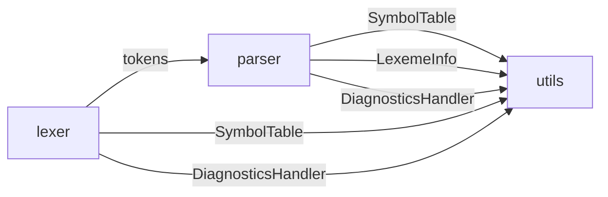
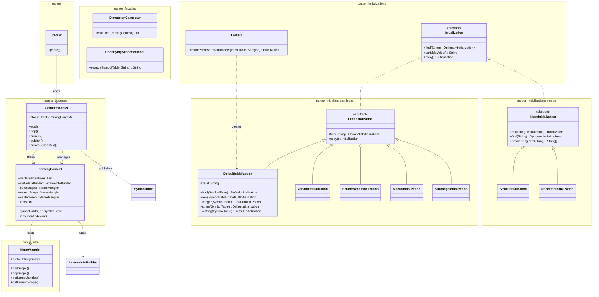
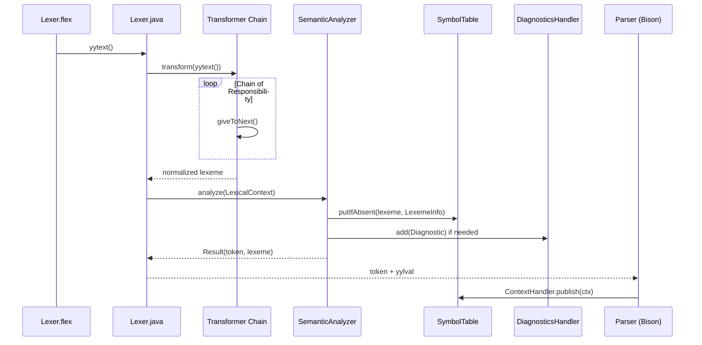
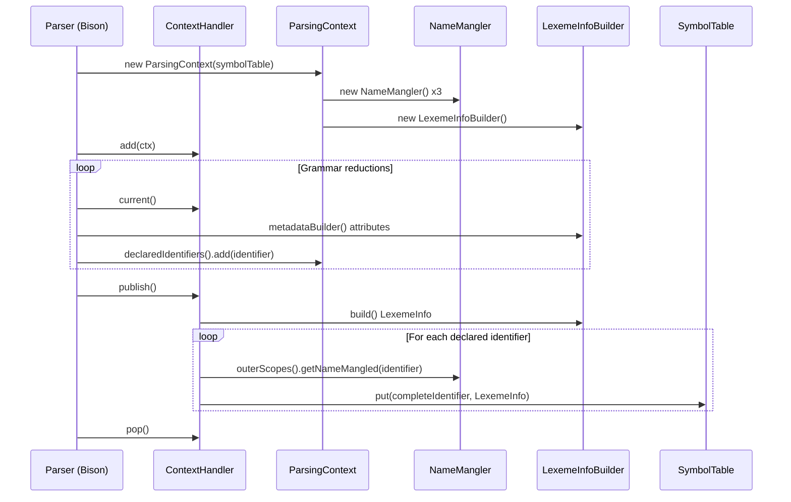
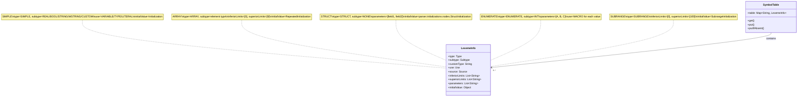

# Parser

Syntax analysis module generated with **GNU Bison 3.8.2** (LALR(1)) from `src/main/java/parser/Parser.y`; implements the **IEC 61131-7** grammar and **IEC 61131-3 Annex B**.

*Last update: 2026-10-18 (Metrics updated from jacoco.xml and stats.json; coverage, LOC, and complexity)*

## Package Diagram



## Class Diagram



Class diagram: `doc/diagrams/parser_class_diagram.mmd` (generated by `scripts/generate_diagrams.py parser`).

## Class Table

| Class                                                   | Responsibility                                                                                                                                 | Pattern                  |
|---------------------------------------------------------|------------------------------------------------------------------------------------------------------------------------------------------------|--------------------------|
| `parser.Parser`                                         | LALR(1) parser generated by Bison; entry point `parse()`                                                                                       | Generated Parser         |
| `parser.internals.ContextHandler`                       | LIFO stack of nested parsing contexts; operations `add`, `pop`, `current`, `publish`, `createSubcontext`                                       | Stack / Context Manager  |
| `parser.internals.ParsingContext`                       | Mutable context per scope: declared identifiers, semantic builder, three `NameMangler` instances, and array index                              | Context Object           |
| `parser.utils.NameMangler`                              | Hierarchical prefixes with separator `#` (`FB#TYPE#FIELD`) for name resolution                                                                 | Name Mangling            |
| `parser.initializations.Factory`                        | Creates default initializations for **all** primitive types (BOOL, INT, REAL, LREAL, STRING, WSTRING and variants) via `DefaultInitialization` | Factory                  |
| `parser.facades.DimensionCalculator`                    | Calculates the total cardinality of multidimensional arrays from `inferiorLimits`/`superiorLimits`                                             | Calculator               |
| `parser.facades.UnderlyingScopeSearcher`                | Follows the custom type chain up to the root scope containing fields/enums                                                                     | Searcher                 |
| `parser.initializations.Initialization`                 | Interface for polymorphic initial values (`find`, `variableValue`, `copy`)                                                                     | Composite / Strategy     |
| `parser.initializations.nodes.NodeInitialization`       | Abstract base for composite initializations (structs, arrays); `put`/`find` operations by path                                                 | Composite                |
| `parser.initializations.nodes.StructInitialization`     | Map `field → Initialization` with composite keys for nested structs                                                                            | Composite                |
| `parser.initializations.nodes.RepeatedInitialization`   | Partitioned in intervals `[start, end] → Initialization` for repeated arrays                                                                   | Interval Map             |
| `parser.initializations.leafs.LeafInitialization`       | Abstract base for leaf initializations (no children); `find` only resolves an empty path, `copy` returns `this`                                | Leaf                     |
| `parser.initializations.leafs.VariableInitialization`   | Wraps a literal or identifier as an explicit initial value                                                                                     | Value Object             |
| `parser.initializations.leafs.EnumeratedInitialization` | First value of an enum acting as the default value                                                                                             | Value Object             |
| `parser.initializations.leafs.MacroInitialization`      | Ordinal value of an enumerated literal registered as `Subtype.INT`                                                                             | Value Object             |
| `parser.initializations.leafs.SubrangeInitialization`   | Lower bound acting as default value; retains lower and upper bounds                                                                            | Value Object             |
| `parser.initializations.leafs.DefaultInitialization`    | Lazy default values for primitives (BOOL, INT, REAL, STRING, WSTRING) registered in `SymbolTable` via `Director`                               | Value Object / Lazy Init |

Sources by subpackage:

| Subpackage                     | Directory                                     |
|--------------------------------|-----------------------------------------------|
| `parser`                       | `src/main/java/parser/`                       |
| `parser.internals`             | `src/main/java/parser/internals/`             |
| `parser.utils`                 | `src/main/java/parser/utils/`                 |
| `parser.facades`               | `src/main/java/parser/facades/`               |
| `parser.initializations`       | `src/main/java/parser/initializations/`       |
| `parser.initializations.leafs` | `src/main/java/parser/initializations/leafs/` |
| `parser.initializations.nodes` | `src/main/java/parser/initializations/nodes/` |

`DefaultInitialization` (`parser.initializations.leafs`) implements default values for **all** primitive subtypes: BOOL, STRING, WSTRING, REAL/LREAL, and all integers (SINT..ULINT). `Factory.createPrimitiveInitialization` in `parser.initializations` delegates to `DefaultInitialization`. The classes `StringInitialization`, `WStringInitialization`, `BooleanInitialization`, `RealInitialization`, `IntInitialization`, and `AbstractPrimitiveInitialization` **no longer exist**.

## Supported Grammar — Summary

### Grammar Metrics

| Metric               | Value | Source                                                                                                                                                                              |
|----------------------|-------|-------------------------------------------------------------------------------------------------------------------------------------------------------------------------------------|
| Declared tokens      | 82    | `%token` directives in `src/main/java/parser/Parser.y`                                                                                                                              |
| Non-terminals        | 139   | `enum SymbolKind` constants in `src/main/java/parser/Parser.java` with index ≥ `S_YYACCEPT`; includes `$accept`                                                                     |
| Initialization types | 7     | Concrete classes in `src/main/java/parser/initializations/leafs/` and `nodes/` (excludes `Initialization.java` interface, and abstract `NodeInitialization` / `LeafInitialization`) |

Chart: `assets/parser_grammar_stats.png` — declared tokens, non-terminals, and initialization types from the Bison grammar (generated by `scripts/extract_stats.py`).

The non-terminal count aligns with the "Nonterminals" section in the Bison report. Previous values of 231 counted all `SymbolKind` constants, including terminals.
The 7 concrete initialization types are: `VariableInitialization`, `EnumeratedInitialization`, `MacroInitialization`, `RepeatedInitialization`, `StructInitialization`, `SubrangeInitialization`, `DefaultInitialization`.

### Main IEC 61131-7 Blocks

```
program → opt_data_type_declaration function_block_declaration

function_block_declaration → FUNCTION_BLOCK function_block_name
    opt_fb_io_var_declarations_list   (VAR_INPUT / VAR_OUTPUT)
    opt_other_var_declarations_list   (VAR)
    opt_function_block_body
    END_FUNCTION_BLOCK

opt_function_block_body → opt_fuzzify_block_list
    opt_defuzzify_block_list
    opt_rule_block_list
    opt_option_block_list

```

### Fuzzify / Defuzzify

```
fuzzify_block → FUZZIFY IDENTIFIER linguistic_term_list END_FUZZIFY
linguistic_term → TERM IDENTIFIER ASSIGN_OP IDENTIFIER ';'
                | TERM IDENTIFIER ASSIGN_OP membership_function ';'
membership_function → singleton | point_list
point_list → point | point_list point
point → '(' numeric_constant ',' numeric_constant ')'
      | '(' IDENTIFIER ',' numeric_constant ')'

defuzzify_block → DEFUZZIFY IDENTIFIER
    opt_range
    opt_linguistic_term_list
    defuzzification_method
    default_value
    END_DEFUZZIFY
defuzzification_method → METHOD ':' defuzz_method ';'
defuzz_method → COG | COGS | COA | LM | RM
default_value → DEFAULT ASSIGN_OP default_val ';'
default_val → numeric_constant | NC
opt_range → empty | RANGE '(' numeric_constant RANGE_OP numeric_constant ')' ';'

```

### Rule Block

```
rule_block → RULEBLOCK IDENTIFIER
    operator_definition
    activation_method_opt
    accumulation_method
    rule_list
    END_RULEBLOCK

operator_definition → opt_operator_or operator_and_opt ';'
opt_operator_or → empty | OR ':' or_type
operator_and_opt → empty | AND ':' and_type
or_type → MAX | ASUM | BSUM
and_type → MIN | PROD | BDIF
activation_method → ACT ':' act_type ';'
act_type → PROD | MIN
accumulation_method → ACCU ':' accu_type ';'
accu_type → MAX | BSUM | NSUM

rule → RULE numeric_constant ':' IF condition THEN conclusion_list opt_weighting ';'
condition → x condition_tail | IDENTIFIER condition_tail
x → NOT x | NOT IDENTIFIER | subcondition | '(' condition ')'
subcondition → IDENTIFIER IS IDENTIFIER | IDENTIFIER IS NOT IDENTIFIER
conclusion_list → IDENTIFIER IS IDENTIFIER | IDENTIFIER
                | conclusion_list ',' IDENTIFIER IS IDENTIFIER
                | conclusion_list ',' IDENTIFIER

```

### Variable Declarations — IEC 61131-3 Annex B

```
var_declarations → var_id_decl var_constant_spec var_init_decl_list ';' END_VAR
var_id_decl → VAR { source=INTERNAL, use=VARIABLE }
io_var_decl → VAR_INPUT { source=IN, use=VARIABLE }
           | VAR_OUTPUT { source=OUT, use=VARIABLE }

var_init_decl → identifier_list ':' var_spec_init { contexts.publish() }
             | identifier_list ':' standard_function_block_spec_init
var_spec_init → custom_spec_init | boolean_spec_init | simple_spec_init
             | subrange_spec_init | enumerated_spec_init | array_spec_init | string_spec_init

```

### Data Types

```
simple_specification → elementary_type_name  { subtype ∈ {SINT..ULINT, REAL, LREAL, TIME, DATE, ...} }
custom_specification → IDENTIFIER  { subtype=CUSTOM, customType=IDENTIFIER }
subrange_specification → subrange_type_decl '(' range ')'
range → numeric_constant RANGE_OP numeric_constant
enumerated_specification → '(' enumerated_values ')'
array_specification → ARRAY '[' range_list ']' OF IDENTIFIER
                    | ARRAY '[' range_list ']' OF non_generic_type_name
structure_specification → STRUCT structure_field_declaration_list END_STRUCT
type_string_specification → STRING { subtype=STRING } | WSTRING { subtype=WSTRING }
string_specification → type_string_specification
                     | type_string_specification '[' numeric_constant ']'

```

### Initializations

```
string_spec_init → string_specification | initialized_string
initialized_string → string_specification ASSIGN_OP string_constant

initialized_simple → simple_specification ASSIGN_OP constant
initialized_custom → custom_type_name ASSIGN_OP constant
                   | custom_type_name ASSIGN_OP identifier_with_opt_mangling
                   | custom_type_name ASSIGN_OP structure_initialization
initialized_boolean → boolean_specification edge
                    | boolean_specification ASSIGN_OP boolean_constant
initialized_subrange → subrange_specification ASSIGN_OP numeric_constant
initialized_enumerated → enumerated_specification ASSIGN_OP identifier_with_opt_mangling
initialized_array → array_specification ASSIGN_OP array_initialization
array_initialization → array_init_open_square_bracket array_initial_elements_list ']'
array_initial_elements → constant | identifier_with_opt_mangling
                       | structure_initialization | array_initialization
repeated_initial_element → numeric_constant '(' array_initial_element ')'
structure_initialization → struct_init_open_parenthesis structure_field_initialization_list ')'
initialized_structure_field → nested_field ASSIGN_OP constant
                            | nested_field ASSIGN_OP identifier_with_opt_mangling
                            | nested_field ASSIGN_OP array_initialization
                            | nested_field ASSIGN_OP structure_initialization
nested_field → IDENTIFIER
identifier_with_opt_mangling → IDENTIFIER | IDENTIFIER '#' IDENTIFIER

```

### Data Type Declaration

```
data_type_declaration → type_id_decl type_declaration_list END_TYPE
type_id_decl → TYPE { use=TYPE, source=NONE }
type_declaration → type_name_declaration ':' type_spec_init
type_spec_init → custom_spec_init | simple_spec_init | enumerated_spec_init
               | subrange_spec_init | array_spec_init | structure_specification | string_spec_init

```

## Key Semantic Actions

Excerpt from `src/main/java/parser/Parser.y`:

| Rule                              | Semantic Action                                                                                                                                  |
|-----------------------------------|--------------------------------------------------------------------------------------------------------------------------------------------------|
| `function_block_name`             | Creates `ParsingContext`, adds the name to `outerScopes`, `contexts.add(ctx)`                                                                    |
| `function_block_declaration`      | Upon reducing `END_FUNCTION_BLOCK`: `contexts.pop()`                                                                                             |
| `io_var_decl` (VAR_INPUT)         | `ctx.metadataBuilder().source(Source.IN).use(Use.VARIABLE)`                                                                                      |
| `io_var_decl` (VAR_OUTPUT)        | `ctx.metadataBuilder().source(Source.OUT).use(Use.VARIABLE)`                                                                                     |
| `var_id_decl` (VAR)               | `ctx.metadataBuilder().source(Source.INTERNAL).use(Use.VARIABLE)`                                                                                |
| `var_init_decl`                   | `contexts.publish(); ctx.declaredIdentifiers().clear()`                                                                                          |
| `custom_type_name`                | Looks up `LexemeInfo`, sets `type=SIMPLE, subtype=CUSTOM`, and adds the underlying scope to `searchScope`                                        |
| `custom_specification`            | Sets `type=SIMPLE, subtype=CUSTOM, customType=$1`, fetching `initialValue` from `SymbolTable`                                                    |
| `simple_specification`            | `type=SIMPLE, subtype=$1, initialValue=Factory.createPrimitiveInitialization(...)`                                                               |
| `range`                           | Accumulates bounds in the builder's `inferiorLimits` / `superiorLimits`                                                                          |
| `enumerated_values_list`          | Creates child context per enum value, sets `use=MACRO, source=NONE`, publishes each literal                                                      |
| `array_specification`             | `type=ARRAY, initialValue=RepeatedInitialization(dimension, defaultInit)` for custom or primitive element                                        |
| `array_initial_elements`          | Consolidates intervals using `RepeatedInitialization.addInterval(start, end, init)` and resets the index                                         |
| `structure_field_declaration`     | New context per field, `use=FIELD, source=NONE`, publishes and `pop`s upon reduction                                                             |
| `structure_specification`         | `type=STRUCT, subtype=NONE, parameters=fields`; constructs `parser.initializations.nodes.StructInitialization` with the `initialValue` per field |
| `type_string_specification`       | Sets `subtype=STRING` or `subtype=WSTRING` in the builder                                                                                        |
| `string_specification`            | `type=SIMPLE`, `initialValue=Factory.createPrimitiveInitialization(symbolTable, subtype)`                                                        |
| `string_specification` with `[n]` | Same as above, but additionally sets `superiorLimits=[n]` with the declared length                                                               |
| `initialized_string`              | `initialValue=new VariableInitialization($3)` parsed from `string_constant`                                                                      |
| `type_declaration`                | `outerScopes.popScope(); contexts.publish(); declaredIdentifiers().clear()`                                                                      |

Notes:

* `Factory.createPrimitiveInitialization` (in `parser.initializations`) delegates to `DefaultInitialization` (in `parser.initializations.leafs`), which supports **all** primitive subtypes: BOOL, STRING, WSTRING, REAL/LREAL, and all integers (SINT..ULINT). Throws an `IllegalArgumentException` for unsupported subtypes.
* The classes `StringInitialization`, `WStringInitialization`, `IntInitialization`, `BooleanInitialization`, `RealInitialization`, and `AbstractPrimitiveInitialization` **have been removed**; their roles are entirely fulfilled by `DefaultInitialization`.
* The publication to the `SymbolTable` is handled by `ContextHandler.publish()`, rather than a separate `Publisher` class.

## Initializations — Hierarchy and Usage


Default behavior of `variableValue`:

| Class                           | Default Value                         | `SymbolTable` Registration                      |
|---------------------------------|---------------------------------------|-------------------------------------------------|
| `VariableInitialization`        | assigned literal or identifier        | does not register (wrapper only)                |
| `DefaultInitialization` BOOL    | `FALSE`                               | `putIfAbsent` via `Director.makeDefaultBoolean` |
| `DefaultInitialization` REAL    | `0.0`                                 | `putIfAbsent` via `Director.makeDefaultReal`    |
| `DefaultInitialization` INT     | `0`                                   | `putIfAbsent` via `Director.makeDefaultInteger` |
| `DefaultInitialization` STRING  | `''`                                  | `putIfAbsent` via `Director.makeDefaultString`  |
| `DefaultInitialization` WSTRING | `""`                                  | `putIfAbsent` via `Director.makeDefaultWString` |
| `EnumeratedInitialization`      | first enum value                      | does not register (selects the value)           |
| `MacroInitialization`           | ordinal of the enum literal           | `putIfAbsent` with `subtype=INT`                |
| `SubrangeInitialization`        | lower bound                           | does not register                               |
| `StructInitialization`          | map: field → `Initialization`         | does not register                               |
| `RepeatedInitialization`        | partition of intervals `[start, end]` | does not register                               |

All lazy default values use a `static DEFAULT` field (in `Director`) and `SymbolTable.putIfAbsent`, ensuring the same table doesn't duplicate a literal's entry.

## Lexer → Parser → SymbolTable Flow



Sequence diagram: `doc/diagrams/lexer_parser_sequence.mmd`.

## Parsing Context Sequence



Sequence diagram: `doc/diagrams/context_handler_sequence.mmd`.

## Symbol Table — Population from the Parser



Storage diagram: `doc/diagrams/symboltable_storage.mmd`.

Keys are capitalized because the lexer normalizes identifiers; for example, `MAIN#STRVAR` and `STRINGTYPE` in `StringTypeIT`.

| Type                 | When it is published                               | Key in SymbolTable | Highlighted LexemeInfo                                                                                         |
|----------------------|----------------------------------------------------|--------------------|----------------------------------------------------------------------------------------------------------------|
| Simple variable      | `var_init_decl` (simple_spec_init)                 | `FB#varName`       | type=SIMPLE, subtype=REAL or BOOL, initialValue=DefaultInitialization                                          |
| String variable      | `var_init_decl` (string_spec_init)                 | `FB#varName`       | type=SIMPLE, subtype=STRING/WSTRING, superiorLimits=[n] if length provided, initialValue=DefaultInitialization |
| Initialized string   | `initialized_string`                               | `FB#varName`       | initialValue=VariableInitialization(string_constant)                                                           |
| String type          | `type_declaration` (string_spec_init)              | `TypeName`         | use=TYPE, source=NONE, subtype=STRING/WSTRING, superiorLimits=[n]                                              |
| Custom variable      | `var_init_decl` (custom_spec_init)                 | `FB#varName`       | type=SIMPLE, subtype=CUSTOM, customType=TypeName, initialValue=Type.initialValue                               |
| Initialized variable | `initialized_simple/custom/boolean/string`         | `FB#varName`       | initialValue=VariableInitialization(literal)                                                                   |
| Array                | `var_init_decl` (array_spec_init)                  | `FB#arrName`       | type=ARRAY, subtype=elementType, initialValue=RepeatedInitialization(dimension, defaultInit)                   |
| Initialized array    | `initialized_array`                                | `FB#arrName`       | initialValue=RepeatedInitialization with intervals                                                             |
| Struct               | `type_declaration` after `structure_specification` | `TypeName`         | type=STRUCT, subtype=NONE, parameters=[field1..], initialValue=StructInitialization                            |