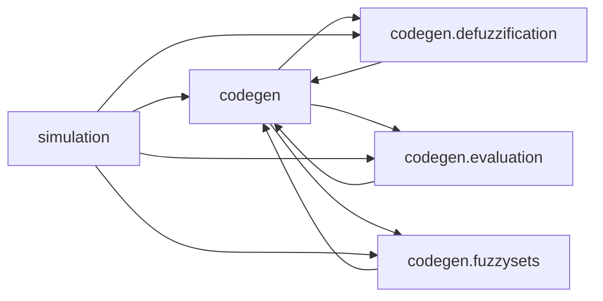
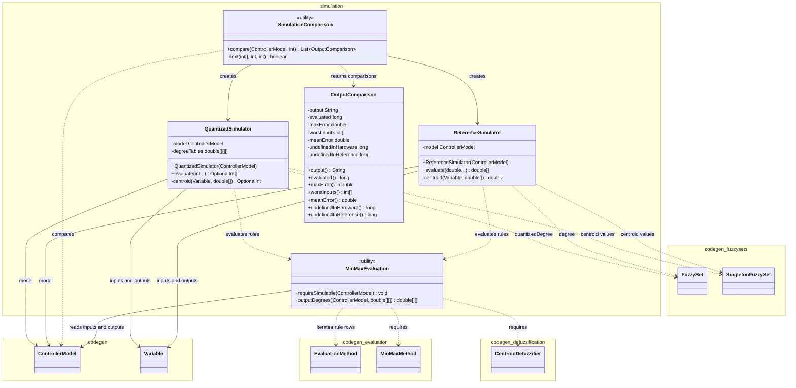
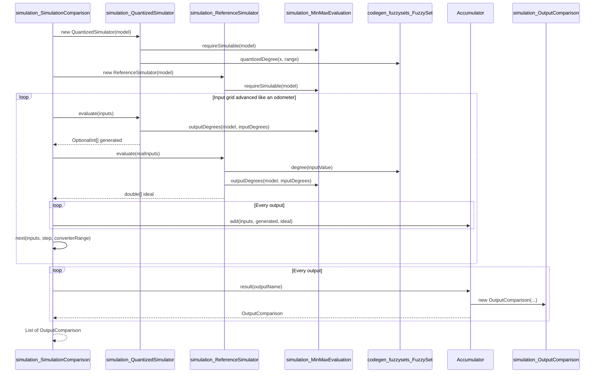

# Simulation

Validates generated fuzzy controllers against the ideal IEC 61131-7 semantics without Vivado or hardware.

Last update: 2026-11-04

## Purpose

The `simulation` package evaluates the same immutable `codegen.ControllerModel` that the code generator consumes and compares two implementations of the controller:

* `simulation.ReferenceSimulator` computes the ideal IEC 61131-7 behaviour in real numbers.
* `simulation.QuantizedSimulator` reproduces the integer arithmetic of the generated C++ and `ap_uint<N>` values.
* `simulation.SimulationComparison` walks a grid of input values, compares both simulators, and returns one `simulation.OutputComparison` per output.

The package validates the generated controller without Vivado HLS or a PLC. Both simulators read the model produced by the lowering phase, and the membership behaviour of each fuzzy set lives next to its code in `codegen.fuzzysets.FuzzySet`. The package documentation in `src/main/java/simulation/package-info.java` states this contract.

The public entry points are:

* `new simulation.ReferenceSimulator(model).evaluate(double...)`, which returns one real value per output.
* `new simulation.QuantizedSimulator(model).evaluate(int...)`, which returns one `OptionalInt` per output.
* `simulation.SimulationComparison.compare(model, step)`, which returns a `List<OutputComparison>` in output order.

`simulation.MinMaxEvaluation` is package-private and shared by both simulators. `simulation.OutputComparison` is the immutable result value returned by the comparison.

## Package Dependencies

Generated by `scripts/generate_diagrams.py simulation` in `doc/diagrams/simulation_package_flowchart.mmd`:



Every edge is an import dependency directed from the importing package to the imported package, taken from the `import` statements of `src/main/java/simulation/*.java` and from the imports of the consumer packages.

The real import direction is one-way. The table and diagram use underscores in package labels, so `codegen_defuzzification` denotes `codegen.defuzzification`, and so on.

| Importing package | Imported package          | Source imports                     |
|-------------------|---------------------------|------------------------------------|
| `simulation`      | `codegen`                 | `ControllerModel`, `Variable`      |
| `simulation`      | `codegen_defuzzification` | `CentroidDefuzzifier`              |
| `simulation`      | `codegen_evaluation`      | `EvaluationMethod`, `MinMaxMethod` |
| `simulation`      | `codegen_fuzzysets`       | `FuzzySet`, `SingletonFuzzySet`    |

No file under `src/main/java/codegen` imports `simulation`. The bidirectional edges between `codegen` and its subpackages in the flowchart are internal codegen imports; only the four `simulation --> ...` edges are dependencies of this package.

## Class Structure

Generated by `scripts/generate_diagrams.py simulation` in `doc/diagrams/simulation_class_diagram.mmd`:



The diagram derives its relationships from fields, constructor calls, casts, and method signatures. `MinMaxEvaluation` is a package-private final utility class. `SimulationComparison` is a final utility class with a private constructor. `OutputComparison` is a public immutable value.

## Class Table

| Class                             | Responsibility                                                                                | Pattern                  |
|-----------------------------------|-----------------------------------------------------------------------------------------------|--------------------------|
| `simulation_ReferenceSimulator`   | Evaluates the controller with ideal IEC 61131-7 real-valued degrees and a `double` centroid.  | Reference implementation |
| `simulation_QuantizedSimulator`   | Reproduces the generated C++ integer arithmetic from precomputed degree tables.               | Quantized implementation |
| `simulation_MinMaxEvaluation`     | Validates the simulated methods and applies MIN over each rule row and MAX per output term.   | Utility                  |
| `simulation_SimulationComparison` | Compares both simulators over an input grid and aggregates one result per output.             | Facade                   |
| `simulation_OutputComparison`     | Immutable per-output result with evaluated count, errors, worst inputs, and undefined counts. | Immutable value object   |

**Table sources:** `src/main/java/simulation/ReferenceSimulator.java`, `src/main/java/simulation/QuantizedSimulator.java`, `src/main/java/simulation/MinMaxEvaluation.java`, `src/main/java/simulation/SimulationComparison.java`, and `src/main/java/simulation/OutputComparison.java`.

## Behaviour and Architecture

Both simulators consume `codegen.ControllerModel`. The model supplies the bit width, the ordered inputs and outputs, the rule matrix through `codegen.evaluation.MinMaxMethod`, and the defuzzifier of each output. The converter range is `model.converterRange()`, equal to `2^N - 1`.

The following table summarizes the two semantics.

| Aspect              | Ideal simulator                               | Quantized simulator                                    |
|---------------------|-----------------------------------------------|--------------------------------------------------------|
| Input domain        | Real values, one per input in signature order | Integers from 0 to the converter range                 |
| Membership degree   | Linear real degree from 0 to 1                | Integer degree from 0 to the converter range           |
| Rule activation     | MIN over the input degrees of a rule          | MIN over the precomputed integer degrees               |
| Output accumulation | MAX per output term                           | MAX per output term                                    |
| Centroid arithmetic | `double` numerator and denominator            | `long` numerator and denominator with integer division |
| Truncation          | None                                          | Mask with the converter range after division           |
| No firing rule      | NaN for that output                           | Empty result for that output                           |

### Simulability Guard

`simulation.MinMaxEvaluation.requireSimulable` restricts both simulators to the subset the generator emits:

* `model.evaluationMethod()` must be an instance of `codegen.evaluation.MinMaxMethod`; otherwise it throws `IllegalArgumentException` with the message `Only MIN-MAX rule evaluation is simulated`.
* For every output, `model.defuzzifier(output.name())` must be an instance of `codegen.defuzzification.CentroidDefuzzifier`; otherwise it throws `IllegalArgumentException` with the message `Only the centroid of singletons is simulated`.

The constructors of `ReferenceSimulator` and `QuantizedSimulator` call this guard before storing the model. A new evaluation or defuzzification method requires a matching simulation implementation.

### Reference Simulator

`src/main/java/simulation/ReferenceSimulator.java` implements the ideal IEC 61131-7 semantics in real numbers.

`evaluate(double...)` checks that the number of values equals `model.inputs().size()` and throws `IllegalArgumentException` with `Expected <n> inputs` otherwise. For each input term it calls `FuzzySet.degree(inputValue)`, which returns a degree in `[0, 1]` that is linear between the points of the set and constant outside them. It then calls `MinMaxEvaluation.outputDegrees` and computes one centroid per output.

The centroid accumulates `degree * SingletonFuzzySet.value()` in `double` numerator and denominator variables. When the denominator is zero it returns `Double.NaN`; otherwise it returns `numerator / denominator` without rounding. Output terms that no rule concludes stay at degree 0 and do not contribute to the centroid.

### Quantized Simulator

`src/main/java/simulation/QuantizedSimulator.java` reproduces what the generated C++ computes.

The constructor validates the model with `MinMaxEvaluation.requireSimulable`, reads `range = model.converterRange()`, and allocates `degreeTables[input][value][term]` with `range + 1` entries per input. For every input, every value `x` from 0 to `range`, and every term it stores `sets.get(term).quantizedDegree(x, range)`. The table is therefore precomputed once, before any evaluation.

`evaluate(int...)` checks the number of values and rejects any value outside `0 .. converterRange` with `IllegalArgumentException`. It reuses the precomputed row for each input value, calls `MinMaxEvaluation.outputDegrees`, and computes one centroid per output.

The centroid uses `long` numerator and denominator. Each precomputed degree is cast to `long`, multiplied by the value of the corresponding `SingletonFuzzySet`, and added to the numerator; the degree is also added to the denominator. When the denominator is zero the method returns `OptionalInt.empty()`, which represents the division by zero of the generated code. Otherwise it returns:

```java
(int) ((numerator / denominator) & model.converterRange())
```

The integer division rounds toward zero and the mask keeps the low `N` bits, like an assignment to `ap_uint<N>`.

### MinMax Evaluation

`src/main/java/simulation/MinMaxEvaluation.java` is the shared rule evaluator. `outputDegrees(model, inputDegrees)` receives `inputDegrees[input][term]` and returns `outputDegrees[output][term]`.

For every rule row it starts `activation` at `Double.POSITIVE_INFINITY`, then applies `Math.min` over the degree of every input term indexed by `rules.set(row, model.inputColumn(input))`. It then visits every output, reads the output term index with `rules.set(row, model.outputColumn(output))`, and keeps the maximum between the current value and `activation`. The output arrays start at zero, so a term that no rule concludes remains at 0. This is the same MIN across each rule row and MAX per output term that `codegen.evaluation.MinMaxMethod` emits.

### Comparison Over A Grid

`src/main/java/simulation/SimulationComparison.java` exposes the static `compare(model, step)` method. It rejects `step < 1` with `IllegalArgumentException` and the message `step must be positive`. It then creates a `QuantizedSimulator`, which precomputes the degree tables, and a `ReferenceSimulator`.

The input grid is the Cartesian product of the values `0, step, 2 * step, ... <= converterRange` for every input. The first combination is all zeros. `next(inputs, step, range)` advances the array like an odometer: it adds `step` to the last input while the result does not exceed the range; otherwise it resets that input to 0 and carries to the previous one. It returns `false` after the last combination. With `step = 1` the grid is exhaustive over every input value.

For every combination it calls `QuantizedSimulator.evaluate` with the integer inputs and `ReferenceSimulator.evaluate` with the same values converted to `double`. Each output has a private `Accumulator`:

* `evaluated` counts every combination for the output.
* `undefinedInHardware` counts combinations where the quantized result is empty.
* `undefinedInReference` counts combinations where the ideal result is NaN.
* A combination where either side is undefined is skipped and does not contribute to the error statistics.
* Otherwise the absolute error is added to `errorSum`, `defined` is incremented, and the maximum error and the worst input combination are updated when the error is larger than the previous maximum.

After the loop, each accumulator builds an `OutputComparison`. The mean error is `0` when no pair is defined, otherwise `errorSum / defined`. The maximum error is `max(maxError, 0)`, so an output with no defined pair reports `0` rather than the internal `-1` sentinel. The returned list preserves output order.

### Output Comparison

`src/main/java/simulation/OutputComparison.java` is an immutable per-output result. It stores the output name, the evaluated count, the maximum absolute error, the worst input combination, the mean absolute error, and the two undefined counts.

The constructor is package-private and clones the worst-input array. `worstInputs()` returns a clone, so the result cannot be modified through the returned array. The exposed counts are the evaluated combinations and the two undefined cases; the number of defined pairs is internal to the accumulator and is used as the denominator of the mean.

`toString()` formats the result with `Locale.ROOT` as:

```text
%s: %d inputs, max error %.2f at %s, mean error %.2f, undefined in hardware %d, undefined in reference %d
```

The format arguments are the output name, the evaluated count, the maximum error, `Arrays.toString(worstInputs)`, the mean error, the hardware-undefined count, and the reference-undefined count.

## Comparison Flow

Generated by `scripts/generate_diagrams.py simulation` in `doc/diagrams/simulation_comparison_sequence.mmd`:



The sequence shows the construction step, the precomputation of the quantized degree tables, the odometer loop over the input grid, the per-output accumulation, and the final creation of the comparison results.

## How to Test

The integration test is `integration.simulation.ControllerSimulationIT` in `src/test/java/integration/simulation/ControllerSimulationIT.java`. It extends `ParserTestSupport` and builds a `codegen.ControllerModel` from the FCL programs under `src/test/resources/golden/luca/` through the parser and `lowering.lowers.ControllerLower.newInstance(...).adapt()`.

| Test method                                                    | Verification                                                                                                                                                                                                         |
|----------------------------------------------------------------|----------------------------------------------------------------------------------------------------------------------------------------------------------------------------------------------------------------------|
| `Pendulum_at_rest_pushes_with_the_center_force`                | For `pendulo_invertido` at inputs `127, 127`, the quantized simulator returns an `OptionalInt` holding `127` and the reference simulator returns `127.0` within `1e-9`; both use the center singleton.               |
| `Single_active_rule_gives_its_singleton`                       | For `pendulo_invertido` at `120, 127`, only the rule that concludes the `ps` singleton fires; both simulators return `149`.                                                                                          |
| `Truck_at_the_extreme_angle_fires_no_rule`                     | For `EstacionamientoCamion` at `127, 0`, no rule fires: the quantized result is not present and the reference result is `NaN`.                                                                                       |
| `Generated_pendulum_is_close_to_the_ideal_one_for_every_input` | The exhaustive comparison with step `1` evaluates `256 * 256` input combinations, finds no hardware-undefined result, and asserts a maximum error `<= 5`; the test comment records `4.66` when the test was written. |

Run the full suite:

```bash
mvn -q test
```

Run only the simulation integration test:

```bash
mvn -q -Dtest=ControllerSimulationIT test
```

## Charts

Chart: `assets/loc_per_module.png` — lines of code per module in `src/main/java`; the simulation module has 381 lines in 5 source files.

Chart: `assets/cyclomatic_complexity.png` — average cyclomatic complexity per package estimated from decision points in `src/main/java`; simulation averages 3.9 over 13 estimated methods, with total complexity 51.

Chart: `assets/test_coverage.png` — line coverage per package from `target/site/jacoco/jacoco.xml`; simulation reaches 91% line coverage, against 89% overall.

Chart: `assets/package_coupling.png` — afferent and efferent coupling per package from the import analysis; simulation has afferent coupling 0, efferent coupling 1, and instability 1.00.

The numeric values above come from `doc/stats.json`, produced by `scripts/extract_stats.py`.

## File Tree

Source: `src/main/java/simulation/`.

```text
src/main/java/simulation/
├── MinMaxEvaluation.java
├── OutputComparison.java
├── package-info.java
├── QuantizedSimulator.java
├── ReferenceSimulator.java
└── SimulationComparison.java
```

## Usage in Thesis

According to the module-to-chapter mapping in `scripts/synthesize_thesis_context.py`, this module feeds `doc/thesis/04.4-simulacion.md`, which describes the simulation phase and its classes. Its metrics are also consumed by `doc/thesis/07-mantenibilidad.md`, the integration test is consumed by `doc/thesis/08-testing.md`, and the validation results are consumed by `doc/thesis/10-resultados.md`.
