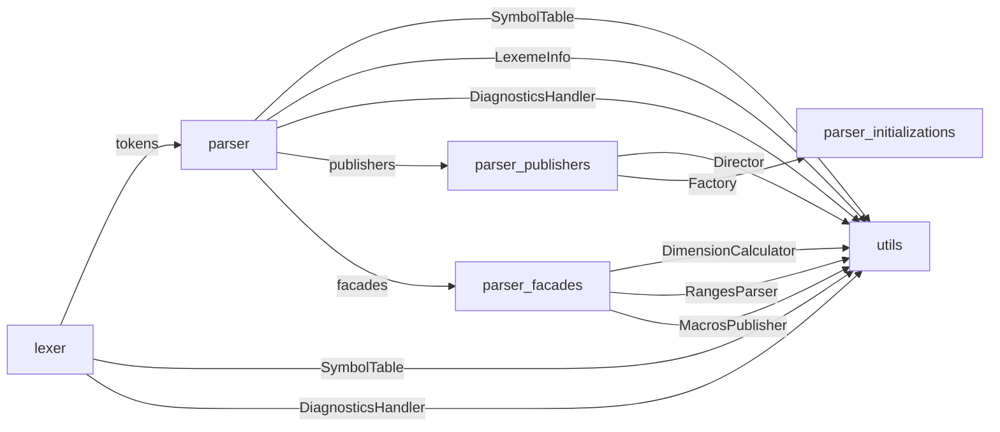
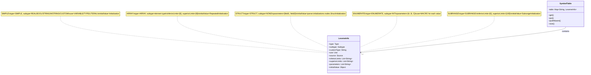
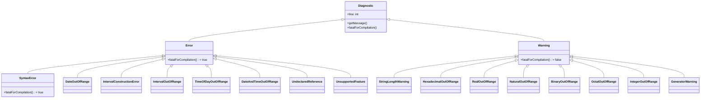

# utils

Shared compiler state and semantic metadata: symbol table, `LexemeInfo` DTO, diagnostics, builders, and classification enums.

Last update: 2026-10-30

## Purpose

The `utils` package is the shared repository for every compiler phase. It contains the symbol table that stores semantic metadata, the `LexemeInfo` DTO that carries that metadata, the diagnostics collector and diagnostic hierarchy, the builder API used to construct `LexemeInfo`, and the enums that classify symbols.

The package is consumed by the lexer, the parser, the parser publishers and facades, the lowering phase, and the compiler entry point. `utils` itself has no outgoing dependency on another compiler package: it only depends on the JDK, the SpotBugs annotations, and its own `utils.enums` and `utils.diagnostics` subpackages. This page documents `utils` and its subpackages `utils.builders`, `utils.enums`, and `utils.diagnostics`. Helper classes in `parser.utils`, `lexer.semantics.utils`, and `lexer.transformers.utils` belong to the parser and lexer module pages.

Source files:

* `src/main/java/utils/SymbolTable.java`
* `src/main/java/utils/LexemeInfo.java`
* `src/main/java/utils/DiagnosticsHandler.java`
* `src/main/java/utils/builders/*.java`
* `src/main/java/utils/enums/*.java`
* `src/main/java/utils/diagnostics/*.java`

## Package Diagram

Generated by `python3 scripts/generate_diagrams.py architecture` in `doc/diagrams/package_dependencies.mmd`:



The diagram shows the consumers of `utils`. The internal split into `builders`, `enums`, and `diagnostics` appears in the class diagram below.

## Class Diagram

Generated by `python3 scripts/generate_diagrams.py utils` in `doc/diagrams/utils_class_diagram.mmd`:

```mermaid
classDiagram
    namespace utils {
        class SymbolTable {
            -table: Map~String, LexemeInfo~
            +get()
            +put()
            +putIfAbsent()
            +size()
        }
        class LexemeInfo {
            +type: Type
            +subtype: Subtype
            +customType: String
            +use: Use
            +source: Source
            +inferiorLimits: List~String~
            +superiorLimits: List~String~
            +parameters: List~String~
            +initialValue: Object
        }
        class DiagnosticsHandler {
            -diagnostics: List~Diagnostic~
            -hasErrors: boolean
            +add()
            +hasErrors()
            +getDiagnostics()
        }
    }
    namespace utils_builders {
        class LexemeInfoMutator {
            <<interface>>
            +type(Type)
            +subtype(Subtype)
            +customType(String)
            +source(Source)
            +use(Use)
            +inferiorLimits(List~String~)
            +superiorLimits(List~String~)
            +parameters(List~String~)
            +initialValue(Object)
        }
        class LexemeInfoView {
            <<interface>>
            +type()
            +subtype()
            +customType()
            +source()
            +use()
            +inferiorLimits()
            +superiorLimits()
            +parameters()
            +initialValue()
        }
        class LexemeInfoBuilder {
            +build()
        }
        class Director {
            +makeWithMetadata(LexemeInfoMutator, LexemeInfoView)
            +makeLiteral(LexemeInfoMutator)
            +makeIntegerZeroConstant(LexemeInfoMutator)
            +makeDefaultInteger(LexemeInfoMutator)
            +makeDefaultReal(LexemeInfoMutator)
            +makeDefaultBoolean(LexemeInfoMutator)
            +makeTrueBoolean(LexemeInfoMutator)
            +makeDefaultString(LexemeInfoMutator)
            +makeDefaultWString(LexemeInfoMutator)
        }
    }
    namespace utils_enums {
        class Type { 8 values }
        class Subtype { 35 values }
        class Use { 12 values }
        class Source { 7 values }
    }
    namespace utils_diagnostics {
        class Diagnostic
        class Error
        class Warning
        class SyntaxError
        class UndeclaredReference
        class UnsupportedFeature
        class DateOutOfRange
        class DateAndTimeOutOfRange
        class TimeOfDayOutOfRange
        class IntervalOutOfRange
        class IntervalConstructionError
        class GeneratorWarning
        class IntegerOutOfRange
        class RealOutOfRange
        class BinaryOutOfRange
        class OctalOutOfRange
        class HexadecimalOutOfRange
        class NaturalOutOfRange
        class StringLengthWarning
    }
    Diagnostic <|-- Error
    Diagnostic <|-- Warning
    Error <|-- SyntaxError
    Error <|-- UndeclaredReference
    Error <|-- UnsupportedFeature
    Error <|-- DateOutOfRange
    Error <|-- DateAndTimeOutOfRange
    Error <|-- TimeOfDayOutOfRange
    Error <|-- IntervalOutOfRange
    Error <|-- IntervalConstructionError
    Warning <|-- GeneratorWarning
    Warning <|-- IntegerOutOfRange
    Warning <|-- RealOutOfRange
    Warning <|-- BinaryOutOfRange
    Warning <|-- OctalOutOfRange
    Warning <|-- HexadecimalOutOfRange
    Warning <|-- NaturalOutOfRange
    Warning <|-- StringLengthWarning
    LexemeInfoBuilder ..|> LexemeInfoMutator
    LexemeInfoBuilder ..|> LexemeInfoView
    Director ..> LexemeInfoMutator
    Director ..> LexemeInfoView
    SymbolTable --> LexemeInfo
    DiagnosticsHandler --> Diagnostic
```



## Class Table

| Class                                         | Responsibility                                                                                                                                                              | Pattern                       |
|-----------------------------------------------|-----------------------------------------------------------------------------------------------------------------------------------------------------------------------------|-------------------------------|
| `utils.SymbolTable`                           | Stores and retrieves `LexemeInfo` by lexeme name using a `HashMap`                                                                                                          | Repository                    |
| `utils.LexemeInfo`                            | Mutable DTO with public fields for type, subtype, custom type, use, source, limits, parameters, and initial value; defines value-based `equals`, `hashCode`, and `toString` | DTO with value-based equality |
| `utils.DiagnosticsHandler`                    | Collects diagnostics in insertion order and tracks whether any diagnostic is fatal                                                                                          | Collector                     |
| `utils.builders.LexemeInfoMutator`            | Fluent setter contract for every `LexemeInfo` attribute                                                                                                                     | Builder interface             |
| `utils.builders.LexemeInfoView`               | Read-only getter contract for every `LexemeInfo` attribute                                                                                                                  | Builder interface             |
| `utils.builders.LexemeInfoBuilder`            | Concrete builder implementing both contracts and exposing `build()`                                                                                                         | Builder                       |
| `utils.builders.Director`                     | Static recipes for literals, defaults, and copying metadata from a view into a mutator                                                                                      | Director                      |
| `utils.enums.Type`                            | General type classification: `ARRAY`, `ENUMERATE`, `FUNCTION`, `NONE`, `SIMPLE`, `STRUCT`, `SUBRANGE`, `UNKNOWN`                                                            | Enum                          |
| `utils.enums.Subtype`                         | Specific primitive, temporal, bit-string, fuzzy membership-function, and sentinel subtypes                                                                                  | Enum                          |
| `utils.enums.Use`                             | Usage context: `COMPONENT`, `CONSTANT`, `FIELD`, `FUNCTION_BLOCK`, `LITERAL`, `MACRO`, `PRAGMA`, `RULE`, `TERM`, `TYPE`, `UNKNOWN`, `VARIABLE`                              | Enum                          |
| `utils.enums.Source`                          | Declaration block: `DEFUZZIFY`, `FUZZIFY`, `IN`, `INTERNAL`, `NONE`, `OUT`, `UNKNOWN`                                                                                       | Enum                          |
| `utils.diagnostics.Diagnostic`                | Abstract base holding a source line and the fatal/non-fatal contract                                                                                                        | Template Method               |
| `utils.diagnostics.Error`                     | Fatal diagnostic; prefixes messages with `ERROR:`                                                                                                                           | Inheritance                   |
| `utils.diagnostics.Warning`                   | Non-fatal diagnostic; prefixes messages with `WARNING:`                                                                                                                     | Inheritance                   |
| `utils.diagnostics.SyntaxError`               | Invalid character or token reported by the lexer; extends `Error`                                                                                                           | Inheritance                   |
| `utils.diagnostics.UndeclaredReference`       | Rule or block names an undeclared variable or term; extends `Error`                                                                                                         | Inheritance                   |
| `utils.diagnostics.UnsupportedFeature`        | Valid FCL feature that the code generator cannot produce; extends `Error`                                                                                                   | Inheritance                   |
| `utils.diagnostics.DateOutOfRange`            | Invalid calendar DATE literal; extends `Error`                                                                                                                              | Inheritance                   |
| `utils.diagnostics.DateAndTimeOutOfRange`     | Invalid DATE_AND_TIME components; extends `Error`                                                                                                                           | Inheritance                   |
| `utils.diagnostics.TimeOfDayOutOfRange`       | Invalid TIME_OF_DAY components; extends `Error`                                                                                                                             | Inheritance                   |
| `utils.diagnostics.IntervalOutOfRange`        | TIME interval whose total duration exceeds the Long range; extends `Error`                                                                                                  | Inheritance                   |
| `utils.diagnostics.IntervalConstructionError` | TIME interval where a minor magnitude exceeds its limit while a major magnitude is present; extends `Error`                                                                 | Inheritance                   |
| `utils.diagnostics.GeneratorWarning`          | Code is generated but a feature is ignored or assumed; extends `Warning`                                                                                                    | Inheritance                   |
| `utils.diagnostics.IntegerOutOfRange`         | Signed integer literal exceeding the 64-bit range; extends `Warning`                                                                                                        | Inheritance                   |
| `utils.diagnostics.RealOutOfRange`            | Real literal exceeding the floating-point range; extends `Warning`                                                                                                          | Inheritance                   |
| `utils.diagnostics.BinaryOutOfRange`          | Binary literal exceeding the 64-bit range; extends `Warning`                                                                                                                | Inheritance                   |
| `utils.diagnostics.OctalOutOfRange`           | Octal literal exceeding the 64-bit range; extends `Warning`                                                                                                                 | Inheritance                   |
| `utils.diagnostics.HexadecimalOutOfRange`     | Hexadecimal literal exceeding the 64-bit range; extends `Warning`                                                                                                           | Inheritance                   |
| `utils.diagnostics.NaturalOutOfRange`         | Unsigned decimal literal exceeding 2^64 - 1; extends `Warning`                                                                                                              | Inheritance                   |
| `utils.diagnostics.StringLengthWarning`       | STRING literal exceeding the 255-character limit; extends `Warning`                                                                                                         | Inheritance                   |

## Enum Constants

Counts and constants are read from `src/main/java/utils/enums/*.java`.

| Enum                  | Count | Constants                                                                                                                                                                                                                                                                                                                              |
|-----------------------|-------|----------------------------------------------------------------------------------------------------------------------------------------------------------------------------------------------------------------------------------------------------------------------------------------------------------------------------------------|
| `utils.enums.Type`    | 8     | `ARRAY`, `ENUMERATE`, `FUNCTION`, `NONE`, `SIMPLE`, `STRUCT`, `SUBRANGE`, `UNKNOWN`                                                                                                                                                                                                                                                    |
| `utils.enums.Subtype` | 35    | `BOOL`, `BYTE`, `COA`, `COG`, `COGS`, `COMPLEX`, `CUSTOM`, `DATE`, `DATE_AND_TIME`, `DINT`, `DWORD`, `INT`, `LINEAR`, `LINT`, `LM`, `LREAL`, `LWORD`, `NONE`, `REAL`, `RM`, `SINGLETON`, `SINT`, `STRING`, `TIME`, `TIME_OF_DAY`, `TRAPEZOID`, `TRIANGLE`, `UDINT`, `UINT`, `ULINT`, `UNKNOWN`, `USINT`, `VARIABLE`, `WORD`, `WSTRING` |
| `utils.enums.Use`     | 12    | `COMPONENT`, `CONSTANT`, `FIELD`, `FUNCTION_BLOCK`, `LITERAL`, `MACRO`, `PRAGMA`, `RULE`, `TERM`, `TYPE`, `UNKNOWN`, `VARIABLE`                                                                                                                                                                                                        |
| `utils.enums.Source`  | 7     | `DEFUZZIFY`, `FUZZIFY`, `IN`, `INTERNAL`, `NONE`, `OUT`, `UNKNOWN`                                                                                                                                                                                                                                                                     |

`Subtype` includes fuzzy membership-function shapes such as `COA`, `COG`, `COGS`, `COMPLEX`, `LINEAR`, `LM`, `RM`, `SINGLETON`, `TRAPEZOID`, `TRIANGLE`, and `VARIABLE`. These are not primitive IEC data types; they classify membership-function terms stored in `LexemeInfo`.

## Builder Recipes

`utils.builders.Director` is a non-instantiable utility class. Its static methods configure a `LexemeInfoMutator` and, for literal recipes, return the source spelling of the literal.

| Method                    | Configuration                                            | Return value |
|---------------------------|----------------------------------------------------------|--------------|
| `makeWithMetadata`        | Copies every `LexemeInfoView` attribute into the mutator | `void`       |
| `makeLiteral`             | `type=SIMPLE`, `use=LITERAL`, `source=NONE`              | `void`       |
| `makeIntegerZeroConstant` | Literal recipe plus `subtype=INT`, `initialValue=0`      | `"0"`        |
| `makeDefaultInteger`      | Delegates to `makeIntegerZeroConstant`                   | `"0"`        |
| `makeDefaultReal`         | Literal recipe plus `subtype=REAL`, `initialValue=0D`    | `"0.0"`      |
| `makeDefaultBoolean`      | Literal recipe plus `subtype=BOOL`, `initialValue=false` | `"FALSE"`    |
| `makeTrueBoolean`         | Literal recipe plus `subtype=BOOL`, `initialValue=true`  | `"TRUE"`     |
| `makeDefaultString`       | Literal recipe plus `subtype=STRING`, `initialValue=""`  | `''`         |
| `makeDefaultWString`      | Literal recipe plus `subtype=WSTRING`, `initialValue=""` | `""`         |

## Statistical Charts

### Constant distribution in enums

Chart: `assets/enum_sizes.png` — Distribution of constants in the four semantic enums: `Type` 8, `Source` 7, `Use` 12, `Subtype` 35.
*Source: `src/main/java/utils/enums/*.java` via `scripts/extract_stats.py`*

### Type distribution in SymbolTable

Chart: `assets/symboltable_type_distribution.png` — Estimated distribution of `SymbolTable` entries by `Type`.
*Source: estimate in `scripts/extract_stats.py` based on the type-system design in `src/main/java/utils/LexemeInfo.java` and `src/main/java/utils/enums/Type.java`*

### LexemeInfo field population by type

Chart: `assets/lexemeinfo_field_population.png` — Which `LexemeInfo` fields are populated for each symbol type.
*Source: field-population table in `scripts/extract_stats.py` and the DTO fields in `src/main/java/utils/LexemeInfo.java`*

### Cyclomatic complexity per package

Chart: `assets/cyclomatic_complexity.png` — Average cyclomatic complexity per package; `utils` is 2.4 over an estimated 51 methods.
*Source: decision-point estimate in `scripts/extract_stats.py`*

### Lines of code per module

Chart: `assets/loc_per_module.png` — Non-comment lines of code per module; `utils` is 1330 lines across 31 files.
*Source: `scripts/extract_stats.py`*

### Diagnostics distribution — errors vs warnings

Chart: `assets/diagnostics_error_vs_warning.png` — Concrete diagnostic classes by severity; the extractor counts 7 errors and 8 warnings.
*Source: `src/main/java/utils/diagnostics/*.java` via `scripts/extract_stats.py`. The extractor excludes the abstract bases and `SyntaxError`; the hierarchy has eight `Error` subclasses when `SyntaxError` is included.*

### Test coverage per package

Chart: `assets/test_coverage.png` — Line coverage per JaCoCo package.
*Source: `target/site/jacoco/jacoco.xml` via `scripts/extract_stats.py`. Consult the JaCoCo report for package-level values; the extractor stores one percentage per module key, so the chart is not an aggregate of all `utils.*` packages.*

### Package coupling

Chart: `assets/package_coupling.png` — Afferent and efferent coupling between packages; `utils` has afferent 2, efferent 0, and instability 0.0.
*Source: import analysis in `scripts/extract_stats.py`*

## Storage in SymbolTable by type

Generated by `python3 scripts/generate_diagrams.py utils` in `doc/diagrams/symboltable_storage.mmd`:



`SymbolTable` exposes `get`, `put`, `putIfAbsent`, and `size`; the backing `table` field is private. The notes summarize the metadata patterns that parser semantic actions publish for each `Type`.

## Diagnostics Hierarchy

Generated by `python3 scripts/generate_diagrams.py utils` in `doc/diagrams/diagnostics_hierarchy.mmd`:



`Diagnostic` stores the source line in a protected final field. `Error` and `Warning` implement `fatalForCompilation`; `DiagnosticsHandler.add` uses that method to update its `hasErrors` flag. `GeneratorWarning`, `UndeclaredReference`, and `UnsupportedFeature` use line 0 and carry a detail string because they are reported after parsing, when the element is known but its source line is not retained.

## How to test

Primary unit test: `src/test/java/unit/utils/SymbolTableTest.java`, tagged with `@Tag("utils")`.

| Test method                                      | Verifies                                                                             |
|--------------------------------------------------|--------------------------------------------------------------------------------------|
| `PutAndGet_StoresAndRetrievesLexemeInfo`         | `put` stores a value and `get` retrieves it                                          |
| `Put_WithVariousLexemeInfo_StoresCorrectly`      | Parameterized over five `Type`, `Subtype`, `Use`, and `Source` combinations          |
| `Get_ForNonExistentKey_ReturnsNull`              | Missing keys return `null`                                                           |
| `Put_OverwritesExistingKey_ReturnsOldValue`      | `put` replaces the value and returns the previous one                                |
| `PutIfAbsent_Behavior`                           | Parameterized over absent key, existing key, and existing key with a different value |
| `PutIfAbsent_NullValue_StoresNull`               | A `null` value can be stored under a key                                             |
| `Size_ReturnsEntryCount`                         | `size` for empty, one-entry, and two-entry tables                                    |
| `Size_AfterPutIfAbsent_IncrementsOnlyForNewKeys` | Duplicate `putIfAbsent` calls do not increase the size                               |

Related tests:

* `src/test/java/unit/lexer/LexerSymbolTableTest.java` verifies that scanning literals populates `SymbolTable` with the expected `LexemeInfo` subtype and initial value.
* `src/test/java/unit/lexer/LexerDiagnosticHandlerTest.java` verifies the numeric, temporal, and string diagnostic classes and their fallback behavior.
* `src/test/java/integration/lexer/parser/symboltable/*IT.java` verifies parser publication for primitive, array, struct, subrange, enum, fuzzifier, defuzzifier, option, function-block interface, and declaration-error cases.
* `src/test/java/utils/ParserTestSupport.java` and `src/test/java/utils/LexemeInfoComparator.java` provide the shared parser harness and field-level comparison used by the integration tests.

Execution:

```bash
mvn test -Dtest=SymbolTableTest
mvn test -Dtest=LexerSymbolTableTest,LexerDiagnosticHandlerTest
mvn test -Dtest=PrimitiveIT,ArrayIT,StructIT,SubrangeIT,EnumerateIT
```

The POM configures Surefire but no Failsafe plugin, so `*IT` classes are not part of the default `mvn test` selection and must be named explicitly. JaCoCo writes `target/site/jacoco/jacoco.xml` during the test phase.

## File tree

```
src/main/java/utils/
├── package-info.java
├── DiagnosticsHandler.java
├── LexemeInfo.java
├── SymbolTable.java
├── builders/
│   ├── package-info.java
│   ├── Director.java
│   ├── LexemeInfoBuilder.java
│   ├── LexemeInfoMutator.java
│   └── LexemeInfoView.java
├── enums/
│   ├── package-info.java
│   ├── Source.java (7 values)
│   ├── Subtype.java (35 values)
│   ├── Type.java (8 values)
│   └── Use.java (12 values)
└── diagnostics/
    ├── package-info.java
    ├── Diagnostic.java
    ├── Error.java
    ├── Warning.java
    ├── SyntaxError.java
    ├── UndeclaredReference.java
    ├── UnsupportedFeature.java
    ├── DateOutOfRange.java
    ├── DateAndTimeOutOfRange.java
    ├── TimeOfDayOutOfRange.java
    ├── IntervalOutOfRange.java
    ├── IntervalConstructionError.java
    ├── GeneratorWarning.java
    ├── IntegerOutOfRange.java
    ├── RealOutOfRange.java
    ├── BinaryOutOfRange.java
    ├── OctalOutOfRange.java
    ├── HexadecimalOutOfRange.java
    ├── NaturalOutOfRange.java
    └── StringLengthWarning.java
```

## Supporting diagrams

| Diagram               | File                                     | Description                                                                 |
|-----------------------|------------------------------------------|-----------------------------------------------------------------------------|
| `utils` classes       | `doc/diagrams/utils_class_diagram.mmd`   | Complete class structure of `utils`, `builders`, `enums`, and `diagnostics` |
| SymbolTable storage   | `doc/diagrams/symboltable_storage.mmd`   | `SymbolTable` to `LexemeInfo` cardinality and per-type metadata notes       |
| Diagnostics hierarchy | `doc/diagrams/diagnostics_hierarchy.mmd` | Concrete `Error` and `Warning` subclasses                                   |
| Package dependencies  | `doc/diagrams/package_dependencies.mmd`  | Consumers of `utils` in the lexer, parser, publishers, and facades          |

## Thesis chapters consuming this module

The primary module-to-chapter mapping in `scripts/synthesize_thesis_context.py` assigns `utils` to chapters 04 and 07. The following chapters also consume specific `utils` artifacts.

| Chapter | Focus                                                                                            |
|---------|--------------------------------------------------------------------------------------------------|
| 02      | Theoretical framework: Builder and Repository patterns, `LexemeInfoBuilder`, `SymbolTable`       |
| 03      | Planned versus implemented architecture: package count and `utils` coupling                      |
| 04      | Implemented architecture: shared state, Repository pattern, `SymbolTable`, `LexemeInfo`          |
| 04.2    | Lowering diagnostics: `UnsupportedFeature`, `GeneratorWarning`, `UndeclaredReference`            |
| 05      | Lexical analysis: `SymbolTable` and `LexemeInfo` publication                                     |
| 06      | Parser: `LexemeInfoBuilder`, `Director`, publishers, `SymbolTable`, `LexemeInfo`                 |
| 07      | Maintainability: coupling and LOC metrics for `utils`                                            |
| 08      | Testing: `unit.utils.SymbolTableTest` and related lexer and integration tests                    |
| 10      | Results: enum sizes, diagnostics distribution, type distribution, field population, and coupling |
