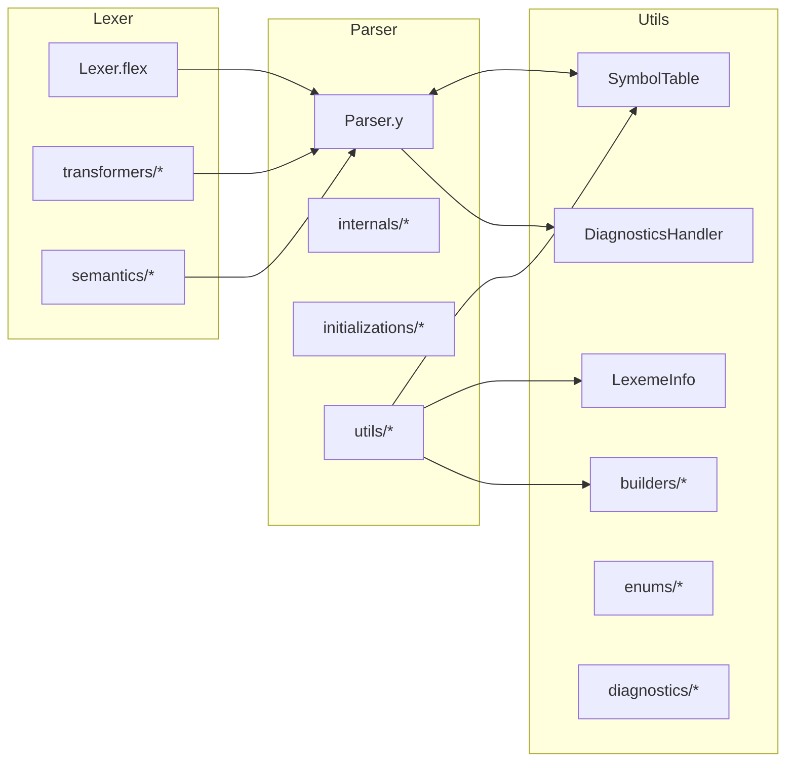
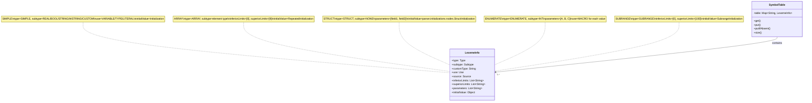
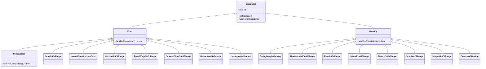

# utils

Core utilities package: symbol table, diagnostics, semantic builders, and enums for the IEC 61131-7 compiler.

## Package Diagram

Generated by `scripts/generate_diagrams.py utils` in `doc/diagrams/`:



## Class Diagram

Generated by `scripts/generate_diagrams.py utils` in `doc/diagrams/utils_class_diagram.mmd`:

```mermaid
classDiagram
    namespace utils {
        class SymbolTable {
            -table: Map~String, LexemeInfo~
            +get()
            +put()
            +putIfAbsent()
            +size()
        }
        class LexemeInfo {
            +type: Type
            +subtype: Subtype
            +customType: String
            +use: Use
            +source: Source
            +inferiorLimits: List~String~
            +superiorLimits: List~String~
            +parameters: List~String~
            +initialValue: Object
        }
        class DiagnosticsHandler {
            -diagnostics: List~Diagnostic~
            -hasErrors: boolean
            +add()
            +hasErrors()
            +getDiagnostics()
        }
    }
    namespace utils_builders {
        class LexemeInfoMutator {
            <<interface>>
            +type(Type)
            +subtype(Subtype)
            +customType(String)
            +source(Source)
            +use(Use)
            +inferiorLimits(List~String~)
            +superiorLimits(List~String~)
            +parameters(List~String~)
            +initialValue(Object)
        }
        class LexemeInfoView {
            <<interface>>
            +type()
            +subtype()
            +customType()
            +source()
            +use()
            +inferiorLimits()
            +superiorLimits()
            +parameters()
            +initialValue()
        }
        class LexemeInfoBuilder {
            +build()
        }
        class Director {
            +makeWithMetadata(LexemeInfoMutator, LexemeInfoView)
            +makeLiteral(LexemeInfoMutator)
            +makeIntegerZeroConstant(LexemeInfoMutator)
            +makeDefaultInteger(LexemeInfoMutator)
            +makeDefaultReal(LexemeInfoMutator)
            +makeDefaultBoolean(LexemeInfoMutator)
            +makeTrueBoolean(LexemeInfoMutator)
            +makeDefaultString(LexemeInfoMutator)
            +makeDefaultWString(LexemeInfoMutator)
        }
    }
    namespace utils_enums {
        class Type { 8 values }
        class Subtype { 35 values }
        class Use { 12 values }
        class Source { 7 values }
    }
    namespace utils_diagnostics {
        class Diagnostic
        class Error
        class Warning
        class SyntaxError
        class UndeclaredReference
        class UnsupportedFeature
        class GeneratorWarning
        class IntegerOutOfRange
        class RealOutOfRange
        class BinaryOutOfRange
        class OctalOutOfRange
        class HexadecimalOutOfRange
        class NaturalOutOfRange
        class DateOutOfRange
        class DateAndTimeOutOfRange
        class TimeOfDayOutOfRange
        class IntervalOutOfRange
        class IntervalConstructionError
        class StringLengthWarning
    }
    Diagnostic <|-- Error
    Diagnostic <|-- Warning
    Error <|-- SyntaxError
    Error <|-- UndeclaredReference
    Error <|-- UnsupportedFeature
    Error <|-- DateOutOfRange
    Error <|-- DateAndTimeOutOfRange
    Error <|-- TimeOfDayOutOfRange
    Error <|-- IntervalOutOfRange
    Error <|-- IntervalConstructionError
    Warning <|-- GeneratorWarning
    Warning <|-- IntegerOutOfRange
    Warning <|-- RealOutOfRange
    Warning <|-- BinaryOutOfRange
    Warning <|-- OctalOutOfRange
    Warning <|-- HexadecimalOutOfRange
    Warning <|-- NaturalOutOfRange
    Warning <|-- StringLengthWarning
    LexemeInfoBuilder ..|> LexemeInfoMutator
    LexemeInfoBuilder ..|> LexemeInfoView
    Director ..> LexemeInfoMutator
    Director ..> LexemeInfoView
    SymbolTable --> LexemeInfo
    DiagnosticsHandler --> Diagnostic

```



## Class Table

| Class                                         | Responsibility                                                                                                         | Pattern             |
|-----------------------------------------------|------------------------------------------------------------------------------------------------------------------------|---------------------|
| `utils.SymbolTable`                           | Stores and retrieves `LexemeInfo` by lexeme name                                                                       | Repository          |
| `utils.LexemeInfo`                            | DTO with complete semantic attributes (type, subtype, use, source, limits, parameters, initial value)                  | Value Object        |
| `utils.DiagnosticsHandler`                    | Collects and manages diagnostics (errors/warnings) in insertion order                                                  | Collector           |
| `utils.builders.LexemeInfoMutator`            | Fluent contract with a setter per `LexemeInfo` attribute                                                               | Builder (interface) |
| `utils.builders.LexemeInfoView`               | Read-only view of `LexemeInfo` attributes                                                                              | Builder (interface) |
| `utils.builders.LexemeInfoBuilder`            | Concrete builder implementing mutator and view, with `build()`                                                         | Builder             |
| `utils.builders.Director`                     | Static recipes for literal and default `LexemeInfo` configurations                                                     | Director            |
| `utils.enums.Type`                            | General classification: UNKNOWN, SIMPLE, ENUMERATE, SUBRANGE, ARRAY, STRUCT, FUNCTION, NONE                            | Enum                |
| `utils.enums.Subtype`                         | IEC 61131-7 primitive types (INT, REAL, BOOL, TIME, etc.) + CUSTOM/NONE                                                | Enum                |
| `utils.enums.Use`                             | Usage context: VARIABLE, FIELD, LITERAL, FUNCTION_BLOCK, TYPE, MACRO, RULE, TERM, CONSTANT, COMPONENT, PRAGMA, UNKNOWN | Enum                |
| `utils.enums.Source`                          | Declaration block: IN, OUT, INTERNAL, FUZZIFY, DEFUZZIFY, NONE, UNKNOWN                                                | Enum                |
| `utils.diagnostics.Diagnostic`                | Abstract base with line number and `fatalForCompilation()`                                                             | Template Method     |
| `utils.diagnostics.Error`                     | Fatal diagnostic (`fatalForCompilation() = true`)                                                                      | Inheritance         |
| `utils.diagnostics.Warning`                   | Non-fatal diagnostic (`fatalForCompilation() = false`)                                                                 | Inheritance         |
| `utils.diagnostics.SyntaxError`               | Lexical/syntactical errors for invalid characters (extends `Error`)                                                    | Inheritance         |
| `utils.diagnostics.UndeclaredReference`       | Rule or block names an undeclared variable or term (extends `Error`)                                                   | Inheritance         |
| `utils.diagnostics.UnsupportedFeature`        | Valid FCL feature the code generator cannot produce (extends `Error`)                                                  | Inheritance         |
| `utils.diagnostics.DateOutOfRange`            | Invalid calendar DATE literal (extends `Error`)                                                                        | Inheritance         |
| `utils.diagnostics.DateAndTimeOutOfRange`     | Invalid DATE_AND_TIME literal components (extends `Error`)                                                             | Inheritance         |
| `utils.diagnostics.TimeOfDayOutOfRange`       | Invalid TIME_OF_DAY literal components (extends `Error`)                                                               | Inheritance         |
| `utils.diagnostics.IntervalOutOfRange`        | TIME interval exceeding Long range (extends `Error`)                                                                   | Inheritance         |
| `utils.diagnostics.IntervalConstructionError` | Invalid TIME interval magnitude construction (extends `Error`)                                                         | Inheritance         |
| `utils.diagnostics.GeneratorWarning`          | Code generated but something ignored or assumed (extends `Warning`)                                                    | Inheritance         |
| `utils.diagnostics.IntegerOutOfRange`         | Signed integer literal exceeding 64-bit range (extends `Warning`)                                                      | Inheritance         |
| `utils.diagnostics.RealOutOfRange`            | Real literal exceeding floating-point range (extends `Warning`)                                                        | Inheritance         |
| `utils.diagnostics.BinaryOutOfRange`          | Binary literal exceeding 64-bit range (extends `Warning`)                                                              | Inheritance         |
| `utils.diagnostics.OctalOutOfRange`           | Octal literal exceeding 64-bit range (extends `Warning`)                                                               | Inheritance         |
| `utils.diagnostics.HexadecimalOutOfRange`     | Hexadecimal literal exceeding 64-bit range (extends `Warning`)                                                         | Inheritance         |
| `utils.diagnostics.NaturalOutOfRange`         | Unsigned decimal literal exceeding 2^64 - 1 (extends `Warning`)                                                        | Inheritance         |
| `utils.diagnostics.StringLengthWarning`       | STRING literal exceeding 255 character maximum (extends `Warning`)                                                     | Inheritance         |

## Statistical Charts

### Constant distribution in enums — utils

Chart: `assets/enum_sizes.png` — Distribution of constants in semantic enums
*Source: `src/main/java/utils/enums/*.java`*

### Type distribution in SymbolTable

Chart: `assets/symboltable_type_distribution.png` — SymbolTable entries distribution by Type
*Source: type system design in `utils/LexemeInfo.java` and `utils/enums/Type.java`*

### LexemeInfo field population by type

Chart: `assets/lexemeinfo_field_population.png` — LexemeInfo field population by symbol type
*Source: `src/main/java/utils/LexemeInfo.java`*

### Cyclomatic complexity per package

Chart: `assets/cyclomatic_complexity.png` — Average cyclomatic complexity per package
*Source: `utils` avg CYCLO 2.4 (estimated 51 methods)*

### Lines of code per module

Chart: `assets/loc_per_module.png` — Lines of code per module
*Source: `utils` 1330 LOC across 31 files*

### Diagnostics distribution — errors vs warnings

Chart: `assets/diagnostics_error_vs_warning.png` — Count of error vs warning classes in `utils.diagnostics`
*Source: `src/main/java/utils/diagnostics/*.java` (7 errors, 8 warnings)*

### Test coverage per package

Chart: `assets/test_coverage.png` — Test coverage per package
*Source: JaCoCo — `utils` 100% coverage*

### Package coupling

Chart: `assets/package_coupling.png` — Afferent/efferent coupling between packages
*Source: imports analysis — `utils` afferent=2, efferent=0, instability=0.0*

## Storage in SymbolTable by type

Generated by `scripts/generate_diagrams.py utils` in `doc/diagrams/symboltable_storage.mmd`:



## Diagnostics Hierarchy

Generated by `scripts/generate_diagrams.py utils` in `doc/diagrams/diagnostics_hierarchy.mmd`:



## How to test

Unit tests in `src/test/java/unit/utils/SymbolTableTest.java` (`SymbolTable` is the only `utils` type with its own unit test):

* `PutAndGet_StoresAndRetrievesLexemeInfo` — verifies basic `put`/`get`
* `Put_WithVariousLexemeInfo_StoresCorrectly` — parameterized with 5 combinations of Type/Subtype/Use/Source
* `Get_ForNonExistentKey_ReturnsNull` — behavior for a non-existent key
* `Put_OverwritesExistingKey_ReturnsOldValue` — overwrites and returns the previous value
* `PutIfAbsent_Behavior` — 3 cases: absent key, existing key (does not overwrite), existing key with a different value
* `PutIfAbsent_NullValue_StoresNull` — allows null values
* `Size_ReturnsEntryCount` — size with 0, 1, and 2 initial entries
* `Size_AfterPutIfAbsent_IncrementsOnlyForNewKeys` — size increments only for new insertions

Execution:

```bash
mvn test -Dtest=SymbolTableTest

```

Current coverage: **100%** (JaCoCo).

## File tree

```
src/main/java/utils/
├── package-info.java
├── SymbolTable.java
├── LexemeInfo.java
├── DiagnosticsHandler.java
├── LucaInfo.java (@deprecated)
├── builders/
│   ├── package-info.java
│   ├── LexemeInfoMutator.java
│   ├── LexemeInfoView.java
│   ├── LexemeInfoBuilder.java
│   └── Director.java
├── enums/
│   ├── package-info.java
│   ├── Type.java (8 values)
│   ├── Subtype.java (35 values)
│   ├── Use.java (12 values)
│   └── Source.java (7 values)
└── diagnostics/
    ├── package-info.java
    ├── Diagnostic.java
    ├── Error.java
    ├── Warning.java
    ├── SyntaxError.java
    ├── UndeclaredReference.java
    ├── UnsupportedFeature.java
    ├── DateOutOfRange.java
    ├── DateAndTimeOutOfRange.java
    ├── TimeOfDayOutOfRange.java
    ├── IntervalOutOfRange.java
    ├── IntervalConstructionError.java
    ├── GeneratorWarning.java
    ├── IntegerOutOfRange.java
    ├── RealOutOfRange.java
    ├── BinaryOutOfRange.java
    ├── OctalOutOfRange.java
    ├── HexadecimalOutOfRange.java
    ├── NaturalOutOfRange.java
    └── StringLengthWarning.java

```

## Supporting diagrams — assets

| Diagram               | File                                     | Description                                                  |
|-----------------------|------------------------------------------|--------------------------------------------------------------|
| `utils` classes       | `doc/diagrams/utils_class_diagram.mmd`   | Complete structure of utils + builders + enums + diagnostics |
| ST Storage            | `doc/diagrams/symboltable_storage.mmd`   | SymbolTable ↔ LexemeInfo by type                             |
| Diagnostics hierarchy | `doc/diagrams/diagnostics_hierarchy.mmd` | Concrete errors and warnings                                 |

## Thesis chapters consuming this module

| Chapter | Focus                                                                                   |
|---------|-----------------------------------------------------------------------------------------|
| 04      | Implemented architecture — SymbolTable, Repository pattern, Lexer↔Parser↔SymbolTable    |
| 07      | Maintainability — design→QA, metrics (CYCLO 2.4, LOC 1330, COVERAGE 100%, coupling 0.0) |

*Excludes `LucaInfo.java` (marked `@deprecated`) and local-only files according to validation rules.*

## Other `utils` packages in the project

In addition to the main `utils` package, there are three auxiliary packages with specialized utilities:

### `parser.utils`

| Class                      | Responsibility                                                                            | Pattern                 |
|----------------------------|-------------------------------------------------------------------------------------------|-------------------------|
| `parser.utils.NameMangler` | Generates qualified (mangled) names for symbols in nested scopes using `#` as a separator | Utility / Scope Manager |

**`NameMangler`** — Manages the scope stack to generate global unique keys in IEC 61131-7 (which uses a flat namespace but supports nested structures):

* `addScope(scope)` — Pushes a new scope onto the stack
* `getCurrentScope()` — Current full prefix without the trailing `#`
* `popScope()` — Pops and returns the last scope
* `getNameMangled(name)` — Returns the fully mangled name (e.g., `TYPE#FIELD#VALUE`)

### `lexer.semantics.utils`

| Class                                 | Responsibility                                                    | Pattern                 |
|---------------------------------------|-------------------------------------------------------------------|-------------------------|
| `lexer.semantics.utils.ReservedWords` | Lookup table for IEC 61131-7 reserved words → lexer token numbers | Registry / Lookup Table |

**`ReservedWords`** — Static `String → Integer` map with \~80 entries covering:

* Boolean literals (`TRUE`, `FALSE`)
* Program blocks (`FUNCTION_BLOCK`, `FUZZIFY`, `DEFUZZIFY`, `RULEBLOCK`, `OPTION`)
* Control structures (`IF`, `THEN`, `RULE`, `WITH`, `ACT`, `ACCU`)
* Fuzzy operators (`COG`, `COGS`, `COA`, `LM`, `RM`, `NC`, `MIN`, `MAX`, `ASUM`, `BSUM`, `PROD`, `BDIF`, `NSUM`)
* Variable declarations (`VAR_INPUT`, `VAR_OUTPUT`, `VAR`, `END_VAR`, `RETAIN`, `NON_RETAIN`, `CONSTANT`)
* Data types (`BOOL`, `SINT`, `INT`, `DINT`, `LINT`, `USINT`, `UINT`, `UDINT`, `ULINT`, `REAL`, `LREAL`, `STRING`, `WSTRING`, `BYTE`, `WORD`, `DWORD`, `LWORD`, `TIME`, `DATE`, `DATE_AND_TIME`, `ARRAY`, `OF`, `STRUCT`, `END_STRUCT`, `TYPE`, `END_TYPE`)
* Method: `isReserved(identifier)` → `tokenNumber` or `null`

### `lexer.transformers.utils`

| Class                                     | Responsibility                                            | Pattern                 |
|-------------------------------------------|-----------------------------------------------------------|-------------------------|
| `lexer.transformers.utils.ExponentFinder` | Locates the exponent character (`E`/`e`) in real literals | Utility / String Parser |

**`ExponentFinder`** — Static `find(lexeme)` method that returns the index of the first occurrence of `E` or `e` (uppercase has priority if both exist), or `-1` if there is no exponent. Used by the lexer to parse IEC 61131-7 scientific notation (e.g., `1.5E10`, `3.14e-5`).

***
