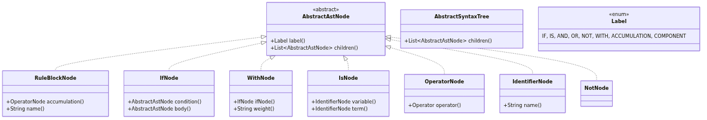
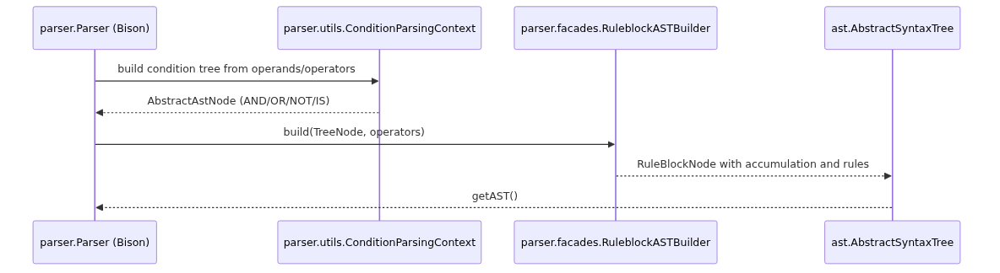

# Árbol sintáctico del bloque RULEBLOCK

## Propósito

El analizador sintáctico construye, además de la tabla de símbolos, un **árbol de sintaxis abstracta (AST)** que representa el cuerpo del bloque `RULEBLOCK`. Ese árbol es la entrada del *lowering* que lo convierte en la matriz de reglas del generador de código C++. La construcción del AST está aislada del análisis léxico y de la tabla de símbolos: el parser sólo reduce reglas gramaticales y empaqueta nodos; el *lowering* los interpreta después.

## Jerarquía de nodos del AST

Todos los nodos heredan de `ast.AbstractAstNode` y llevan una etiqueta de `ast.Label`. Las etiquetas son:

* `IF` — encabezado de una regla (`IF <condición> THEN ...`)
* `IS` — condición o conclusión `variable IS término`
* `AND` / `OR` / `NOT` — operadores lógicos de la condición
* `WITH` — factor de ponderación de la regla
* `ACCUMULATION` — operador de acumulación de reglas (ej. `ACCU: MAX`)
* `COMPONENT` — componente difuso del cuerpo de la regla

### Diagramas de clases



## Construcción del árbol durante el parsing

El parser genera el AST en las acciones semánticas de `Parser.y`. El flujo principal es:

1. `rule_block` reduce a un `RuleBlockNode` que agrupa nombre, operadores (OR/AND/activación/acumulación) y las reglas.
2. Cada regla (`IF condición WITH peso` o solo `IF condición`) reduce a `IfNode` (o `WithNode` si tiene peso).
3. La condición se construye como árbol de operadores con `ConditionParsingContext`: cadenas de `AND: MIN` se aplanan en `OperatorNode` con hijos `ISNode`; `OR`, `NOT` y otros operadores se detectan y se reportan como no soportados por el generador.
4. Cada `variable IS término` reduce a `IsNode` con dos `IdentifierNode` (variable y término).
5. El cuerpo de la regla concluye con una lista de `ISNode` (uno por salida), envueltos en `COMPONENT`.



## Qué acepta el generador (Basic Level)

El árbol completo puede tener `OR`, `NOT`, varios `RULEBLOCK`, reglas que no usen todas las entradas, etc., pero el generador de código (vía *lowering*) solo acepta el subconjunto **Basic Level** de IEC 61131-7:

* Exactly one `RULEBLOCK`.
* `ACCU: MAX` como operador de acumulación.
* Cada regla es `AND: MIN` de condiciones `entrada IS término` usando **todas** las entradas una vez.
* Cada regla concluye `salida IS término` para **todas** las salidas.
* Factor `WITH` debe ser `1` (o ausente).
* Sin `OR`, sin `NOT`, sin variables como subcondición.

Todo lo que se sale de ese subconjunto se reporta como `UnsupportedFeature` o `UndeclaredReference` durante el *lowering* (Capítulo 04.2), no durante el parsing.

## Claves de las clases del AST

| Clase                                  | Archivo                                                   | Responsabilidad                                       |
|----------------------------------------|-----------------------------------------------------------|-------------------------------------------------------|
| `ast.AbstractAstNode`                  | `src/main/java/ast/AbstractAstNode.java`                  | Nodo base con etiqueta e hijos                        |
| `ast.AbstractSyntaxTree`               | `src/main/java/ast/AbstractSyntaxTree.java`               | Raíz del árbol, lista de nodos hijos                  |
| `ast.Label`                            | `src/main/java/ast/Label.java`                            | Enumeración de etiquetas de nodo                      |
| `ast.ruleblock.RuleBlockNode`          | `src/main/java/ast/ruleblock/RuleBlockNode.java`          | Nodo del bloque de reglas con operador de acumulación |
| `ast.ruleblock.IfNode`                 | `src/main/java/ast/ruleblock/IfNode.java`                 | Encabezado IF + cuerpo de una regla                   |
| `ast.ruleblock.WithNode`               | `src/main/java/ast/ruleblock/WithNode.java`               | Regla con factor de ponderación WITH                  |
| `ast.ruleblock.IsNode`                 | `src/main/java/ast/ruleblock/IsNode.java`                 | Condición o conclusión `variable IS término`          |
| `ast.ruleblock.OperatorNode`           | `src/main/java/ast/ruleblock/operators/OperatorNode.java` | Operador lógico (AND, OR, NOT, ACCUMULATION)          |
| `ast.ruleblock.IdentifierNode`         | `src/main/java/ast/ruleblock/IdentifierNode.java`         | Nombre de variable o término                          |
| `ast.ruleblock.NotNode`                | `src/main/java/ast/ruleblock/NotNode.java`                | Negación (no soportada por el generador)              |
| `parser.facades.RuleblockASTBuilder`   | `src/main/java/parser/facades/RuleblockASTBuilder.java`   | Convierte árbol del parser en `RuleBlockNode`         |
| `parser.utils.ConditionParsingContext` | `src/main/java/parser/utils/ConditionParsingContext.java` | Construye el árbol de condiciones durante el parsing  |

## Flujo de punta a punta del RULEBLOCK

```
FCL fuente
    │
    ▼
Lexer + Parser ─────► tabla de símbolos + AST de RULEBLOCK
    │
    ▼
lowering.ControllerLowering ──► codegen.ControllerModel
    │                           (matriz de reglas + variables)
    ▼
codegen.CodeGenerator ───────► <base>_out.cpp / _out.h / _outTB.cpp
```
