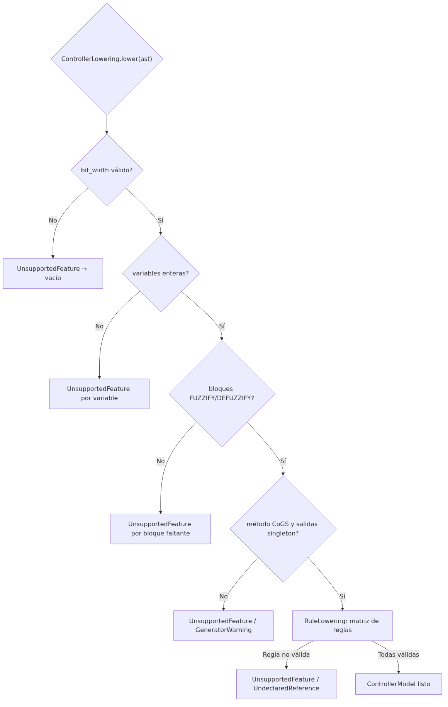

# Lowering: del AST y la tabla de símbolos al modelo del controlador

## Propósito

El *lowering* es la fase que traduce lo producido por el analizador sintáctico (tabla de símbolos y AST del `RULEBLOCK`) al `codegen.ControllerModel`, el modelo inmutable que consume el generador de código C++. Es también el punto donde se comprueba qué características del programa FCL soporta el generador: todo lo que excede el **Basic Level** de IEC 61131-7 se reporta como diagnóstico y no se genera código.

## Arquitectura del lowering

```
tabla de símbolos + AST de RULEBLOCK
        │
        ▼
lowering.ControllerLowering
        ├── bit_width (PRAGMA bit_width N, 1..30; default 8 con warning)
        ├── variables de entrada/salida (solo enteros, en orden de declaración)
        ├── términos lingüísticos → conjuntos difusos (singleton, rampa Z/S, triángulo, trapecio)
        └── RuleLowering ──► matriz de reglas (una fila por regla, una columna por entrada y luego por salida)
        │
        ▼
codegen.ControllerModel (inmutable, listo para codegen)
```

Cada problema (variable sin bloque FUZZIFY/DEFUZZIFY, tipo REAL, método no CoGS, salida no singleton, más de un RULEBLOCK, ACCU distinto de MAX, regla que no use todas las entradas/salidas, WITH ≠ 1, OR, NOT, término no declarado) se reporta al `DiagnosticsHandler` mediante `LoweringReport` y el modelo no se construye (`Optional.empty()`).

## Claves de símbolos (`SymbolKeys`)

`SymbolKeys` es el único lugar que sabe cómo el parser nombra los símbolos en la tabla. Todas las claves llevan el prefijo del bloque de función (`MAIN`):

| Símbolo                          | Forma de clave           | Ejemplo                  |
|----------------------------------|--------------------------|--------------------------|
| Bloque de función                | `<FB>`                   | `MAIN`                   |
| Variable                         | `<FB>#<VAR>`             | `MAIN#ANGLE`             |
| Bloque FUZZIFY de una variable   | `<FB>#<VAR>@fuzzifier`   | `MAIN#ANGLE@fuzzifier`   |
| Bloque DEFUZZIFY de una variable | `<FB>#<VAR>@defuzzifier` | `MAIN#ANGLE@defuzzifier` |
| Término lingüístico              | `<FB>#<VAR>#<TERM>`      | `MAIN#ANGLE#NEGATIVO`    |
| Pragma de OPTION                 | `<FB>@option#<NAME>`     | `MAIN@option#BIT_WIDTH`  |

Los nombres en el AST no están calificados, así que `SymbolKeys` los resuelve anteponiendo el nombre del bloque de función.

## Restricciones del generador (Basic Level)

| Aspecto                   | Lo que acepta                                                            | Lo que rechaza                                          |
|---------------------------|--------------------------------------------------------------------------|---------------------------------------------------------|
| Bit width                 | `PRAGMA bit_width N;` con `1 ≤ N ≤ 30`                                   | `N` fuera de rango o no entero                          |
| Bit width por defecto     | 8 bits (con `GeneratorWarning`)                                          | —                                                       |
| Tipos de variable         | Enteros (SINT..ULINT, SUBRANGE de entero)                                | REAL, LREAL, STRING, WSTRING, BOOL                      |
| Bloques obligatorios      | Cada entrada con FUZZIFY, cada salida con DEFUZZIFY                      | Falta de bloque                                         |
| Método de defuzzificación | `CoGS` (centroide de singletons)                                         | `CoG`, `COA`, `LM`, `RM`, etc.                          |
| Salidas                   | Solo términos `SINGLETON`                                                | Triángulo, trapecio, rampas en salidas                  |
| RULEBLOCK                 | Exactly one                                                              | Cero o más de uno                                       |
| Acumulación               | `ACCU: MAX`                                                              | `ACCU` distinto de MAX                                  |
| Reglas                    | `AND: MIN` de todas las entradas, concluye todas las salidas, `WITH = 1` | `OR`, `NOT`, `WITH ≠ 1`, regla que omite entrada/salida |
| Puntos de términos        | Enteros en `0 .. 2^N - 1`                                                | Reales, negativos, fuera de rango                       |

## Claves de las clases

| Clase                                   | Archivo                                                    | Responsabilidad                                                     |
|-----------------------------------------|------------------------------------------------------------|---------------------------------------------------------------------|
| `lowering.ControllerLowering`           | `src/main/java/lowering/ControllerLowering.java`           | Entrada del lowering; construye `ControllerModel` y chequea soporte |
| `lowering.FuzzySetLowering`             | `src/main/java/lowering/FuzzySetLowering.java`             | Convierte un término lingüístico en `FuzzySet` del generador        |
| `lowering.RuleLowering`                 | `src/main/java/lowering/RuleLowering.java`                 | Convierte el AST de reglas en la matriz de reglas                   |
| `lowering.SymbolKeys`                   | `src/main/java/lowering/SymbolKeys.java`                   | Único lugar que arma las claves de la tabla de símbolos             |
| `lowering.LoweringReport`               | `src/main/java/lowering/LoweringReport.java`               | Acumula errores y warnings del lowering                             |
| `lowering.package-info`                 | `src/main/java/lowering/package-info.java`                 | Documentación del paquete                                           |
| `utils.diagnostics.UnsupportedFeature`  | `src/main/java/utils/diagnostics/UnsupportedFeature.java`  | Error: característica no soportada por el generador                 |
| `utils.diagnostics.GeneratorWarning`    | `src/main/java/utils/diagnostics/GeneratorWarning.java`    | Warning del generador (bit width por defecto, DEFAULT ignorado)     |
| `utils.diagnostics.UndeclaredReference` | `src/main/java/utils/diagnostics/UndeclaredReference.java` | Error: variable o término no declarado                              |

## Diagnósticos típicos del lowering

