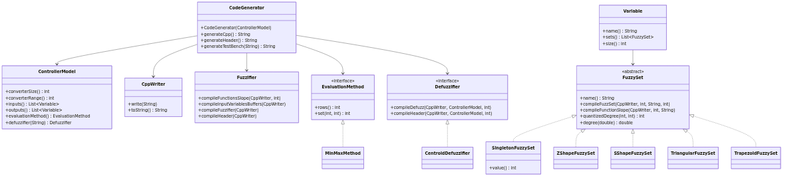

# Generación de código: del modelo del controlador a C++ Vivado HLS

## Propósito

La fase de generación de código recibe el `codegen.ControllerModel` (inmutable, construido por el *lowering*) y emite tres archivos de C++ destinados a Vivado HLS:

* `<base>_out.cpp` — implementación del controlador difuso
* `<base>_out.h` — cabecera con tipos y firmas
* `<base>_outTB.cpp` — banco de pruebas (test bench) que llama al controlador con cada entrada a mitad del rango del conversor

El generador es un **port** del generador de Luca Sarramone (Generador-FLC, commit `c304c1d`), usado con su permiso. El código generado es el mismo; las diferencias son internas: el modelo se pasa explícitamente en vez de vivir en campos estáticos, y el resultado se devuelve como texto en vez de escribirse en archivos.

## Arquitectura del codegen

```
codegen.ControllerModel
        │
        ▼
codegen.CodeGenerator
        ├── generateCpp()    → <base>_out.cpp
        ├── generateHeader() → <base>_out.h
        └── generateTestBench(headerFile) → <base>_outTB.cpp
        │
        ▼
codegen.CppWriter  (sink de texto en memoria, sin estado global ni I/O)
```

## Componentes del codegen

| Clase                                         | Archivo                                                          | Responsabilidad                                                                      |
|-----------------------------------------------|------------------------------------------------------------------|--------------------------------------------------------------------------------------|
| `codegen.CodeGenerator`                       | `src/main/java/codegen/CodeGenerator.java`                       | Orquesta la generación de los tres archivos C++                                      |
| `codegen.ControllerModel`                     | `src/main/java/codegen/ControllerModel.java`                     | Modelo inmutable: bit width N, entradas, salidas, matriz de reglas, defuzzificadores |
| `codegen.CppWriter`                           | `src/main/java/codegen/CppWriter.java`                           | Sink de texto en memoria (reemplaza el `Writer.file` estático del original)          |
| `codegen.Fuzzifier`                           | `src/main/java/codegen/Fuzzifier.java`                           | Emite las funciones de pendiente y la fuzzificación de cada variable                 |
| `codegen.Variable`                            | `src/main/java/codegen/Variable.java`                            | Variable de entrada/salida con sus conjuntos difusos, en orden                       |
| `codegen.fuzzysets.FuzzySet`                  | `src/main/java/codegen/fuzzysets/FuzzySet.java`                  | Conjunto difuso abstracto; emite su código C++ y calcula su grado cuantizado         |
| `codegen.fuzzysets.SingletonFuzzySet`         | `src/main/java/codegen/fuzzysets/SingletonFuzzySet.java`         | Conjunto punto único (salidas)                                                       |
| `codegen.fuzzysets.ZShapeFuzzySet`            | `src/main/java/codegen/fuzzysets/ZShapeFuzzySet.java`            | Rampa decreciente (Z)                                                                |
| `codegen.fuzzysets.SShapeFuzzySet`            | `src/main/java/codegen/fuzzysets/SShapeFuzzySet.java`            | Rampa creciente (S)                                                                  |
| `codegen.fuzzysets.TriangularFuzzySet`        | `src/main/java/codegen/fuzzysets/TriangularFuzzySet.java`        | Triángulo                                                                            |
| `codegen.fuzzysets.TrapezoidFuzzySet`         | `src/main/java/codegen/fuzzysets/TrapezoidFuzzySet.java`         | Trapecio                                                                             |
| `codegen.evaluation.EvaluationMethod`         | `src/main/java/codegen/evaluation/EvaluationMethod.java`         | Interfaz de evaluación de reglas                                                     |
| `codegen.evaluation.MinMaxMethod`             | `src/main/java/codegen/evaluation/MinMaxMethod.java`             | Evaluación AND: MIN, ACCU: MAX                                                       |
| `codegen.defuzzification.Defuzzifier`         | `src/main/java/codegen/defuzzification/Defuzzifier.java`         | Interfaz de defuzzificación                                                          |
| `codegen.defuzzification.CentroidDefuzzifier` | `src/main/java/codegen/defuzzification/CentroidDefuzzifier.java` | Centroide de singletons (CoGS)                                                       |
| `codegen.package-info`                        | `src/main/java/codegen/package-info.java`                        | Documentación del paquete                                                            |

## Tipos generados

Todos los valores del controlador son enteros sin signo de `N` bits (`ap_uint<N>`), donde `N` es el bit width (1..30, del `PRAGMA bit_width` u 8 por defecto):

| Tipo generado        | Significado                                | Ancho                               |
|----------------------|--------------------------------------------|-------------------------------------|
| `fixed_int`          | Valor de entrada / grado de pertenencia    | `ap_uint<N>`                        |
| `fixed_aux_<salida>` | Acumulador del centroide de una salida     | `ap_uint<2N + número de conjuntos>` |
| `fixed_out`          | Resultado empaquetado de todas las salidas | `ap_uint<N × número de salidas>`    |

## Estructura del código generado

### `<base>_out.cpp`

1. Tipos (`typedef ap_uint<N> fixed_int`, `fixed_aux_*`, `fixed_out`)
2. Funciones de pendiente de cada conjunto difuso (`function<var><i>`)
3. Buffers de fuzzificación (`<var>Fuzz`)
4. Función `fuzzifier()`: fuzzifica todas las entradas
5. `rulesEvaluation()`: evalúa la matriz de reglas (AND: MIN, ACCU: MAX)
6. Una función `defuzzifier<salida>()` por salida: centroide de singletons
7. Función `fuzzyController()`: une fuzzificador, reglas y defuzzificadores con `#pragma HLS DATAFLOW`

### `<base>_out.h`

Mismos tipos y funciones de pendiente, más las firmas de `fuzzifier`, `rulesEvaluation`, cada `defuzzifier<salida>` y `fuzzyController`.

### `<base>_outTB.cpp`

Banco de pruebas que incluye la cabecera, declara cada entrada a `converterRange / 2`, llama a `fuzzyController()` e imprime el resultado.

## Matriz de reglas

La matriz tiene una columna por entrada (en orden de declaración) y luego una columna por salida (en orden de empaquetado). Cada celda contiene el índice del término de esa variable para esa regla. La evaluación es:

* Activación de la regla: mínimo de los grados de los términos de entrada (AND: MIN).
* Grado de cada término de salida: máximo sobre las reglas que lo concluyen (ACCU: MAX).

## Port vs. generador original de Luca

| Aspecto             | Generador original (Luca)                                    | Port en este proyecto                                       |
|---------------------|--------------------------------------------------------------|-------------------------------------------------------------|
| Estado              | Campos estáticos (`IOVars`, `Compiler.table`, `Writer.file`) | Modelo pasado explícitamente, `CppWriter` sin estado global |
| Salida              | Escritura directa a archivos                                 | Texto devuelto por métodos (`String`)                       |
| Tipos de test bench | `ap_uint<8>` y `ap_uint<18>` fijos                           | Se mantienen iguales                                        |
| Bugs corregidos     | Triángulo con pendientes cruzadas; trapecio con meseta `= 1` | Pendientes corregidas, meseta `= 2^N - 1`                   |

## Bugs del generador original corregidos en el port

1. **Triángulo** (`TriangularFuzzySet`): las pendientes de subida y bajada estaban intercambiadas. En el ejemplo del péndulo invertido, `nm = TRIANGULAR(0, 99, 113)` daba 242 en `x = 0` y 226 en `x = 113`, donde corresponde 0.
2. **Trapecio** (`TrapezoidFuzzySet`: condición externa invertida y meseta `= 1` en vez de `2^N - 1`.

Las referencias de salida están en `src/test/resources/golden/luca/<ejemplo>/` con las carpetas `original/` (salida de Luca sin tocar) y `expected/` (con los triángulos corregidos por reemplazo mecánico).

## Diagrama de clases del codegen

