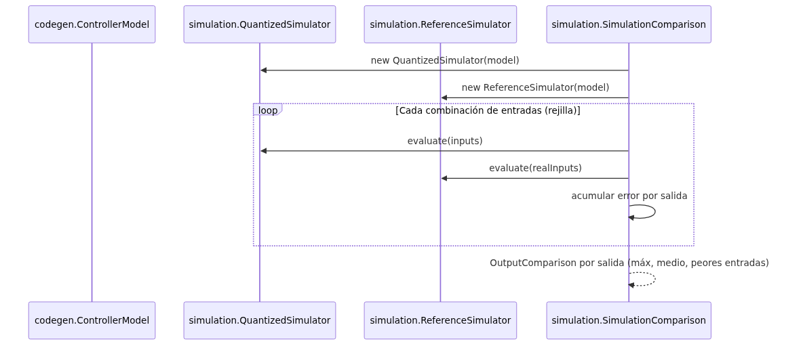

# Simulación: validación del controlador generado sin Vivado

## Propósito

La fase de simulación permite validar el controlador difuso generado sin necesidad de Vivado HLS ni de hardware PLC. Se comparan dos evaluaciones del mismo `ControllerModel`:

* **`ReferenceSimulator`** — semántica ideal de IEC 61131-7, en números reales (grados de 0 a 1, AND: MIN, ACCU: MAX, centroide de singelos sin redondeo).
* **`QuantizedSimulator`** — lo que realmente calcula el código C++ generado, con aritmética `ap_uint<N>` (pendientes enteras, truncado a `N` bits, división entera en el centroide).

Una tercera clase, `SimulationComparison`, recorre una rejilla exhaustiva de combinaciones de entradas y reporta, por salida: valor máximo de error, error medio, entradas peores y casos donde el hardware o el ideal no definen resultado (división por cero cuando ninguna regla dispara).

## Arquitectura de simulación

```
codegen.ControllerModel
        ├── ReferenceSimulator ──► evaluación ideal (reales 0..1)
        └── QuantizedSimulator ──► evaluación cuantizada (ap_uint<N>)
                │
                ▼
        SimulationComparison ─────► OutputComparison por salida
                                    (máx error, error medio, peores entradas)
```

## Claves de las clases

| Clase                             | Archivo                                              | Responsabilidad                                                                       |
|-----------------------------------|------------------------------------------------------|---------------------------------------------------------------------------------------|
| `simulation.ReferenceSimulator`   | `src/main/java/simulation/ReferenceSimulator.java`   | Semántica ideal del estándar: grados lineales entre puntos, centroide sin redondeo    |
| `simulation.QuantizedSimulator`   | `src/main/java/simulation/QuantizedSimulator.java`   | Aritmética del C++ generado: pendientes enteras, truncado a `N` bits, división entera |
| `simulation.SimulationComparison` | `src/main/java/simulation/SimulationComparison.java` | Compara ambos simuladores sobre rejilla de entradas (`step = 1` = exhaustivo)         |
| `simulation.OutputComparison`     | `src/main/java/simulation/OutputComparison.java`     | Resultado por salida: máx error, error medio, peores entradas, indefinidos            |
| `simulation.MinMaxEvaluation`     | `src/main/java/simulation/MinMaxEvaluation.java`     | Evaluación de reglas compartida (AND: MIN, ACCU: MAX) por ambos simuladores           |
| `simulation.package-info`         | `src/main/java/simulation/package-info.java`         | Documentación del paquete                                                             |

## Diferencias entre los simuladores

| Aspecto                 | ReferenceSimulator (ideal)                    | QuantizedSimulator (hardware)                                    |
|-------------------------|-----------------------------------------------|------------------------------------------------------------------|
| Dominio                 | Números reales, grados 0..1                   | Enteros `0 .. 2^N - 1`                                           |
| Grado de pertenencia    | Lineal entre puntos, constante fuera          | Pendiente entera `converterRange / ancho`, truncado a `N` bits   |
| Activación de regla     | `MIN` de grados de entrada                    | Igual, en enteros                                                |
| Acumulación             | `MAX` por término de salida                   | Igual, en enteros                                                |
| Centroide               | `sum(grado × valor) / sum(grado)` en `double` | `sum(grado × valor) / sum(grado)` en `long`, truncado a `N` bits |
| Sin reglas que disparen | `NaN` para esa salida                         | `OptionalInt.empty()` (división por cero del C++)                |
| Métodos soportados      | MIN-MAX + CoGS solamente                      | Igual                                                            |

## Flujo de validación



## Resultados de validación (ejemplos de Luca)

Estos valores se obtuvieron comparando el C++ generado (traducido a Python) contra el controlador ideal, sobre todas las entradas del rango `0..255` (8 bits), escala de salida 0..255:

| Controlador                              | Error máximo | Error medio | Con triángulo original de Luca |
|------------------------------------------|--------------|-------------|--------------------------------|
| Péndulo invertido                        | 4,66         | 0,84        | 52,4                           |
| Estacionamiento del camión               | 4,39         | 0,23        | 71,6                           |
| Autoenfoque (3 salidas, 16,7 M entradas) | ≤ 4,46       | ≤ 0,37      | —                              |

El error restante proviene de las pendientes enteras (`255 / (b - a)`: el pico no siempre llega a 255).

## Hallazgo importante: DEFAULT y división por cero

En el ejemplo del estacionamiento del camión hay 512 combinaciones de entrada (`ánguloCamión = 0` o `255`) donde **ninguna regla dispara**. El centroide divide por cero:

* En el C++ generado: comportamiento indefinido (división por entero entre cero).
* En `QuantizedSimulator`: devuelve `OptionalInt.empty()` para esa salida.
* En `ReferenceSimulator`: devuelve `Double.NaN`.

El estándar FCL prevé un valor `DEFAULT` para este caso, pero el generador lo ignora con un `GeneratorWarning`. Esto se documenta como trabajo futuro (Capítulo 11).

## Simulabilidad

Ambos simuladores solo soportan el subconjunto que el generador produce: evaluación MIN-MAX y defuzzificación por centroide de singeltons (CoGS). Cualquier otro método lanza `IllegalArgumentException` (`MinMaxEvaluation.requireSimulable`).
