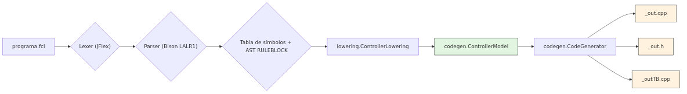

# Pipeline del compilador: de FCL a C++ Vivado HLS

## Propósito

El compilador es un pipeline de punta a punta que recibe un programa FCL (IEC 61131-7) y produce tres archivos de C++ para Vivado HLS: `<base>_out.cpp`, `<base>_out.h` y `<base>_outTB.cpp`. La orquestación la hace `compiler.FlcCompiler`; la entrada por línea de comandos la maneja `compiler.CommandLine` (y `Main.java` como punto de entrada del JAR).

## Fases del pipeline

```
programa.fcl
    │
    ▼
┌─────────────────┐
│ Lexer + Parser  │  JFlex + Bison LALR(1)
│                 │  → tabla de símbolos + AST de RULEBLOCK
└────────┬────────┘
         │
         ▼
┌─────────────────┐
│ lowering        │  ControllerLowering
│                 │  → codegen.ControllerModel (o vacío si hay errores)
└────────┬────────┘
         │
         ▼
┌─────────────────┐
│ codegen         │  CodeGenerator
│                 │  → <base>_out.cpp, <base>_out.h, <base>_outTB.cpp
└─────────────────┘
```

`FlcCompiler.compile(Reader, String)` devuelve una lista de `GeneratedFile` en memoria (nombre + contenido). Si el programa tiene errores léxicos, sintácticos o del lowering, devuelve una lista vacía y los diagnósticos quedan en el `DiagnosticsHandler`.

## Claves de las clases

| Clase                    | Archivo                                     | Responsabilidad                                                                   |
|--------------------------|---------------------------------------------|-----------------------------------------------------------------------------------|
| `compiler.FlcCompiler`   | `src/main/java/compiler/FlcCompiler.java`   | Orquesta lexer → parser → lowering → codegen; devuelve `List<GeneratedFile>`      |
| `compiler.CommandLine`   | `src/main/java/compiler/CommandLine.java`   | CLI: `java -jar … programa.fcl [directorio de salida]`; códigos de salida 0/1/2/3 |
| `compiler.GeneratedFile` | `src/main/java/compiler/GeneratedFile.java` | Par nombre/contenido de un archivo generado (en memoria)                          |
| `compiler.Main`          | `src/main/java/Main.java`                   | Punto de entrada del JAR; invoca `CommandLine.run`                                |
| `compiler.package-info`  | `src/main/java/compiler/package-info.java`  | Documentación del paquete                                                         |

## Códigos de salida (`CommandLine`)

| Código | Constante            | Significado                                                     |
|--------|----------------------|-----------------------------------------------------------------|
| 0      | `OK`                 | Código generado (puede haber warnings)                          |
| 1      | `COMPILATION_ERRORS` | El programa tiene errores o usa algo no soportado; nada escrito |
| 2      | `USAGE_ERROR`        | Argumentos incorrectos, o archivo no legible/escribible         |
| 3      | `INTERNAL_ERROR`     | Fallo inesperado del compilador                                 |

## Uso por línea de comandos

```bash
# Compila programa.fcl y escribe los tres archivos junto al programa
java -jar flc-iec61131-7-compiler.jar programa.fcl

# Escribe en otro directorio
java -jar flc-iec61131-7-compiler.jar programa.fcl /ruta/salida

# El nombre base se deriva del archivo (espacios → _):
# "pendulo invertido.fcl" → pendulo_invertido_out.cpp / .h / _outTB.cpp
```

## Diagrama de fases

