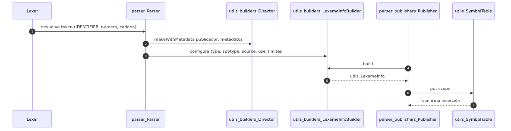
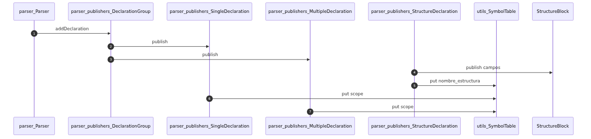

# Análisis sintáctico y resolución semántica

## Gramática

### Generador y punto de entrada

El analizador sintáctico se genera a partir de `src/main/java/parser/Parser.y` con GNU Bison 3.8.2. La clase generada es `parser.Parser`, pública y final, y su constructor recibe el analizador léxico y la tabla de símbolos compartida: `Parser(Lexer, SymbolTable)`. La clase expone la constante `public static final String bisonVersion = "3.8.2"`.

La regla inicial es `program`, que admite una sección opcional de declaraciones de tipos seguida de la declaración del bloque de función:

```
program:
    opt_data_type_declaration
    function_block_declaration
;
```

El cuerpo de `function_block_declaration` agrupa declaraciones de variables (`VAR_INPUT`, `VAR_OUTPUT`, `VAR`), el bloque de funciones difusas (`FUZZIFY`, `DEFUZZIFY`, `RULEBLOCK`, `OPTION`) y termina con `END_FUNCTION_BLOCK`.

### Métricas de la gramática

La tabla siguiente resume las métricas extraídas del archivo `Parser.y` (fuente de verdad: `doc/stats.json`, clave `grammar_stats`).

| Métrica                 | Valor                        |
|-------------------------|------------------------------|
| Tokens                  | 82                           |
| No terminales           | 141                          |
| Tipos de inicialización | 7                            |
| Generador               | GNU Bison 3.8.2              |
| Clase generada          | `parser.Parser`              |
| Constructor             | `Parser(Lexer, SymbolTable)` |

Los 7 tipos de inicialización corresponden a las implementaciones concretas de la interfaz `parser.initializations.Initialization` descritas más adelante.

### Bloques del programa IEC 61131-7

El parser reconoce los bloques propios de IEC 61131-7 (lógica difusa) sobre la base de IEC 61131-3:

* `program`: punto de entrada, envuelve los tipos definidos por el usuario y el bloque de función.
* `function_block_declaration`: contenedor principal con nombre (p. ej. `MAIN`), variables y bloques difusos.
* `fuzzify_block`: define variables de entrada y sus términos lingüísticos, entre `FUZZIFY` y `END_FUZZIFY`.
* `defuzzify_block`: define variables de salida, rango, método de desdifusión y valor por defecto, entre `DEFUZZIFY` y `END_DEFUZZIFY`.
* `rule_block`: base de reglas difusas con operadores OR/AND, entre `RULEBLOCK` y `END_RULEBLOCK`.
* `option_block`: bloque de pragmas específico del fabricante, entre `OPTION` y `END_OPTION`.

### Declaraciones de variables

Las declaraciones de variables siguen el anexo B de IEC 61131-3 y usan las palabras `VAR`, `VAR_INPUT` y `VAR_OUTPUT`, cerradas con `END_VAR`. El parser soporta:

* `VAR ... END_VAR`: variables internas y constantes.
* `VAR_INPUT ... END_VAR`: entradas del bloque, publicadas con `Source.IN`.
* `VAR_OUTPUT ... END_VAR`: salidas del bloque, publicadas con `Source.OUT`.
* `CONSTANT`: opcional dentro de un bloque `VAR`, marca la variable como constante mediante `Use.CONSTANT`.

Cada bloque declara una lista de identificadores que comparten tipo y, opcionalmente, un valor de inicialización:

```
<identificador_lista> : <tipo_especificacion> [:= <valor_inicial>] ;
```

### Tipos de datos

El parser soporta tipos elementales y derivados:

* Elementales: enteros con signo (`SINT`, `INT`, `DINT`, `LINT`), enteros sin signo (`USINT`, `UINT`, `UDINT`, `ULINT`), reales (`REAL`, `LREAL`), fecha/hora (`TIME`, `DATE`, `TIME_OF_DAY`, `DATE_AND_TIME`), cadenas de bits (`BYTE`, `WORD`, `DWORD`, `LWORD`) y booleano (`BOOL`).
* Derivados: enumerados, subrangos, arrays, estructuras y cadenas con longitud (`STRING`, `WSTRING`).

Cada tipo elemental produce un `LexemeInfoBuilder` configurado con `Director.makeWithMetadata` y una instancia de `parser.metadata.PrimitiveMetadata`, que fija `type = SIMPLE` y el `Subtype` correspondiente.

### Inicializaciones en la gramática

La gramática define inicializaciones para variables simples, arrays, estructuras y tipos enumerados. Las inicializaciones se modelan como un árbol polimórfico bajo la interfaz `parser.initializations.Initialization`:

* Hojas: `DefaultInitialization`, `VariableInitialization`, `EnumeratedInitialization`, `SubrangeInitialization`, `MacroInitialization`.
* Nodos: `StructInitialization`, `RepeatedInitialization`.

Los arrays se inicializan con `[ valor, valor, ... ]` y admiten repeticiones `n(valor)`; las estructuras usan `{ campo = valor, ... }`. Cada inicialización es inmutable salvo los nodos, que admiten inserción y búsqueda por ruta con el separador `#` (p. ej. `RGB#R` o `2#X`).

### Declaraciones de tipos de datos

La sección `TYPE ... END_TYPE` permite definir tipos definidos por el usuario reutilizables en declaraciones de variables. Cada `type_declaration` tiene la forma:

```
<nombre_tipo> : <especificacion_tipo> ;
```

Las especificaciones soportadas son: referencia a tipo definido, tipo elemental, enumerado `( valor1, valor2, ... )`, subrango `tipo( inferior .. superior )`, array `ARRAY [ ... ] OF tipo` y estructura `STRUCT ... END_STRUCT`. Todas se publican con `Use.TYPE` y `Source.NONE` bajo la clave `TypeName` en la tabla de símbolos.

## El patrón Publisher Director Builder

### Interfaz Publisher

`parser.publishers.Publisher` es la interfaz que abstrae la publicación de símbolos en la tabla. Extiende `utils.builders.LexemeInfoMutator` y declara tres operaciones:

* `setDeclarationScope(String)`: fija el ámbito bajo el cual se publican los símbolos.
* `publish()`: escribe el símbolo o los símbolos en `utils.SymbolTable`.
* `List<String> keys()`: devuelve las claves que se escribirán al llamar `publish()`, en orden de declaración y con el ámbito aplicado (p. ej. `[MAIN#X, MAIN#Y]`).

### Jerarquía de declaraciones

El parser modela cada construcción declarativa como un publicador concreto:

* `Declaration`: clase abstracta base. Contiene el `LexemeInfoBuilder` y expone el API fluido de `LexemeInfoMutator` delegado en el builder.
* `SingleDeclaration`: publica un único identificador bajo `scope#identificador`. Usada para variables simples, componentes y tipos.
* `MultipleDeclaration`: publica una lista de identificadores que comparten tipo y atributos, bajo el mismo ámbito.
* `DeclarationBlock`: agrupa varias declaraciones (`DeclarationGroup`) y las publica en lote.
* `StructureDeclaration`: extiende `SingleDeclaration`; publica primero los campos de su `StructureBlock` y luego el tipo estructurado.
* `EnumeratedTypeDeclaration`: extiende `SingleDeclaration`; publica los literales como macros con prefijo `enum#` y luego el tipo enumerado.
* `ComponentDeclaration`: extiende `SingleDeclaration`; usada por bloques `FUZZIFY` y `DEFUZZIFY`. Añade el sufijo `@fuzzifier` o `@defuzzifier` a la clave del componente y publica sus términos bajo el ámbito del componente.
* `TermBlock`: `DeclarationGroup` que acumula los términos lingüísticos de un componente.
* `AnnonymousEnumeratedVariable` y `AnnonymousEnumeratedField`: variantes para enumerados anónimos que publican sus macros mediante `parser.facades.MacrosPublisher`.

### Director y recetas predefinidas

`utils.builders.Director` es una clase de utilidad con métodos estáticos que configuran un `LexemeInfoMutator` según recetas frecuentes:

* `makeWithMetadata(LexemeInfoMutator, LexemeInfoView)`: copia todos los atributos de un objeto de vista (`LexemeInfoView`) al builder. Es la receta principal usada en las acciones semánticas de `Parser.y`.
* `makeLiteral(LexemeInfoMutator)`: fija `type = SIMPLE`, `use = LITERAL`, `source = NONE`.
* `makeDefaultInteger` / `makeDefaultReal` / `makeDefaultBoolean` / `makeDefaultString` / `makeDefaultWString`: configuran el valor por defecto de cada tipo primitivo y devuelven la representación literal (`0`, `0.0`, `FALSE`, `''`, `""`).
* `makeTrueBoolean`: configura el literal booleano `TRUE`.

### Fluente API de LexemeInfoBuilder

`utils.builders.LexemeInfoBuilder` implementa `LexemeInfoMutator` y `LexemeInfoView`. Permite encadenar llamadas para configurar `type`, `subtype`, `customType`, `source`, `use`, `inferiorLimits`, `superiorLimits`, `parameters` e `initialValue`, y termina con `build()`, que devuelve una instancia inmutable de `utils.LexemeInfo`.

### Resolución de identificadores

El mangado de identificadores es inline y no depende de una clase separada. El identificador completo se forma como `scope#identificador` (p. ej. `MAIN#X`). La utilidad `parser.facades.IdentifierParser.parse(String, String)` devuelve un `parser.utils.ParsedIdentifier` que separa el ámbito y el nombre simple dividiendo sobre `#`. Cuando el identificador ya contiene `#`, se extraen directamente ámbito y nombre; cuando no, se antepone el ámbito recibido como segundo parámetro.

### Clases eliminadas de la arquitectura

Las clases `ContextHandler`, `ParsingContext`, `NameMangler` y `UnderlyingScopeSearcher` no existen en el código actual y no deben referenciarse como parte de la arquitectura vigente. La resolución de ámbito y el mangado se resuelven con `declarationScope` en los publicadores, `IdentifierParser` y la convención `scope#identificador`. El DTO de símbolos actual es `utils.LexemeInfo`; cualquier DTO de símbolos anterior ha quedado obsoleto y excluido.

## Tipos derivados y LexemeInfo

Cada construcción FCL de tipo derivado mapea a un no terminal principal y a una entrada de `utils.LexemeInfo` con atributos específicos.

| Construcción FCL | No terminal principal     | Resultado en LexemeInfo                                                                                         |
|------------------|---------------------------|-----------------------------------------------------------------------------------------------------------------|
| ENUMERATE        | `enumerated_spec_init`    | `type = ENUMERATE`, `subtype = INT`, `parameters` = lista de valores, `initialValue = EnumeratedInitialization` |
| SUBRANGE         | `subrange_spec_init`      | `type = SUBRANGE`, `inferiorLimits` y `superiorLimits`, `initialValue = SubrangeInitialization`                 |
| STRUCT           | `structure_specification` | `type = STRUCT`, `parameters` = nombres de campos, `initialValue = StructInitialization`                        |
| ARRAY            | `array_spec_init`         | `type = ARRAY`, `inferiorLimits` y `superiorLimits`, `initialValue = RepeatedInitialization`                    |
| SIMPLE elemental | `simple_spec_init`        | `type = SIMPLE`, `subtype` según el tipo elemental, `initialValue = DefaultInitialization`                      |
| STRING / WSTRING | `string_spec_init`        | `type = SIMPLE`, `subtype = STRING` o `WSTRING`, límites de longitud, `initialValue = DefaultInitialization`    |

## Jerarquía de inicializaciones polimórfica

### Interfaz e implementaciones

`parser.initializations.Initialization` define el contrato `find(String)`, `variableValue()` y `copy()`. Se divide en hojas y nodos.

`parser.initializations.leafs.LeafInitialization` es la clase abstracta para valores atómicos. Sus hojas son:

* `DefaultInitialization`: valor por defecto de un tipo primitivo.
* `VariableInitialization`: referencia a otra variable.
* `EnumeratedInitialization`: valor de un tipo enumerado.
* `SubrangeInitialization`: límite inferior de un subrango.
* `MacroInitialization`: literal ordinal de un enumerado, registrado como `INT` en la tabla de símbolos.

`parser.initializations.nodes.NodeInitialization` es la clase abstracta para valores compuestos con búsqueda por ruta. Sus nodos son:

* `StructInitialization`: mapa de campos con nombre, representación `{campo=valor, ...}`.
* `RepeatedInitialization`: dimensión de array particionada en intervalos disjuntos, representación `[valor, n(valor), ...]`.

### Valores por defecto

`parser.initializations.Factory.createPrimitiveInitialization(SymbolTable, Subtype)` devuelve un `DefaultInitialization` para `BOOL`, `REAL`/`LREAL`, `STRING`, `WSTRING` y los enteros `SINT`..`ULINT`; lanza `IllegalArgumentException` para cualquier otro subtipo. Cada default se registra en la tabla de símbolos a través de `Director`.

| Subtype       | Valor por defecto | Receta de Director |
|---------------|-------------------|--------------------|
| BOOL          | FALSE             | makeDefaultBoolean |
| SINT .. ULINT | 0                 | makeDefaultInteger |
| REAL / LREAL  | 0.0               | makeDefaultReal    |
| STRING        | ''                | makeDefaultString  |
| WSTRING       | ""                | makeDefaultWString |

## Flujo Léxico Parser Tabla de Símbolos

El flujo de un símbolo desde el analizador léxico hasta la tabla de símbolos se resume en el diagrama siguiente.



Figura 6.1 — Flujo desde el analizador léxico hasta la tabla de símbolos.

## Publicación en la tabla de símbolos

La publicación es responsabilidad de los publicadores, no del parser directamente. El parser construye el publicador adecuado, configura su builder mediante `Director` e invoca `publish()`.



Figura 6.2 — Publicación de símbolos a través de la jerarquía Publisher.

La tabla siguiente resume las formas de clave y las clases de metadatos implicadas.

| Clave de símbolo            | Forma de clave           | Clase de metadatos                                   | Ejemplo de clave      |
|-----------------------------|--------------------------|------------------------------------------------------|-----------------------|
| Función bloque              | nombre                   | `parser.metadata.FunctionBlockMetadata`              | MAIN                  |
| Variable de entrada/salida  | scope#identificador      | `utils.LexemeInfo` (Director)                        | MAIN#ANGLE            |
| Variable interna            | scope#identificador      | `utils.LexemeInfo` (Director)                        | MAIN#X                |
| Componente fuzzificador     | scope#nombre             | `parser.metadata.FuzzifierMetadata`                  | MAIN#ENTRADA          |
| Componente desdifusificador | scope#nombre             | `parser.metadata.DefuzzifierMetadata`                | MAIN#SALIDA           |
| Término lingüístico         | scope#componente#término | `parser.metadata.TermMetadata`                       | MAIN#ENTRADA#POSITIVO |
| Tipo enumerado              | TypeName                 | `parser.metadata.EnumeratedMetadata`                 | COLOR                 |
| Literal enumerado (macro)   | enum#valor               | `parser.metadata.MacroMetadata`                      | COLOR#ROJO            |
| Tipo estructurado           | TypeName                 | `parser.metadata.StructureMetadata`                  | RGB                   |
| Campo de estructura         | estructura#campo         | `utils.LexemeInfo`                                   | RGB#R                 |
| Tipo subrango               | TypeName                 | `parser.metadata.SubrangeMetadata`                   | TEMPERATURA           |
| Tipo array                  | TypeName                 | `parser.metadata.ArrayMetadata`                      | TABLA                 |
| Tipo cadena                 | TypeName                 | `parser.metadata.StringMetadata`                     | MENSAJE               |
| Literal por defecto         | valor literal            | `parser.initializations.leafs.DefaultInitialization` | 0, 0.0, FALSE         |

## Acciones semánticas clave

Las acciones semánticas son bloques Java embebidos en `Parser.y`. Construyen `LexemeInfoBuilder` mediante `Director`, los envuelven en publicadores y los publican en `utils.SymbolTable`.

| Regla                        | Acción semántica                                                                                                                                      | Efecto                                                                              |
|------------------------------|-------------------------------------------------------------------------------------------------------------------------------------------------------|-------------------------------------------------------------------------------------|
| `function_block_declaration` | `SingleDeclaration` + `Director.makeWithMetadata(functionBlock, new FunctionBlockMetadata($3))`; `functionBlock.identifier(programName).publish()`    | Publica el bloque bajo su nombre con la interfaz de entrada/salida en parámetros    |
| `fuzzify_block`              | `ComponentDeclaration` + `Director.makeWithMetadata(..., new FuzzifierMetadata($3))`; `fuzzifierDeclaration.identifier($2).publish()`                 | Publica componente fuzzificador con sus términos                                    |
| `defuzzify_block`            | `ComponentDeclaration` + `Director.makeWithMetadata(..., new DefuzzifierMetadata($3, $4, $5, $6))`; `defuzzifierDeclaration.identifier($2).publish()` | Publica componente desdifusificador con rango, términos, método y valor por defecto |
| `linguistic_term`            | `new SingleDeclaration(this.symbolTable, $4).identifier($2)`                                                                                          | Registra el término en el bloque de términos del componente                         |
| declaraciones `VAR`          | `$3.source(Source.INTERNAL).use($2).setDeclarationScope(programName); $3.publish()`                                                                   | Publica variables internas con ámbito del bloque de función                         |
| `fb_io_var_declarations`     | `$3.source($1).use(Use.VARIABLE).setDeclarationScope(programName); $3.publish()`                                                                      | Publica entradas y salidas con `Source.IN` / `Source.OUT`                           |
| `type_declaration`           | `$3.identifier($1).use(Use.TYPE).source(Source.NONE); $3.publish()`                                                                                   | Publica tipo definido por el usuario bajo `TypeName`                                |

## Cobertura de la gramática IEC 61131-7

| Sección                    | Reglas clave                                                                                      | Estado         |
|----------------------------|---------------------------------------------------------------------------------------------------|----------------|
| Programa y función bloque  | `program`, `function_block_declaration`, `function_block_name`                                    | ✅ Implementado |
| Bloque FUZZIFY             | `fuzzify_block`, `fuzzify_block_name`, `linguistic_term`, `linguistic_term_list`                  | ✅ Implementado |
| Bloque DEFUZZIFY           | `defuzzify_block`, `defuzzify_block_name`, `defuzzification_method`, `default_value`, `opt_range` | ✅ Implementado |
| Bloque RULEBLOCK           | `rule_block`, `rule_block_name`, `rules_decl`, `operator_definition`                              | ✅ Implementado |
| Bloque OPTION / PRAGMA     | `option_block`, `pragma`, `pragma_list`                                                           | ✅ Implementado |
| Declaraciones de variables | `var_declarations`, `fb_io_var_declarations`, `VAR`, `VAR_INPUT`, `VAR_OUTPUT`                    | ✅ Implementado |
| Tipos elementales          | `elementary_type`, `numeric_type`, `real_type`, `bit_string_type`                                 | ✅ Implementado |
| Tipos derivados            | `subrange_spec_init`, `enumerated_spec_init`, `array_spec_init`, `string_spec_init`               | ✅ Implementado |
| Estructuras                | `structure_specification`, `STRUCT`, `END_STRUCT`                                                 | ✅ Implementado |
| Declaraciones de tipos     | `TYPE`, `END_TYPE`, `data_type_declaration`, `type_declaration`                                   | ✅ Implementado |

## Cómo probarlo

El proyecto se compila y prueba con Maven (`pom.xml`). Los comandos siguientes ejecutan los conjuntos de prueba más relevantes para el analizador sintáctico:

```bash
# Prueba unitaria del parser y de inicializaciones repetidas
mvn test -Dtest=unit.parser.ParserTest,unit.parser.initializations.RepeatedInitializationTest

# Pruebas de integración sobre la tabla de símbolos por tipo de dato
mvn test -Dtest=integration.lexer.parser.symboltable.PrimitiveIT,integration.lexer.parser.symboltable.ArrayIT,integration.lexer.parser.symboltable.StructIT,integration.lexer.parser.symboltable.EnumerateIT

# Pruebas de integración sobre bloques difusos e interfaz de función bloque
mvn test -Dtest=integration.lexer.parser.ast.RuleBlockIT,integration.lexer.parser.symboltable.FunctionBlockInterfaceIT
```

Cada archivo de prueba verifica un aspecto concreto:

* `unit.parser.ParserTest`: valida el parsing de programas completos, bloques difusos y la población de la tabla de símbolos a partir de archivos FCL de entrada.
* `unit.parser.initializations.RepeatedInitializationTest`: cubre la inserción, búsqueda y copia de inicializaciones de array por intervalos y rutas anidadas.
* `integration.lexer.parser.symboltable.PrimitiveIT`: comprueba que los tipos elementales se publican con el subtipo y el valor por defecto correctos.
* `integration.lexer.parser.symboltable.ArrayIT`: valida límites de arrays, inicializaciones repetidas y acceso por índice.
* `integration.lexer.parser.symboltable.StructIT`: valida estructuras, campos anidados y acceso por ruta con `#`.
* `integration.lexer.parser.symboltable.EnumerateIT`: valida tipos enumerados, literales macros y sus claves en la tabla de símbolos.
* `integration.lexer.parser.ast.RuleBlockIT`: cubre reglas difusas, operadores y acumulación.
* `integration.lexer.parser.symboltable.FunctionBlockInterfaceIT`: valida la interfaz de la función bloque (entradas y salidas en orden de declaración).

Estas pruebas garantizan que los cambios en la gramática, los publicadores o las inicializaciones no rompan el contrato de la tabla de símbolos y que el parser se mantenga mantenible a medida que crece.
